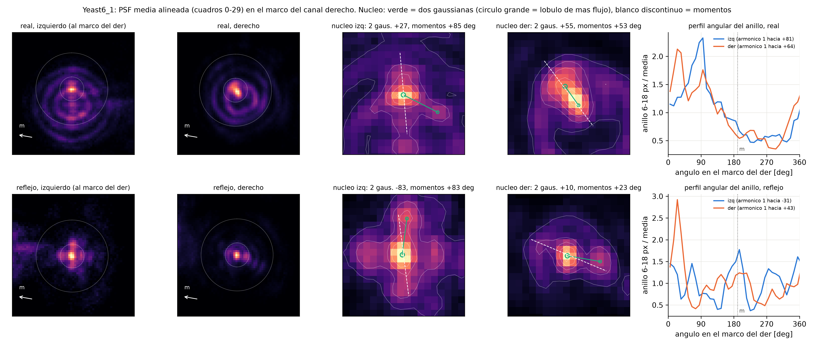
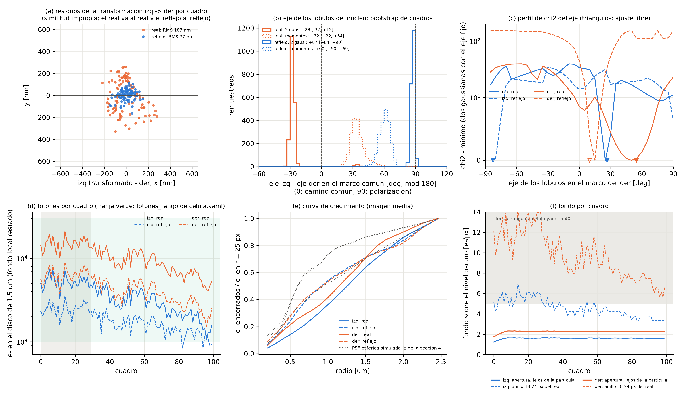

# PSF real de Yeast6_1 en los dos canales de polarización (sin la red)

Mismos datos que `resultados_datos_reales.md` (Yeast6_1, 100 cuadros, 1696 × 900 px, corte en x = 840, 98.48 nm/px) y continuación de `resultados_celula.md` (sección 4), que encontró un núcleo de dos lóbulos en el real del canal derecho. Aquí se miden la forma de la PSF del real y del reflejo en **los dos** canales, en un marco común, y los fotones y el fondo en e⁻. No interviene la red. Todas las cifras salen de

```bash
$PY figuras/psf_real.py [--tif RUTA] [--cuadros 30] [--r-nucleo 4] [--n-boot 2000] [--salida figuras/psf_real]   # ~15 min (14 de bootstrap)
```

que importa la detección de `figuras/analisis_datos_reales.py` y, solo para la energía encerrada, `simulador_nuevo/simulador.py`, y escribe `figuras/psf_real/fig_psf_real_imagenes.png` y `figuras/psf_real/fig_psf_real_medidas.png` (300 dpi). Ángulos en el **marco del canal derecho** (x = columna − 840, y = fila), de +x hacia +y, ejes módulo 180°. En ese marco m (reflejo → real) = −169.9° y t = −79.9°, y los ejes de la cámara del canal izquierdo caen a −85.2° y +4.8°. Los IC son al 95 %, por bootstrap de los cuadros 0–29 (2000 remuestreos, los mismos índices en los dos canales porque los cuadros son simultáneos).

## Resumen

| | resultado |
|---|---|
| transformación izq → der | La similitud impropia lleva el real al real (171 nm, mediana) y el reflejo al reflejo (62 nm). El cruce real → reflejo queda a 4.6 µm. La dirección reflejo → real transformada coincide con la del derecho con −0.1° de diferencia, y los pasos cuadro a cuadro del real se correlacionan +0.68 a lo largo de m y +0.44 a lo largo de t |
| **reflejo: eje de los lóbulos** | **Rotado ~90° entre canales: +87.5° [+84.2, +90.1]** (dos gaussianas; 100 % de los remuestreos con \|dif\| > 45°). En el derecho el eje va a lo largo de m (+9.8°, a −0.2° de m); en el izquierdo, a lo largo de t (−82.7°, a 2.7° de t). Los momentos dan +60° [+50, +69], arrastrados por la cruz del canal izquierdo. Según el registro elegido, la diferencia va de +81° a +88° |
| **real: eje de los lóbulos** | **No hay rotación de 90°**, pero tampoco el mismo eje: −28° [−32, +12] (dos gaussianas) y +32° [+22, +54] (momentos). Ningún remuestreo de dos gaussianas, y solo el 9.5 % de los de momentos, pasa de \|dif\| > 45°. El derecho tiene dos lóbulos claros (+54.7° [+52.4, +57.1], a 45° de m; separación 336 nm; flujo 2/1 0.38). **El izquierdo no tiene un segundo lóbulo medible** (flujo 2/1 0.12, cociente de ejes 1.13 frente a 1.41), así que su eje depende del estimador |
| respuesta a la pregunta | **El núcleo de dos lóbulos no es una aberración del camino común: depende de la polarización.** En el reflejo los lóbulos rotan ~90° entre canales y siguen a m y a t. En el real, los lóbulos del derecho no aparecen en el izquierdo. Lo que sí es común a los dos canales es la estructura a escala del anillo: el lado brillante del anillo del real (armónico 1 a +81° y +64°) y la elongación del anillo del reflejo a lo largo de m (armónico 2 a +3° y +11°) |
| cruz del canal izquierdo | El núcleo del reflejo izquierdo es una cruz "+" (armónico 4 = 0.30 frente a 0.16 en el derecho). Sus brazos van a +2.6° [+1.6, +3.8] de los ejes de la cámara izquierda, no a m/t (−5.1° en ese marco). En el real izquierdo es débil (0.06) |
| fotones del real (cuadros 0–29) | Disco de 2.5 µm: **izq 9 800 e⁻, der 23 900 e⁻**. Corrigiendo con la energía encerrada simulada a 2.5 µm (0.68 en las z de cerca, 0.35 en las de lejos), el total es izq 14 000–28 000 y der 35 000–68 000. El canal derecho queda en el borde superior de `fotones_rango` [1000, 30000] o por encima, y la suma de canales por encima. El fotoblanqueo los divide por ~3 en 100 cuadros |
| fotones del reflejo | Disco de 2.5 µm: izq 4 200, der 11 100 e⁻. El cociente reflejo/real en ese disco es 0.42 (izq) y 0.47 (der); en fotones totales sería 0.82 / 0.91 con las z de cerca y 0.22 / 0.24 con las de lejos. Cerca cae dentro de `ratio_reflejo_rango` [0.45, 1.0]; lejos, por debajo |
| fondo | Lejos de la partícula, dentro de la apertura: **izq 1.6, der 2.3 e⁻/px**, por debajo del mínimo de `fondo_rango` [5, 40]. Junto a la partícula (anillo de 22–29 px de la imagen media, que incluye la autofluorescencia de la célula y el halo del otro punto): izq 3.5–4.3, der 7.1–8.6 e⁻/px |
| cámara | Nivel oscuro (fuera de las aperturas) 97.7–97.8 ADU, frente al offset de 99 ADU del simulador. Ruido de lectura con mediana 2.18 ADU (1.00 e⁻) y rms 2.9 ADU (1.34 e⁻), frente a 3.26 ADU (1.50 e⁻). La ganancia por transferencia de fotones da 0.45 e⁻/ADU, lo que confirma los 0.46 supuestos |

## 1. La misma partícula en los dos canales

La detección, las pistas y los pares son los de `analisis_datos_reales.py`, con un par real/reflejo por canal presente en los 100 cuadros. En coordenadas locales:
- izquierdo: real (435.9, 524.6), reflejo (431.9, 480.0) px;
- derecho: real (327.4, 442.6), reflejo (373.7, 450.8) px.

La transformación izq → der deshace el giro de ~90° y el espejado. Se ajusta como similitud impropia por mínimos cuadrados con los 100 cuadros × 2 puntos: s = 1.049, Q = Rot(−85.2°)·diag(1, −1), un espejado respecto de la recta a −42.6° (la antidiagonal exacta está a −45°).

| registro | RMS real | RMS reflejo | ángulo de Q | s |
|---|---|---|---|---|
| similitud impropia (todos los puntos) | 187 nm | 77 nm | −85.2° | 1.049 |
| ídem, solo con el real | 181 nm | 554 nm | −91.5° | 1.002 |
| ídem, solo con el reflejo | 228 nm | 76 nm | −86.4° | 1.068 |
| antidiagonal pura + traslación | 287 nm | 238 nm | −90° | 1 |

Validación con las posiciones del real y del reflejo:
- **Sin intercambio:** el real izquierdo transformado cae a 171 nm del real derecho y a 4590 nm del reflejo derecho; el reflejo izquierdo, a 62 nm del reflejo derecho y a 4621 nm del real.
- **Geometría:** la dirección reflejo → real del izquierdo (+84.9° local) transformada da −170.1°, frente a −169.9° en el derecho. La separación (× s) es 4628 nm frente a 4630 nm.
- **Movimiento:** los pasos cuadro a cuadro del real izquierdo transformado y del real derecho se correlacionan +0.68 a lo largo de m y +0.44 a lo largo de t, con el signo correcto.
- La escala y el ángulo siguen sin quedar fijados con una sola partícula (lo mismo que en `resultados_datos_reales.md`, sección 2): el ángulo de Q va de −85° a −92° según el registro. Para la orientación de la PSF solo importa Q, y ese abanico de ±3° se arrastra como sistemático (sección 3).

## 2. Imágenes medias, lóbulos y anillo



**Método.**
- Recortes de 61 × 61 px de los cuadros 0–29, centrados en el centroide de cada cuadro con un desplazamiento de Fourier y refinados por correlación cruzada con la media (sobremuestreo ×20, 2 iteraciones). El refinamiento mueve los recortes 0.3–0.4 px en mediana, salvo el real izquierdo (0.85 px): su centroide está sesgado por un anillo asimétrico y débil.
- El canal izquierdo se lleva al marco del derecho con Q, interpolando con spline cúbica sobre la imagen media.
- La cruz y los anillos ya aparecen promediando los cuadros con un recentrado entero, sin desplazamiento subpíxel, así que no son artefactos de la interpolación.

**Eje de los lóbulos**, con dos estimadores sobre la imagen media menos el fondo (mediana del anillo de 22–29 px, sin el sector hacia el otro punto):
- **dos gaussianas:** constante más dos gaussianas isótropas en el disco de 7 px alrededor del centro del núcleo, con la separación acotada a 1–6 px (los lóbulos, no el anillo) y 8 arranques. El eje es la recta entre los centros.
- **momentos de segundo orden** en el disco de 4 px, restando la mediana del anillo de 4–6 px.

| | dos gaussianas: eje (vs m), separación, flujo 2/1 | momentos: eje, cociente de ejes |
|---|---|---|
| izq, real | +26.7° (+16.6°), 557 nm, **0.12** | +85.0°, **1.13** |
| der, real | +54.7° (+44.7°), 336 nm, 0.38 | +53.1°, 1.41 |
| izq, reflejo | −82.7° (+87.3°), 532 nm, 0.28 | +82.8°, 1.35 |
| der, reflejo | +9.8° (−0.2°), 484 nm, 0.48 | +22.7°, 1.47 |

- **Reflejo:** los dos canales tienen un par de lóbulos claro y los dos estimadores son estables. El de dos gaussianas varía menos de 3° con el radio del ajuste (5–9 px). En el izquierdo los momentos se desvían porque el núcleo es una cruz con brazos a lo largo de los dos ejes y el estimador queda casi degenerado.
- **Real derecho:** dos lóbulos claros a +55°, con los dos estimadores de acuerdo (±2°).
- **Real izquierdo:** no hay segundo lóbulo. La segunda gaussiana se lleva el 12 % del flujo a 5.7 px, ya en el borde del núcleo, y el núcleo es casi redondo (1.13). El eje salta con la región: +27° con 6–7 px y +88…+90° con 5 o 9 px; los momentos dan −46° a r = 3 px y +85° a r = 4–5 px.

**Armónicos** (perfil angular por sectores de 10°):
- **núcleo de 1.5–7 px, armónico 4** (cruz): reflejo izquierdo 0.30, brazos a +2.6° de los ejes de su cámara; real izquierdo 0.06; derecho 0.08 (real) y 0.16 (reflejo), sin brazos alineados con nada.
- **anillo de 6–18 px:**
  - real: el armónico 1 es fuerte en los dos canales (0.64 y 0.61) y apunta casi al mismo lado, +80.8° [+79.8, +83.1] y +63.5° [+61.4, +66.1], 17° de diferencia. La rotación que mejor superpone los dos perfiles es −40° [−50, −20], con correlación 0.79 frente a 0.76 sin rotar y −0.23 / 0.21 a ±90°.
  - reflejo: el armónico 2 (elongación) apunta a lo largo de m en los dos canales, +3.1° y +11.4°, con amplitudes de 0.20 y 0.43. El armónico 1 es débil (0.14 y 0.21). La superposición de perfiles del reflejo (−160°, corr 0.63) está dominada por la banda de luz a lo largo de m del canal izquierdo (franja del espejo) y no se interpreta.

## 3. ¿Camino común o polarización?



Diferencia de ejes izq − der en el marco común. Bajo una aberración del camino común sería 0 y bajo un efecto de polarización ~90°:

| | dos gaussianas | momentos | sistemático del registro (dos gaussianas) |
|---|---|---|---|
| reflejo | **+87.5° [+84.2, +90.1]**, std 1.5°; \|dif\| > 45° en el 100 % | +60.0° [+49.6, +69.4]; > 45° en el 99.3 % | +81.1 a +87.5° |
| real | **−28.0° [−31.6, +11.5]**, std 9.5°; \|dif\| > 45° en el 0 % | +31.9° [+21.6, +54.1]; > 45° en el 9.5 % | −34.3 a −28.0° |

El IC del real con dos gaussianas llega a +11.5° por una cola de ~3 % de remuestreos cerca de +30°, donde el ajuste del real izquierdo salta al eje de los momentos. El resto está en −34…−22° (panel b).

**Perfil de χ² del eje** (panel c). El mismo ajuste de dos gaussianas se repite con el eje fijo cada 5° y lo demás libre. El χ² usa la varianza entre cuadros de la imagen media y se escala por χ²_min/ν, porque el modelo no describe todo el núcleo (χ²/ν = 7–18). La tabla da Δχ² en el eje del otro canal y en ese eje + 90°:

| | eje del otro canal | eje del otro canal + 90° | lectura |
|---|---|---|---|
| izq real (mínimo +25°) | 16.7 | 30.5 | prefiere "mismo eje" por 14 |
| der real (mínimo +50°) | 6.5 | 38.9 | prefiere "mismo eje" por 32 |
| izq reflejo (mínimo −85°) | 23.9 | 6.8 | prefiere "rotado 90°" por 17 |
| der reflejo (mínimo +15°) | 152.0 | 19.4 | prefiere "rotado 90°" por 133 |

Δχ² en "rotado 90°" no es cero en el reflejo porque, con la rejilla de 5°, la diferencia está en 95–100°; eso cabe dentro del sistemático del registro. Ninguno de los cuatro ajustes es bueno en absoluto (χ²/ν ≫ 1), así que las Δχ² ordenan hipótesis pero no son probabilidades.

**Lectura.**
1. En el reflejo, el eje de los lóbulos está **rotado 87.5° [84, 90] entre canales**, y en cada canal coincide con un eje de la geometría del espejo: m en el derecho y t en el izquierdo. Es lo que se espera de un efecto de polarización, no de una aberración del camino común.
2. En el real, el par de lóbulos del derecho (+55°, a 45° de m) **no existe en el izquierdo**. No es una rotación de 90° (se excluye con los dos estimadores), pero tampoco es el mismo patrón. Una aberración del camino común daría los mismos lóbulos en los dos canales. Por eso el núcleo de dos lóbulos del real también depende de la polarización, aunque su "ángulo" en el izquierdo no esté definido: −28° o +32° según el estimador.
3. Lo que sí comparten los dos canales es la estructura a escala del anillo: el lado brillante del anillo del real (17° de diferencia) y la elongación del anillo del reflejo a lo largo de m. Eso apunta a una aberración del camino común, o a la geometría del espejo (recorte de pupila), a escala de µm, con una modulación de polarización encima, en el núcleo.
4. La cruz del reflejo izquierdo sigue los ejes de la cámara izquierda (+2.6°), no la geometría del espejo (−5.1°), así que parece una aberración solo de la rama izquierda (por ejemplo, el astigmatismo de una lámina inclinada o del divisor de polarización) más que un efecto en la muestra. Es una hipótesis: la diferencia con m es de 8° y el registro tiene ±3° de sistemático.

**Hipótesis físicas (no probadas).**
- La PSF de un emisor visto a través de un analizador lineal con NA alta no es circular: la apodización de la pupila depende de la polarización y produce estructura orientada con el analizador.
- En el reflejo se suma la reflexión en el espejo inclinado, con fases y reflectancias distintas para s y p. El plano de incidencia contiene a m, así que p ≈ m y s ≈ t. Lóbulos a lo largo de m en un canal y de t en el otro encajan si los analizadores de los canales están cerca de m y t, pero esa orientación no se conoce en el marco de la muestra.
- El modelo escalar del simulador no puede producir ninguno de los dos efectos.
- Consecuencia para `resultados_datos_reales.md` (sección 7a): sumar los dos canales alineados promedia dos núcleos con lóbulos rotados, de forma distinta para el real y para el reflejo. Es otro argumento a favor de la opción de dos canales (b).

## 4. Fotones y fondo (e⁻, 0.46 e⁻/ADU)

**Cámara.**
- Nivel oscuro: media recortada fuera de las dos aperturas (~150 000 px por canal): 97.78 (izq) y 97.73 ADU (der), estable entre cuadros (std 0.03 ADU). Es 1.2 ADU más bajo que el offset de 99 ADU del simulador, unos 0.6 e⁻/px. Esa diferencia solo pesa con `normalizacion: fija`; la robusta resta la mediana.
- Ruido de lectura: varianza temporal de las diferencias de cuadros consecutivos / 2, fuera de las aperturas. Mediana 2.18 ADU (1.00 e⁻), rms 2.9 ADU (1.34 e⁻); el simulador usa 3.26 ADU (1.50 e⁻), algo pesimista.
- Ganancia por transferencia de fotones (exceso de señal / exceso de varianza, dentro frente a fuera): 0.45 e⁻/ADU en los dos canales, coherente con 0.46.

**Fondo** (sobre el nivel oscuro):

| | izq | der |
|---|---|---|
| apertura, a > 40 px de las partículas (cuadros 0–29) | 1.58 e⁻/px | 2.24 e⁻/px |
| ídem, cuadros 0–4 → 95–99 | 1.37 → 1.61 | 1.93 → 2.29 |
| anillo de 22–29 px de la imagen media, real / reflejo | 3.5 / 4.3 | 8.6 / 7.1 |
| anillo de 18–24 px por cuadro (fondo de la fotometría), real / reflejo | 5.6 / 4.9 | 12.3 / 9.2 |

- El fondo de la apertura es 2–3 veces menor que el mínimo de `fondo_rango` (5). Sube un 15–20 % en los primeros ~8 cuadros y después se queda plano.
- El fondo junto a la partícula es mayor y baja a lo largo del video (panel f): es autofluorescencia de la célula, que se blanquea, más el halo del otro punto. En el derecho cae dentro del extremo bajo del rango de entrenamiento; en el izquierdo, justo por debajo.
- El anillo de 18–24 px todavía contiene anillos de la propia PSF, así que sobreestima el fondo y subestima los fotones de los discos.

**Fotones** (fondo local restado):

| | disco 1.5 µm, cuadros 0–29 | 0–4 → 95–99 | disco 2.5 µm (imagen media) | total, z de cerca (EE 2.5 µm) | total, z de lejos (EE 2.5 µm) |
|---|---|---|---|---|---|
| izq, real | 5 280 ± 930 | 4 930 → 1 330 | 9 840 | 14 400 (0.68) | 28 200 (0.35) |
| izq, reflejo | 2 500 ± 430 | 2 340 → 1 050 | 4 160 | 11 900 (0.35) | 6 200 (0.67) |
| der, real | 15 080 ± 2 530 | 13 900 → 4 620 | 23 880 | 35 100 (0.68) | 68 400 (0.35) |
| der, reflejo | 6 400 ± 1 200 | 5 710 → 1 970 | 11 130 | 31 900 (0.35) | 16 600 (0.67) |

"Total" es el disco de 2.5 µm dividido por la energía encerrada a 2.5 µm de la PSF esférica simulada (`psf_directa`, sin recorte) en las z del ajuste radial de `resultados_celula.md` (sección 4):
- cerca: real −1.2 µm, reflejo −5.8 µm;
- lejos: real +5.8 µm, reflejo +1.3 µm.

La curva de crecimiento medida sube más despacio que la simulada (panel e) porque los anillos reales son más anchos, y a 2.5 µm aún no ha llegado a la meseta. El total es, por tanto, una estimación de ±30 % que depende de la variante.

**Comparación con `configs/celula.yaml`.**
- `fotones_rango` [1000, 30000], fotones del real por imagen de un canal:
  - el canal izquierdo (10–28 mil) cae dentro;
  - el derecho (24 mil en 2.5 µm; 35–68 mil en total) está en el borde superior o por encima al principio del video, y dentro tras el fotoblanqueo (×3 en 100 cuadros);
  - sumar los dos canales (~34 mil en 2.5 µm) queda por encima del rango.
- `ratio_reflejo_rango` [0.45, 1.0]: el cociente de apertura a 2.5 µm (0.42 / 0.47) no es el `ratio_reflejo`, que es un cociente de fotones totales. Corregido por la energía encerrada da 0.82 / 0.91 con cerca (dentro del rango) y 0.22 / 0.24 con lejos (fuera). Concuerda con la calibración de `resultados_recorte_pupila.md` si la variante es cerca.
- `fondo_rango` [5, 40] fotones/px: el fondo real es más bajo, 1.6–2.3 e⁻/px lejos de la célula y 3.5–8.6 junto a ella, y no es uniforme (célula, franja del espejo). Conviene bajar el mínimo del rango a ~1 y añadir fondo estructurado (célula) al entrenamiento.
- Cámara: offset 99 frente a 97.7 medido; read_noise 3.26 ADU frente a 2.2 (mediana) o 2.9 (rms) ADU; gain 0.46, confirmado.

## Supuestos y limitaciones

- Una sola partícula y 30 cuadros, con el emisor moviéndose (~1.4 µm en lateral). El bootstrap de cuadros mide el ruido de la imagen media, no la variación entre partículas ni con la profundidad. Un núcleo que cambia con z queda promediado: el real recorre ~1 µm en z (z triangulada de `resultados_celula.md`, de −1.3 a −0.3 µm).
- El registro sale de esta misma partícula (Q entre −85° y −92°). Los ángulos llevan ±3° de sistemático, que no cambia ninguna conclusión.
- Ni dos gaussianas isótropas ni los momentos describen bien un núcleo con anillos (χ²/ν = 7–18). El eje del real izquierdo no está bien definido con ninguno de los dos.
- No se conoce la orientación de los analizadores de polarización en el marco de la muestra. La lectura "eje de los lóbulos = m o t" es geométrica, no una medida de la polarización.
- Los fotones totales dependen de la variante a través de la energía encerrada (factor ~2). La fotometría del real incluye parte de su halo en el fondo local.
- Para separar polarización de aberración no común hace falta un z-stack de beads en los dos canales, ideal también con un polarizador conocido delante: da el patrón de lóbulos frente a z en cada canal sin espejo (sin el efecto s/p) y con él.
