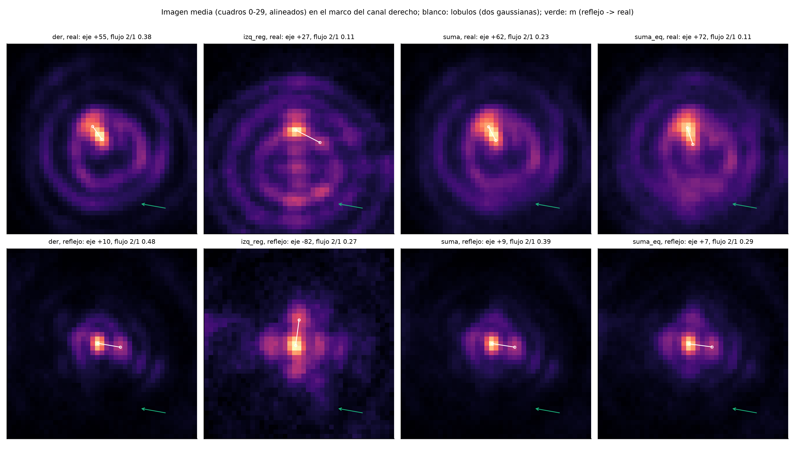
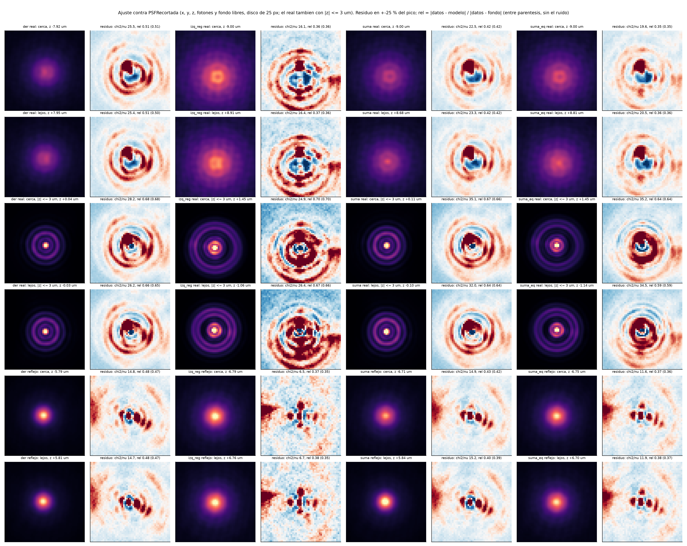

# Suma de los dos canales de polarización frente a la PSF escalar

Continuación de `resultados_psf_real.md` y de `resultados_celula.md` (sección 4), con los mismos datos: Yeast6_1, cuadros 0–29, 98.48 nm/px y 0.46 e⁻/ADU. La pregunta es si la suma de los dos canales, una vez alineados, se parece más a la PSF escalar de `simulador_nuevo` que cada canal por separado. No interviene la red.

```bash
PY=~/miniforge3/envs/tesis/bin/python
$PY figuras/suma_canales.py [--tif RUTA] [--cuadros 30] [--salida figuras/suma_canales]    # ~40 s
```

El script importa la detección de `figuras/analisis_datos_reales.py` y las medidas de `figuras/psf_real.py` (recortes alineados, `medir`, `disco`). Genera tres figuras PNG a 300 dpi:

- `figuras/suma_canales/fig_suma_canales_imagenes.png`
- `figuras/suma_canales/fig_suma_canales_residuos.png`
- `figuras/suma_canales/fig_suma_canales_medidas.png`

y las tablas `figuras/suma_canales/suma_canales_*.csv`. Los ángulos están en el marco del canal derecho, de +x hacia +y; m = −169.9° (reflejo → real) y t = −79.9°.

Se comparan cuatro imágenes:

| imagen | qué es |
|---|---|
| **der** | el canal derecho |
| **izq_reg** | el izquierdo registrado sobre la rejilla del derecho |
| **suma** | der + izq_reg |
| **suma_eq** | der + 2.845 · izq_reg |

La suma simple pesa ~73/27 a favor del derecho, que es ~2.8 veces más brillante. La equilibrada da a los dos canales el mismo flujo del real, como si esa diferencia fuera solo de transmisión. Es la prueba más directa de si los lóbulos de los dos canales se cancelan.

## Resumen

| pregunta | respuesta |
|---|---|
| registro | Bien. El real y el reflejo del izquierdo registrado caen a 166 y 66 nm (mediana) de los del derecho, lo mismo que los residuos de la transformación (171 y 62 nm). La interpolación mueve los centroides solo 12–22 nm (mediana) y conserva el flujo dentro del 2 % |
| ¿desaparecen los lóbulos del reflejo en la suma? | **No.** En la suma simple el par de lóbulos a lo largo de m sigue ahí (eje +9°, flujo 2/1 0.39 frente a 0.48 en el derecho). En la equilibrada se debilita pero no se va (0.29, eje +7°). El núcleo se redondea (cociente de ejes 1.47 → 1.35 → 1.19) y queda una cruz débil (armónico 4: 0.18). Del real, en cambio, en la equilibrada desaparece el segundo lóbulo (flujo 2/1 0.11, como en el izquierdo; cociente 1.16) |
| ¿baja el χ²/ν? | **No frente al mejor canal.** χ²/ν del ajuste libre: real 25.5 (der), 16.1 (izq), 22.5 (suma), 19.6 (suma_eq); reflejo 14.8, 6.5, 14.9, 11.6. El χ²/ν sube con la señal del canal (el izquierdo es el más ruidoso), así que la comparación justa es el residuo relativo sin ruido: real 0.51 / 0.36 / 0.42 / **0.35**; reflejo 0.47 / 0.35 / 0.42 / **0.36**. La suma equilibrada empata con el izquierdo solo, y ninguna baja de ~35 % de la señal |
| ¿es escalar la PSF de la suma? | **No.** Con z libre, el mejor ajuste del real en las cuatro imágenes es un disco difuso a \|z\| ≈ 8–9 µm, sin núcleo ni anillos. Con \|z\| ≤ 3 µm (la z triangulada es −0.84 µm) el residuo relativo es 0.59–0.70 en las cuatro: los anillos de los datos no son los concéntricos del modelo. Cerca y lejos dan el mismo χ² (±5 %) porque, ajustando cada punto por separado, la forma es simétrica bajo z → −z |
| estructura del residuo de la suma | **real:** un núcleo asimétrico (armónico 1 del residuo de 0.38–0.50 con z libre y 0.73–0.78 con \|z\| ≤ 3 µm: el lóbulo brillante está a un lado del centro del modelo), exceso positivo en el núcleo y en el anillo (+0.13 / +0.20 del nivel de los datos) y anillos excéntricos o en espiral. **reflejo:** elongación a lo largo de m en el núcleo y el anillo (armónico 2 del residuo: 0.24 y 0.28–0.34), algo de cruz (armónico 4: 0.15–0.23) y el halo del real en el borde que da al real |
| fotones (disco de 2.5 µm, cuadros 0–29) | real: der 31 400, izq 11 100, suma 42 300 e⁻ (el izquierdo aporta el 26 %). Reflejo: 14 000, 5 300 y 19 200 e⁻ |
| cociente reflejo / real | Por cuadro: der 0.446 ± 0.004, izq 0.485 ± 0.011, suma 0.453 ± 0.005 (2.5 µm). Con 1.5 µm: 0.423, 0.493 y 0.437. Con esta fotometría el izquierdo da +0.04 ± 0.01 (2.5 µm) y +0.07 ± 0.01 (1.5 µm) más que el derecho. `resultados_psf_real.md`, con otro fondo, daba el signo contrario (0.42 frente a 0.47), así que la diferencia entre canales está dominada por el sistemático del fondo |

## 1. Registro

La transformación es la ya estimada: similitud impropia con s = 1.0491 y Q = Rot(−85.20°)·diag(1, −1), det M = −1.1005 = −s². Se reajustó con los 100 cuadros × 2 puntos y se verificó que coincide.

- **Cómo se registra:** cada cuadro del canal izquierdo se pasa a e⁻ (ADU menos el nivel oscuro de su canal y cuadro: 97.78 / 97.73 ADU, por 0.46) y se lleva a una región de 181 × 181 px del derecho alrededor del par, con `ndimage.affine_transform`.
- **Interpolación:** spline cúbica con prefiltro, multiplicada por 1/|det M| para conservar el flujo.

`figuras/suma_canales/suma_canales_registro.csv`, con el centroide iterativo cuadro a cuadro:

| | izq registrado − der: mediana / rms | sesgo (x, y) | izq registrado − T(centroide nativo): mediana / rms |
|---|---|---|---|
| real | 166 / 178 nm | (−7, −3) nm | 22 / 64 nm |
| reflejo | 66 / 80 nm | (−9, −7) nm | 12 / 23 nm |

**Flujo.** Disco del izquierdo nativo de radio r/s frente al registrado de radio r:

| | 1.5 µm | 2.5 µm |
|---|---|---|
| real | 4942 → 4855 e⁻ (−1.8 %) | 11 261 → 11 053 e⁻ (−1.8 %) |
| reflejo | 2421 → 2389 e⁻ (−1.3 %) | 5378 → 5346 e⁻ (−0.6 %) |

La diferencia cabe en el cambio del anillo de fondo, que no cubre exactamente la misma región física.

Lectura:

- Lo que separa al real de los dos canales (166 nm) ya estaba en la transformación: el real izquierdo, débil y con anillo asimétrico, se localiza peor (`resultados_psf_real.md`, sección 1). No lo agrega la interpolación.
- El reflejo, compacto, coincide a 66 nm.
- Hay un pico aislado de 400 nm en el real (cuadro 23) por un salto del centroide del izquierdo.
- Al promediar, `recortes_alineados` vuelve a alinear cada imagen por correlación cruzada, así que estos desfases no se suman a la imagen media.

## 2. Lóbulos



Se usa el mismo método que en `psf_real.py` (`medir`): dos gaussianas en el disco de 7 px con separación de 1–6 px, momentos con r = 4 px y armónicos del perfil angular (`figuras/suma_canales/suma_canales_lobulos.csv`):

| | eje (vs m) | separación | flujo 2/1 | momentos: eje, cociente | núcleo: a4, a2 | anillo: a1 (hacia), a2 (eje) |
|---|---|---|---|---|---|---|
| der, real | +54.7° (+44.7°) | 336 nm | 0.38 | +53.1°, 1.41 | 0.08, 0.09 | 0.61 (+64°), 0.16 (+35°) |
| izq_reg, real | +27.1° (+17.0°) | 572 nm | 0.11 | −80.0°, 1.10 | 0.06, 0.11 | 0.63 (+80°), 0.22 (+78°) |
| suma, real | +62.1° (+52.0°) | 329 nm | 0.23 | +56.4°, 1.33 | 0.08, 0.06 | 0.61 (+66°), 0.13 (+48°) |
| **suma_eq, real** | +71.7° (+61.6°) | 374 nm | **0.11** | +64.5°, **1.16** | 0.08, 0.04 | 0.64 (+71°), 0.15 (+61°) |
| der, reflejo | +9.8° (−0.2°) | 484 nm | 0.48 | +22.7°, 1.47 | 0.16, 0.35 | 0.21 (+43°), 0.43 (+11°) |
| izq_reg, reflejo | −82.5° (+87.5°) | 549 nm | 0.27 | +85.4°, 1.49 | **0.29**, 0.08 | 0.18 (−23°), 0.19 (+3°) |
| suma, reflejo | +8.9° (−1.1°) | 484 nm | 0.39 | +24.1°, 1.35 | 0.14, 0.23 | 0.21 (+37°), 0.38 (+11°) |
| **suma_eq, reflejo** | +7.4° (−2.6°) | 484 nm | **0.29** | +30.0°, **1.19** | 0.18, 0.12 | 0.17 (+6°), 0.31 (+11°) |

- **der** e **izq_reg** reproducen las medidas de `resultados_psf_real.md` en el marco común (+54.7° / +27° en el real; +9.8° / −82.7° en el reflejo). Aquí el izquierdo pasa además por la escala s, sin cambio apreciable.
- **Reflejo:** los lóbulos de los dos canales están rotados ~90°: a lo largo de m en el derecho y de t en el izquierdo.
  - En la suma simple gana el derecho: el eje queda a lo largo de m (+9°) y la fuerza baja solo de 0.48 a 0.39.
  - En la equilibrada el núcleo se redondea (cociente de momentos 1.19 frente a ~1.5 en cada canal; armónico 2 del núcleo de 0.35 a 0.12). Pero el lóbulo a lo largo de m del derecho sigue resolviéndose (0.29), y la cruz del izquierdo deja un armónico 4 de 0.18.
  - Los lóbulos no se cancelan: los del derecho están más separados y son más fuertes que los del izquierdo, así que la suma no da un núcleo circular.
- **Real:** en la equilibrada el segundo lóbulo baja a 0.11, como en el izquierdo, y el núcleo queda casi redondo (1.16). Lo que queda es un núcleo algo alargado a +65–72°, no dos lóbulos separados.
- **Anillo del real:** el lado brillante (armónico 1 ≈ 0.6) es el mismo en los cuatro casos (+64° a +80°). Esa asimetría es común a los dos canales y no se va al sumar (`resultados_psf_real.md`, sección 3).

## 3. Ajuste contra la PSF escalar



**Modelo:** `PSFRecortada` de cerca y de lejos con la geometría de los datos (espejo a 45°, φ = m) y el recorte de pupila del real y del reflejo. La PSF es exacta en z, sin banco interpolado.

**Ajuste:** b + N·P(x, y, z) en el disco de 25 px, con x, y, z, N y b libres:

1. rejilla en z de −8 a +8 µm cada 100 nm, con N y b lineales;
2. refinamiento no lineal desde los 3 mejores mínimos.

**Pesos:** varianza entre cuadros de la imagen media. La suma interpolada no es Poisson, y la varianza entre cuadros incluye el movimiento y el fotoblanqueo, así que **el χ²/ν solo ordena casos**.

**Residuo relativo:** |datos − modelo| / |datos − fondo|. «Sin ruido» resta del numerador la varianza esperada (Σ var); como el ruido es pequeño frente a la falta de modelo, cambia ≤ 0.02.

Datos en `figuras/suma_canales/suma_canales_ajustes.csv`:

| | der | izq_reg | suma | suma_eq |
|---|---|---|---|---|
| real, z libre (cerca / lejos): z | −7.9 / +8.0 µm | −9.0 / +8.9 µm | −9.0 / +8.7 µm | −9.0 / +8.8 µm |
| real, z libre: χ²/ν | 25.5 / 25.4 | 16.1 / 16.4 | 22.5 / 23.3 | 19.6 / 20.5 |
| real, z libre: residuo sin ruido | 0.51 / 0.50 | 0.36 / 0.37 | 0.42 / 0.42 | **0.35** / 0.36 |
| real, \|z\| ≤ 3 µm: z | +0.04 / −0.03 µm | +1.45 / −1.06 µm | +0.12 / −0.10 µm | +1.45 / −1.14 µm |
| real, \|z\| ≤ 3 µm: χ²/ν | 28.2 / 26.2 | 24.9 / 26.4 | 35.1 / 32.0 | 35.2 / 34.5 |
| real, \|z\| ≤ 3 µm: residuo sin ruido | 0.68 / 0.65 | 0.70 / 0.66 | 0.66 / 0.64 | 0.64 / **0.59** |
| reflejo (cerca / lejos): z | −5.8 / +5.8 µm | −6.8 / +6.8 µm | −6.7 / +5.8 µm | −6.8 / +6.7 µm |
| reflejo: χ²/ν | 14.8 / 14.7 | 6.5 / 6.7 | 14.9 / 15.2 | 11.6 / 11.9 |
| reflejo: residuo sin ruido | 0.47 / 0.47 | **0.35** / 0.35 | 0.42 / 0.39 | 0.36 / 0.37 |

**¿Baja el χ²/ν en la suma?**

- **Frente al derecho, sí, un poco:** χ²/ν 25.5 → 22.5 (suma) y 19.6 (equilibrada) en el real, y 14.8 → 11.6 (equilibrada) en el reflejo. El residuo sin ruido baja de 0.51 a 0.42 y 0.35 en el real, y de 0.47 a 0.42 y 0.36 en el reflejo.
- **Frente al izquierdo, no.**
  - El izquierdo solo tiene el χ²/ν más bajo (16.1 y 6.5), pero eso es en buena parte porque es el más ruidoso: su varianza por píxel relativa a la señal es mayor.
  - En residuo sin ruido, la equilibrada empata con él (0.35 frente a 0.36 en el real, 0.36 frente a 0.35 en el reflejo), y la suma simple queda peor (0.42).
  - Sumar no acerca la PSF al modelo escalar más que el canal izquierdo solo, que es el de núcleo más redondo.
- **Con \|z\| ≤ 3 µm** las cuatro quedan en 0.59–0.70: sumar mejora 0.02–0.06 en un ajuste cuyo residuo es ~2/3 de la señal (en norma cuadrática).
- **Cerca frente a lejos:** con cada punto ajustado por separado, la forma de la PSF es simétrica bajo z → −z (también con el recorte, tomado en −f), y los χ² difieren menos del 5 %. Esto no distingue la variante; para eso hace falta la restricción z' = z − L tan β (`resultados_celula.md`, sección 4).

**¿Qué estructura queda en el residuo de la suma?** Armónicos del perfil angular del residuo, relativos al nivel medio de los datos en la misma corona:

- **Real, z libre:**
  - el modelo es un disco difuso. El residuo tiene un núcleo positivo y descentrado: medio +0.15, armónico 1 de 0.38–0.50, es decir, el lóbulo brillante a un lado;
  - los anillos de los datos quedan en positivo (anillo medio +0.20) con forma de espiral o excéntrica: no son concéntricos con el núcleo.
- **Real, \|z\| ≤ 3 µm:** el modelo trae anillos concéntricos, pero no coinciden en radio ni en intensidad con los de los datos. El residuo del anillo es positivo (+0.32 a +0.35) y el del núcleo, muy asimétrico (armónico 1 de 0.73–0.78).
- **Reflejo:**
  - en la suma simple, el residuo del núcleo y del anillo es alargado a lo largo de m (armónico 2: 0.24 y 0.28–0.34): los lóbulos del derecho, que el modelo circular no tiene;
  - hay algo de cruz (armónico 4: 0.15–0.23);
  - hay una zona positiva en el borde del recorte que da al real: su halo, a 47 px.
  - En la equilibrada el armónico 2 baja (0.15 en el núcleo, 0.22 en el anillo) y el 4 se queda (0.19, 0.18).

En resumen, lo que el modelo escalar no tiene y la suma no quita es:

- la asimetría del núcleo y de los anillos del real, común a los dos canales;
- la elongación a lo largo de m del reflejo, que el derecho domina;
- la cruz del canal izquierdo.

## 4. Fotones

Fotometría en discos de 1.5 y 2.5 µm con el fondo local (`disco` de `psf_real.py`: mediana del anillo [r + 3, r + 9] px sin la región del otro punto), cuadros 0–29, en e⁻ (`figuras/suma_canales/suma_canales_fotones.csv`, `suma_canales_cociente.csv`):

| | real, 1.5 µm | real, 2.5 µm | reflejo, 1.5 µm | reflejo, 2.5 µm | reflejo/real por cuadro, 1.5 µm | ídem, 2.5 µm |
|---|---|---|---|---|---|---|
| der | 15 080 | 31 440 | 6 390 | 14 000 | 0.423 ± 0.004 | 0.446 ± 0.004 |
| izq nativo | 4 940 | 11 260 | 2 420 | 5 380 | 0.491 ± 0.007 | 0.480 ± 0.010 |
| izq_reg | 4 860 | 11 050 | 2 390 | 5 350 | 0.493 ± 0.006 | 0.485 ± 0.011 |
| suma | 19 790 | 42 350 | 8 670 | 19 180 | 0.437 ± 0.003 | 0.453 ± 0.005 |
| suma_eq (izq × 2.845) | 28 620 | 62 770 | 13 010 | 28 900 | 0.454 ± 0.004 | 0.461 ± 0.006 |
| izq − der, pareado por cuadro | | | | | **+0.071 ± 0.007** | **+0.040 ± 0.009** |

- **Reparto de flujo:** el izquierdo aporta el 26 % del flujo del real en la suma (coherente con el ~27 % de `resultados_datos_reales.md`) y el 28 % del del reflejo. El cociente der/izq es 2.85 en el real y 2.62 en el reflejo, porque el reflejo tiene más peso relativo en el izquierdo.
- **Cociente por canal:** con esta fotometría, el izquierdo tiene un cociente reflejo/real 0.04–0.07 mayor que el derecho, y el error estadístico (pareado, cuadros simultáneos) es ~0.01. Pero `resultados_psf_real.md`, con el fondo de la imagen media (anillo de 22–29 px) y la curva de crecimiento, daba 0.42 (izq) y 0.47 (der), el signo contrario. Y `resultados_datos_reales.md` ya mostraba que el cociente depende del estimador de fondo. **Una diferencia de cociente entre polarizaciones sigue sin estar demostrada**: el sistemático del fondo (franja del espejo bajo el reflejo, halo del otro punto) es mayor que la diferencia.
- **Fotones del ajuste:**
  - con z libre, N del real (94 000 en el derecho) es 3 veces el disco de 2.5 µm, porque el modelo difuso absorbe el halo y el fondo estructurado. Sus cocientes reflejo/real (0.21–0.28) no tienen sentido físico;
  - con \|z\| ≤ 3 µm, N del real da 13 300–14 000 (der), 4 700–5 000 (izq) y 19 000–20 000 (suma), por debajo del disco de 2.5 µm: el modelo no reproduce la luz de los anillos.
  - La fotometría de disco es la medida útil aquí; los fotones totales dependen de la variante y del modelo (±30 % según `resultados_psf_real.md`).
- **Frente a `fotones_rango` [1000, 30000]:** la suma simple (~42 000 e⁻ en 2.5 µm al principio del video) queda por encima del rango, igual que el derecho solo con la corrección de energía encerrada. Si se usa la suma (opción a de `resultados_datos_reales.md`, sección 7), habría que ampliar el rango de fotones.

## Conclusión

- **Sumar no convierte la PSF en escalar.**
  - La suma simple es casi el canal derecho (73 % del flujo) y conserva sus lóbulos.
  - La suma equilibrada cancela el segundo lóbulo del real y redondea el núcleo del reflejo. Sin embargo, deja la elongación a lo largo de m del reflejo, la cruz del izquierdo y, sobre todo, la asimetría del núcleo y de los anillos del real, que es común a los dos canales.
  - En ningún caso el residuo del ajuste con la PSF escalar de cerca o de lejos baja de ~35 % de la señal (norma cuadrática, \|datos − modelo\| / \|datos − fondo\|). En la z plausible del real (\|z\| ≤ 3 µm) no baja de ~60 %.
- **Para el modelado** (`resultados_datos_reales.md`, sección 7):
  - la suma (a) no evita tener que modelar una PSF no escalar;
  - la equilibrada se acerca algo más a una PSF simétrica, pero amplifica 2.8 veces el ruido del canal izquierdo;
  - ninguna de las dos resuelve la asimetría común de los anillos, que apunta a una aberración del camino común o al espejo, a escala de µm.
- **El paso necesario** sigue siendo medir la PSF con beads (z-stack en los dos canales) y llevarla al simulador como PSF medida o como fase de pupila ajustada, en lugar de la esférica ideal.

## Supuestos y limitaciones

- La transformación sale de esta misma partícula (escala y ángulo sin calibrar; `resultados_psf_real.md`, sección 1). La equilibrada supone que el cociente de brillo del real (2.85) es transmisión, no polarización de la emisión.
- La interpolación cúbica correlaciona el ruido del izquierdo registrado. χ²/ν con la varianza entre cuadros sirve para ordenar casos, no como bondad de ajuste absoluta, y favorece a las imágenes más ruidosas; por eso se da también el residuo sin ruido.
- El ajuste es de cada punto por separado: no impone z' = z − L tan β ni el mismo N con el ratio, y no distingue cerca de lejos.
- Una sola partícula, 30 cuadros, con el real recorriendo ~1 µm en z: la imagen media promedia una PSF que cambia con z.
