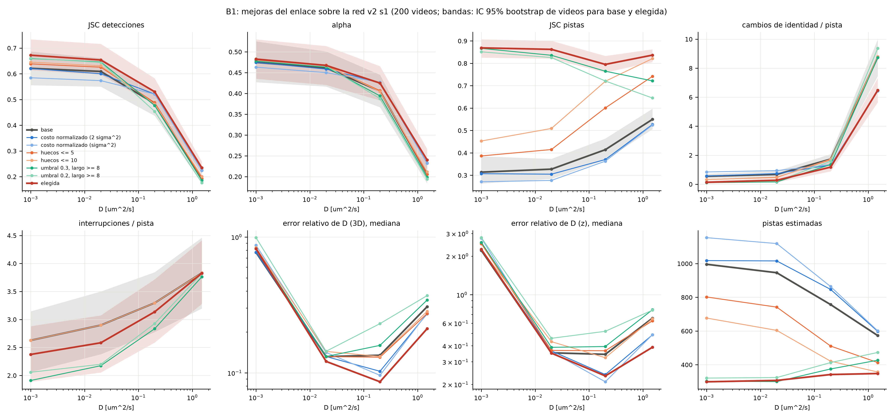
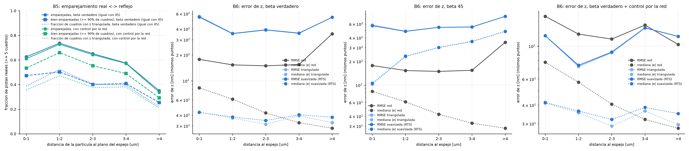
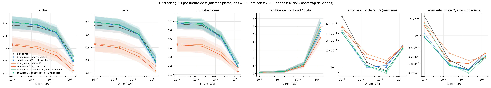
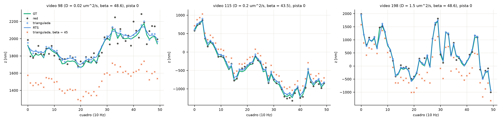

# Tracking 3D: enlace mejorado y z por triangulación con el reflejo

Continuación de `resultados_tracking_base.md`, sobre los **mismos 200 videos** (50 muestras base × 4 D, 1–12 emisores por célula, 50 cuadros a 10 Hz, `configs/celula_v2.yaml` cerca) y la misma red (`hypatia_celula_v2_b45_cerca_s1`). Sin reentrenar y sin Hypatia. Dos partes:
- **B1, enlace:** costo normalizado por eje, cierre de huecos más largo, umbral de confianza más bajo y descarte de pistas cortas;
- **B2–B7, espejo:** detección clásica de los reflejos, sus pistas, emparejamiento de pistas real ↔ reflejo y z por triangulación, con suavizado Kalman/RTS.

```bash
PY=~/miniforge3/envs/tesis/bin/python
$PY tracking/tests/test_tracking.py                     # 17 tests (~2 s)
LD_PRELOAD=$HOME/miniforge3/envs/tesis/lib/libstdc++.so.6 $PY figuras/tracking_3d.py localizar   # red con umbral 0.2 (~25 min GPU)
$PY figuras/tracking_3d.py reflejos                     # manchas DoG + ajuste gaussiano en los 10 000 cuadros (~1 min)
$PY figuras/tracking_3d.py enlace analisis              # B1 y B4-B7 (~1 min)
```

- **Código:**
  - `tracking/enlace.py`: `CostoEuclideo` (la línea base, sin cambios bit a bit) y `CostoNormalizado`, más `filtrar_cortas`;
  - `tracking/reflejos.py`: detector de manchas;
  - `tracking/espejo.py`: coordenadas (s, t), triangulación, Kalman/RTS y emparejamiento;
  - `tracking/metricas.py`: `isbi(..., por_pista=True)`;
  - `figuras/tracking_3d.py`: el experimento.
- **Salidas:**
  - agregados y figuras (PNG 300 dpi) en `figuras/tracking_3d/`;
  - tablas por video, pista, par y punto en `localizacion/datos/tracking_celula_v2_cerca/tracking_3d/` (no se versionan);
  - la inferencia con umbral 0.2 en `detecciones_u02.csv` y las manchas en `manchas.csv`, en la misma carpeta de datos.
- **IC:** 95 %, bootstrap de videos.
- **Evaluación:** la misma de la línea base: ε = 150 nm en (x, y, z · 0.5), y D por MSD (τ = 1–4, con ordenada) comparado con el mismo estimador sobre la pista GT de la partícula.

## Resumen

| | resultado |
|---|---|
| B1: enlace | **Costo normalizado por eje (2σ²_e + 2·D·Δt), huecos ≤ 10, umbral 0.4 y pistas ≥ 8 detecciones.** Elegido por el JSC medio en la mitad de selección (muestras base 0–24) y confirmado en la de prueba (25–49). Frente a la línea base: JSC 0.62 → **0.67** (D = 0.001), 0.49 → **0.53** (0.2) y 0.19 → **0.24** (1.5); cambios de identidad por pista 0.55 → **0.14** y 8.8 → **6.5**; JSC de pistas 0.31 → **0.87**; pistas estimadas 996 → 299 (para 314 partículas); error de D en 3D a D = 1.5: 31 % → **21 %**. |
| B1: qué aporta cada cambio | El **costo normalizado** quita la mitad de los cambios de identidad a D alto (con el GT exacto, 9.5 → 5.7 por pista). Los **huecos largos** juntan fragmentos (JSC de pistas 0.31 → 0.45) sin tocar el JSC de detecciones. **Bajar el umbral a 0.3 o 0.2 no ayuda:** recupera un 1–2.5 % de recall a costa de precisión (0.905 → 0.844), y a D ≥ 0.2 empeora el JSC y el error de D |
| B2: reflejo en el GT | **Ya estaba** (`x/y_reflejo_px`, `z_reflejo_nm`, `photons_reflejo`, `reflejo_en_fov`): no hubo que regenerar los videos ni tocar el simulador |
| B3–B4: reflejos | Detector clásico: DoG + máximos > 5σ + ajuste gaussiano 2D, sin las manchas a ≤ 2 px de una detección de la red y solo del lado del espejo de algún real. **Recall 0.49–0.55, precisión 0.84–0.91,** error lateral RMS de 62 nm. Las pérdidas son físicas: reflejos con < 3000 fotones (31 % detectados), z' < −5 µm (37 %) o un vecino a 300–600 nm (39 %) |
| B5: emparejamiento | **El 61 % de las pistas reales** (≥ 5 cuadros) se empareja con algún reflejo, y en el 41 % de sus cuadros hay z triangulada. Por cuadro, **el 93 % de los emparejamientos es correcto** (95 % a D ≤ 0.2 y 87 % a D = 1.5). Por distancia de la partícula al espejo: 63 % (0–1 µm), **74 % (1–2 µm)**, 65 % (2–3), 58 % (3–4) y 35 % (> 4 µm, reflejos más desenfocados) |
| B6: z, β verdadero | **En los cuadros bien emparejados, el RMSE z triangulado es de 54 nm frente a 127 nm de la red en los mismos puntos.** Ese error es casi todo un sesgo fijo por partícula (49 nm RMS entre partículas, 24 nm dentro de cada una), así que el RTS no lo baja (58 nm). **El 7 % mal emparejado lo arruina:** sobre todos los puntos con z triangulada, el RMSE es de 405 nm frente a 176 nm (la mediana de \|e\| sigue siendo mejor: 36 frente a 46 nm) |
| B6: con control por la red | Si se descartan los cuadros con \|z_tri − z_red\| > 3σ combinado, el **RMSE z queda en 103 nm frente a 126 nm de la red** (mismos puntos) y los errores > 300 nm bajan de 1.5 % a **0.2 %**. Es la variante usable |
| B6: β = 45° fijo | **Inservible:** β verdadero va de 40 a 50°, y el error sistemático (366 nm RMS en los bien emparejados) supera al de la red. A 45°, dz/dβ ≈ 2·s_real, unos 127 nm por grado con la mediana s_real = 3.6 µm: **β hay que medirlo a ~0.4° para 50 nm** |
| B7: tracking | Las pistas son las mismas (la z triangulada no cambia el enlace), así que solo cambia el término de posición. α sube de 0.48 a **0.50** a D = 0.001 (IC solapados) y el JSC de 0.67 a 0.69–0.70. A D = 1.5 el RTS sin control empeora (α 0.24 → 0.20): suaviza sobre los saltos de los pares incorrectos |
| B7: D por MSD | **Donde más se nota la triangulación.** En las pistas emparejadas (≥ 50 % de cuadros con z triangulada), el error relativo de D en z pasa de 151 % a **25 %** (D = 0.001), de 24 % a **11 %** (0.02) y de 14 % a **8 %** (0.2, con control). **El RTS sesga D hacia abajo** (D_z / ref = 0.2–0.8 a D ≤ 0.02): para el MSD hay que usar la z triangulada sin suavizar |

## 1. B1: mejoras del enlace



**Rejilla:** 3 costos × huecos {2, 5, 10} × umbral {0.4, 0.3, 0.2} × largo mínimo {1, 3, 5, 8}, sobre la red, más los controles GT + ruido y GT exacto para el costo y los huecos (`tracking_3d_enlace_rejilla.csv`).

- **Umbral bajo:** la red se volvió a correr con `postproc.umbral = 0.2`. Los máximos locales y su `conf` no dependen del umbral, así que las detecciones con conf ≥ 0.4 son **exactamente** las 51 635 de la línea base, y la fila «base» reproduce todas las cifras de `resultados_tracking_base.md`.

| umbral | detecciones | recall | precisión | RMSE x / y / z [nm] |
|---|---|---|---|---|
| 0.4 | 51 635 | 0.748 | 0.905 | 26.9 / 27.6 / 97.7 |
| 0.3 | 53 842 | 0.760 | 0.882 | 27.1 / 28.0 / 98.5 |
| 0.2 | 57 280 | 0.773 | 0.844 | 27.4 / 28.3 / 99.6 |

- **Costo normalizado:** d² = Σ_e (Δ_e)² / (c·σ_e² + 2·D·g·Δt), con umbral √χ²₃(0.9999) = 4.59, igual que el radio de la línea base. g son los cuadros entre las dos detecciones, así que el cierre de huecos usa la misma métrica, y σ_e es el RMSE de la red por eje para ese umbral.
  - **c = 2** es la varianza de la diferencia de dos errores independientes; **c = 1** es la fórmula σ² + 2·D·Δt.
  - El c efectivo medido, var(e_{t+1} − e_t) / σ², es **0.46 en x e y** y 1.27 en z: el error lateral de la red está muy correlacionado entre cuadros consecutivos.
  - Aun así, **c = 2 es mejor que c = 1**: con c = 1 los cambios de identidad a D = 0.001 suben de 0.57 a 0.85 por pista, y las pistas de 1018 a 1154. Las colas del error (no gaussianas) cortan enlaces si la compuerta es estrecha.
  - Con GT + ruido gaussiano y c = 1 pasa lo mismo, y más fuerte: el JSC a D = 0.001 cae de 0.99 a 0.80.
- **Selección:** el mayor JSC de detecciones medio sobre los 4 D en la mitad de selección. La mejor fue norm2 / huecos ≤ 10 / umbral 0.4 / largo ≥ 8 (JSC medio 0.519); las 12 primeras usan casi todas norm2 y umbral 0.4.

Red, todas las densidades (`tracking_3d_enlace_comparacion.csv`; entre corchetes, el IC del JSC):

| config | D | α | JSC [IC] | JSC pistas | cambios id. / pista | pistas estimadas | err. D 3D | err. D z |
|---|---|---|---|---|---|---|---|---|
| base | 0.001 | 0.475 | 0.621 [0.560, 0.687] | 0.314 | 0.55 | 996 | 77 % | 222 % |
| | 0.02 | 0.461 | 0.609 | 0.327 | 0.68 | 946 | 13 % | 35 % |
| | 0.2 | 0.406 | 0.485 | 0.414 | 1.73 | 757 | 14 % | 34 % |
| | 1.5 | 0.206 | 0.192 [0.174, 0.212] | 0.550 | 8.76 | 573 | 31 % | 66 % |
| costo normalizado (2σ²) | 0.2 | 0.426 | 0.521 | 0.370 | 1.32 | 847 | 10 % | 24 % |
| | 1.5 | 0.233 | 0.225 | 0.527 | 6.46 | 598 | 27 % | 49 % |
| huecos ≤ 10 | 0.001 | 0.483 | 0.645 | 0.453 | 0.32 | 677 | 84 % | 226 % |
| | 1.5 | 0.211 | 0.201 | 0.821 | 8.80 | 357 | 28 % | 65 % |
| umbral 0.3, largo ≥ 8 | 0.001 | 0.478 | 0.659 | 0.867 | 0.12 | 302 | 82 % | 256 % |
| | 1.5 | 0.199 | 0.185 | 0.722 | 8.73 | 427 | 34 % | 76 % |
| umbral 0.2, largo ≥ 8 | 0.001 | 0.483 | 0.661 | 0.851 | 0.15 | 321 | 99 % | 279 % |
| | 1.5 | 0.194 | 0.176 | 0.645 | 9.38 | 473 | 37 % | 76 % |
| **elegida** | 0.001 | **0.483** | **0.672** [0.617, 0.737] | **0.869** | **0.14** | 299 | 82 % | 226 % |
| | 0.02 | 0.467 | **0.654** | 0.862 | 0.27 | 307 | 12 % | 35 % |
| | 0.2 | **0.425** | **0.530** | 0.795 | **1.18** | 342 | **9 %** | **23 %** |
| | 1.5 | **0.240** | **0.235** [0.212, 0.260] | 0.837 | **6.48** | 348 | **21 %** | **39 %** |

- **Mitad de prueba** (muestras base 25–49, no usadas para elegir). JSC base → elegida: 0.631 → 0.681, 0.615 → 0.664, 0.487 → 0.524 y 0.196 → 0.237. Cambios de identidad a D = 1.5: 9.2 → 6.6. La mejora se sostiene.
- **Los IC de base y elegida se solapan en cada D** por separado, porque el bootstrap es de videos y la varianza entre videos es grande. Pero el diseño es pareado y la diferencia tiene el mismo signo en los 4 D y en las dos mitades.
- **Las interrupciones por pista no cambian con los huecos (2.6 en todas las filas),** porque se miden sobre la cobertura por cuadro de cada pista GT, y el cierre de huecos no agrega detecciones. La fragmentación en pistas se ve en las pistas estimadas (996 → 299) y en el JSC de pistas (0.31 → 0.87). Solo el umbral más bajo baja las interrupciones (2.6 → 1.9 con 0.3).
- **Controles con GT exacto:** el costo normalizado lleva los cambios de identidad a D = 0.2 de 0.78 a 0.45, y a D = 1.5 de 9.5 a 5.7. Es el mismo efecto que en la sección 4 de la línea base sin reescalar z, ahora con el modelo correcto en vez de una escala fija.
- **El largo mínimo de 8** saca casi todas las pistas espurias de los FP (0.5 por cuadro) y de los fragmentos: el JSC de pistas pasa de ~0.45 a 0.87. Con pistas ≥ 10 puntos para el MSD, no cambia qué pistas entran en D.

## 2. B2–B4: reflejos

- **B2:** el GT de `simulador_nuevo` con espejo ya guarda la posición, la z' y los fotones del reflejo de cada emisor en cada cuadro, así que no hubo que regenerar nada. Sobre el GT, la fórmula de triangulación reproduce z con error < 10⁻¹¹ nm y t' = t exacto (test `test_triangulacion_con_geometria_espejo`).
- **B3, detector** (`tracking/reflejos.py`):
  - imagen en e⁻ → DoG (σ 1.5 y 4 px, quita el fondo y la autofluorescencia) → máximos locales en 5×5 sobre 5σ del ruido (MAD) → ajuste gaussiano 2D con fondo, por mínimos cuadrados, en una ventana de 11×11;
  - se conservan los ajustes con σ en [0.6, 4] px y el centro a < 1.5 px del máximo;
  - salen 77 928 manchas en los 10 000 cuadros.
- **Filtros de reflejo:**
  - **reales:** fuera las manchas a ≤ 2 px de una detección de la red del cuadro (son los reales);
  - **lado:** se exige s < s_real + 150 nm y |t − t_real| < 600 nm para algún real del cuadro. **El lado es relativo al real, no a la línea:** con β = 40–50°, el reflejo cae a los dos lados de la línea del espejo (48 % con s' < 0 en el GT; a 45°, s' = −z).
- **B4:** las pistas de reflejos usan el mismo LAP de B1 en 2D (x, y), con σ = 62 nm (el error lateral medido de las manchas sobre reflejos GT) y huecos ≤ 10 y largo ≥ 8, como los reales.

| D | manchas | candidatas | en pistas | sobre un reflejo GT | recall | precisión | α (2D) | JSC (2D) | pistas estimadas / GT |
|---|---|---|---|---|---|---|---|---|---|
| 0.001 | 18 648 | 8 999 | 8 403 | 7 679 | 0.50 | 0.91 | 0.25 | 0.42 | 224 / 310 |
| 0.02 | 18 882 | 9 058 | 8 323 | 7 544 | 0.49 | 0.91 | 0.25 | 0.41 | 265 / 313 |
| 0.2 | 19 881 | 9 996 | 9 644 | 8 515 | 0.55 | 0.88 | 0.22 | 0.33 | 330 / 315 |
| 1.5 | 20 517 | 10 194 | 10 073 | 8 500 | 0.54 | 0.84 | 0.12 | 0.14 | 345 / 315 |

Recall de las manchas sobre reflejos (muestra de 400 cuadros, antes de los filtros): 31 % con < 3000 fotones, 83 % con 12 000–25 000; 37 % con z' < −5 µm, 75 % con z' entre −3 y −2 µm; 39 % con el punto GT más cercano a 300–600 nm, 70 % a más de 1 µm. Solo el 2 % de los reflejos detectados se pierde por la exclusión de 2 px, y casi todos tienen L < 400 nm, es decir, el reflejo encima del real.

## 3. B5: emparejamiento de pistas real ↔ reflejo



`tracking/espejo.emparejar_pistas`, en coordenadas (s, t) respecto de la línea (t a lo largo del espejo, s hacia la muestra):

- **Cuadros consistentes de un par:** los dos presentes, |Δt| < 3σ_Δt (Δt = t_real − t_reflejo; σ_Δt = √(27² + 62²) = 68 nm) y s_reflejo < s_real (lado).
- **Puntaje:** Σ (log(6/√(2π)) − (Δt/σ_Δt)²/2) sobre esos cuadros. Es el log de la razón de verosimilitudes «es su reflejo» (Δt gaussiana) frente a «coincidencia» (Δt uniforme en la ventana). Un par verdadero suma ~0.37 por cuadro y una coincidencia ~−0.63, así que un desplazamiento constante de 1.5σ ya no se empareja (test).
- **Compuertas:**
  - ≥ 5 cuadros consistentes y puntaje ≥ 2;
  - **diferencia media** |⟨Δt⟩| < σ_Δt;
  - **correlación temporal** de t_real y t_reflejo ≥ 0.5 si el real se mueve en t más de 3σ_Δt;
  - z triangulada (mediana) en [−4, 4] µm.
- **Asignación húngara** de máximo puntaje total, **por rondas.** Cada par asignado consume solo sus cuadros consistentes, así que una pista que cambia de partícula a mitad del video se empareja después, en sus otros cuadros, con el reflejo que corresponde. Una pista cortada se empareja con varios fragmentos (test `test_emparejar_pistas`).
- **Un primer intento con la media de (Δt/σ)² sobre todos los cuadros comunes fracasó a D = 1.5 (ningún par):** basta un cambio de identidad en una de las dos pistas para disparar la media.

| D | pistas reales (≥ 5 cuadros) | emparejadas | bien emparejadas (≥ 90 % de sus cuadros) | cuadros con z triangulada | cuadros bien emparejados | pares de rondas > 1 |
|---|---|---|---|---|---|---|
| 0.001 | 299 | 49 % | 42 % | 41 % | **94.6 %** | 8 % |
| 0.02 | 307 | 56 % | 47 % | 42 % | **95.3 %** | 9 % |
| 0.2 | 342 | 63 % | 47 % | 43 % | **94.5 %** | 35 % |
| 1.5 | 348 | 76 % | 32 % | 36 % | **86.8 %** | 54 % |

**Por distancia de la partícula al plano del espejo** (media sobre el video; pistas reales):

| distancia | pistas | emparejadas | bien emparejadas | cuadros con z triangulada | ídem, con control por la red |
|---|---|---|---|---|---|
| 0–1 µm | 131 | 63 % | 47 % | 39 % | 36 % |
| 1–2 µm | 338 | **74 %** | 50 % | **52 %** | 47 % |
| 2–3 µm | 356 | 65 % | 40 % | 40 % | 38 % |
| 3–4 µm | 306 | 58 % | 41 % | 40 % | 38 % |
| > 4 µm | 157 | 35 % | 26 % | 22 % | 21 % |

- **Cerca del espejo** (d < 1 µm, L = 2d·cos β < 1.4 µm) el reflejo se superpone con el real o con los anillos de su PSF.
- **Lejos** (d > 4 µm, z' = z − 2d·sin β < −5.7 µm + z) el reflejo está muy desenfocado y es tenue.
- **β fijo en 45° da el mismo emparejamiento:** la compuerta de z posible no llega a actuar.
- **Por qué cae «bien emparejadas» a D alto:** a D = 1.5 las pistas reales cambian de partícula 6.5 veces cada una, y los pares se forman sobre tramos de pistas que ya mezclan partículas.

## 4. B6: z por triangulación

**Fórmula:** z = −s_M / tan β + (L/2)·tan β, con s_M el punto medio y L = s_real − s_reflejo, por cuadro, en los cuadros consistentes de cada par.

**Suavizado:** Kalman / RTS de paseo aleatorio, con q = 2·D·Δt (el D de la condición, como el enlace) y la varianza de observación por propagación lineal, σ_z² = ((tan β − cot β)/2·σ_real)² + ((tan β + cot β)/2·σ_reflejo)². A 45° es simplemente σ_reflejo = 62 nm (test `test_kalman_rts`).

- **Dónde se usa cada z:**
  - en el tramo emparejado de cada pista: la z triangulada (o la suavizada, según la variante);
  - en las demás detecciones: la de la red.
- **Variante con control:** descarta, antes del RTS, los cuadros con |z_tri − z_red| > 3·√(σ_red,z² + σ_z²). Usa la z de la red solo como verificación.

**Errores sobre los mismos puntos:** detecciones asociadas lateralmente (< 150 nm, sin compuerta en z) a una partícula GT, que tienen z triangulada. Son 22 357 de 48 898. Como la asociación es lateral, la red muestra aquí sus colas en z: 176 nm de RMSE, frente a los 98 nm con la compuerta de 300 nm de `evaluate.py`.

| fuente | puntos | RMSE red | RMSE triangulada | RMSE RTS | mediana \|e\| red / tri | \|e\| > 300 nm red / tri | RMSE en los bien emparejados: tri / red |
|---|---|---|---|---|---|---|---|
| β verdadero | 22 357 | 176 | 405 | 402 | 46 / **36** | 3.7 % / 3.9 % | **54 / 127** |
| β verdadero + control | 21 021 | 126 | **103** | 103 | 44 / **34** | 1.5 % / **0.2 %** | 54 / 95 |
| β = 45° | 22 357 | 176 | 549 | 547 | 46 / 289 | 3.7 % / 49 % | 366 / 127 |

- **El error triangulado bien emparejado es sobre todo un sesgo por partícula:**
  - 49 nm RMS entre las medias por partícula, y solo **24 nm** dentro de cada una (16 nm a D = 0.001);
  - la red, en los mismos puntos: 68 nm entre partículas y 107 nm dentro;
  - por eso el RTS no mejora a la triangulada (54 → 58 nm), aunque su modelo de ruido blanco sea el correcto para la parte aleatoria.
- **El sesgo no depende de forma clara de z' ni de β** (`tracking_3d_sesgo_reflejo.csv`): la mediana por celda va de −37 a +71 nm, y en conjunto de −3 a −15 nm. Hay casos extremos, como el video 20 (fondo de 46 fotones/px, 9 emisores), con −100 a −160 nm en todas sus partículas y una desviación de 5–15 nm. Candidatos: la asimetría del reflejo por el recorte de pupila (`recorte_pupila_reflejo`) y la contaminación por vecinos o anillos dentro de la ventana de ajuste. **Medirlo y calibrarlo es el siguiente paso** (un ajuste con la PSF del modelo en lugar de una gaussiana).
- **Por D (β verdadero + control), RMSE triangulada / red en los mismos puntos:** 61 / 104 (D = 0.001), 125 / 145 (0.02), 126 / 143 (0.2) y 71 / 97 (1.5). Por densidad: 45 / 78 (1–4 emisores), 93 / 123 (5–8) y 123 / 143 (9–12).
- **β = 45° fijo.** A 45°, ∂z/∂β = s_M/sin²β + (L/2)/cos²β = 2·s_real por radián: unos 127 nm por grado con s_real = 3.6 µm. β uniforme en [40, 50] (2.9° RMS) da 366 nm, lo observado.
  - **Por eso la triangulación exige calibrar β a ~0.4° para no pasar de 50 nm.**
  - Por la misma cuenta (analítica, no simulada), mover la línea del espejo δ a lo largo de m cambia z en δ/tan β, 1:1 a 45°: la línea hay que conocerla a decenas de nm.
  - Aquí la geometría (línea, φ, β) se tomó exacta del simulador. Con datos reales, el error de calibración se suma a todo lo de esta sección (`resultados_calibracion_espejo.md`).

## 5. B7: métricas de tracking por fuente de z



Las pistas y sus identidades son las de B1 (elegida); solo cambia la z de cada detección. Todas las densidades (`tracking_3d_metricas.csv`; por densidad, en el mismo CSV):

| z | D | α [IC] | β | JSC [IC] | cambios id. / pista | interrupciones / pista |
|---|---|---|---|---|---|---|
| red | 0.001 | 0.483 [0.438, 0.531] | 0.477 | 0.672 [0.613, 0.734] | 0.14 | 2.38 |
| | 0.02 | 0.467 | 0.460 | 0.654 | 0.27 | 2.58 |
| | 0.2 | 0.425 | 0.402 | 0.530 | 1.18 | 3.14 |
| | 1.5 | 0.240 | 0.223 | 0.235 | 6.48 | 3.83 |
| triangulada, β verdadero | 0.001 | **0.503** [0.457, 0.549] | 0.497 | **0.685** | 0.16 | 1.95 |
| | 0.02 | 0.488 | 0.479 | 0.666 | 0.27 | 2.30 |
| | 0.2 | 0.442 | 0.419 | 0.539 | 1.24 | 2.97 |
| | 1.5 | 0.240 | 0.223 | 0.227 | 6.38 | 4.44 |
| RTS + control, β verdadero | 0.001 | **0.507** | 0.501 | **0.697** [0.642, 0.759] | 0.15 | 1.93 |
| | 0.02 | 0.487 | 0.479 | 0.674 | 0.27 | 2.17 |
| | 0.2 | 0.428 | 0.406 | 0.531 | 1.17 | 2.95 |
| | 1.5 | 0.210 | 0.194 | 0.196 | 5.64 | 5.42 |
| triangulada + control | 1.5 | **0.247** | 0.230 | 0.236 | 6.48 | 3.74 |
| triangulada, β = 45° | 0.001 | 0.336 | 0.331 | 0.447 | 0.15 | 2.06 |
| | 1.5 | 0.168 | 0.155 | 0.177 | 5.90 | 5.56 |

- **Ganancias pequeñas y dentro de los IC.** Con ε = 150 nm y z × 0.5, los 98 nm de error de la red en z pesan como 49 nm, del orden del lateral. Las métricas ISBI las domina el enlace (cambios de identidad) y la detección (interrupciones), que la z triangulada no toca.
- **Las interrupciones y los cambios de identidad sí cambian algo con la z:** se cuentan con el emparejamiento por cuadro a < ε, y una z mejor (o peor) mete o saca puntos de la tolerancia. A D = 1.5 el RTS sin control une saltos y empeora todo.
- **Por distancia al espejo** (`tracking_3d_metricas_distancia.csv`, por pista GT: α y un JSC sin las pistas espurias, que no tienen partícula):
  - el α de la red crece con la distancia: 0.31 (0–1 µm), 0.36, 0.38, 0.46 y 0.50 (> 4 µm). Cerca del espejo el reflejo se confunde con el real en la red, y los cambios de identidad son mayores a 2–3 µm (3.1 por pista), donde está la mayoría de las partículas de la célula;
  - la triangulada sube α en todos los rangos, sobre todo cerca del espejo: 0.31 → 0.35 (0–1 µm) y 0.36 → 0.40 (1–2 µm).

**D por MSD** (`tracking_3d_msd.csv`; error relativo mediano |D/ref − 1|, con el mismo estimador sobre la pista GT como referencia):

| z | D | todas las pistas: 3D / z | pistas emparejadas (≥ 50 % triangulada): 3D / z | D_z / ref (emparejadas) |
|---|---|---|---|---|
| red | 0.001 | 82 % / 226 % | 61 % / 151 % | 1.23 |
| | 0.02 | 12 % / 35 % | 9 % / 24 % | 1.02 |
| | 0.2 | 9 % / 23 % | 6 % / 14 % | 1.01 |
| | 1.5 | 21 % / 39 % | 21 % / 35 % | 1.03 |
| triangulada, β verdadero | 0.001 | **42 % / 108 %** | **12 % / 25 %** | 0.98 |
| | 0.02 | 10 % / 28 % | **6 % / 11 %** | 1.02 |
| | 0.2 | 11 % / 22 % | 7 % / 16 % | 1.01 |
| | 1.5 | 23 % / 43 % | 22 % / 38 % | 1.00 |
| triangulada + control | 0.2 | 8 % / 20 % | **4 % / 8 %** | 1.02 |
| RTS, β verdadero | 0.001 | 41 % / 93 % | 25 % / 80 % | **0.21** |
| | 0.02 | 11 % / 29 % | 9 % / 23 % | **0.79** |
| triangulada, β = 45° | 0.001 | 55 % / 172 % | 13 % / 35 % | 1.02 |

- **A D bajo, la triangulación es lo que hace medible el D en z:** en las pistas emparejadas, el error pasa de 151 % a 25 % a D = 0.001 y de 24 % a 11 % a D = 0.02. El ruido triangulado dentro de cada partícula (16–24 nm) es 4–6 veces menor que el de la red, y su sesgo fijo no afecta a la pendiente. **Con β = 45° también funciona (35 %):** un error de β es casi un factor de escala fijo sobre z, y a D bajo ese factor pesa poco frente al ruido.
- **D = 1.5:** el error lo pone el enlace (cambios de identidad), igual con todas las fuentes de z.
- **No usar el RTS para el MSD:** la media posterior es más suave que la trayectoria y subestima D (0.21× a D = 0.001 y 0.79× a 0.02). El RTS sirve para la posición, no para la dinámica; para D hay que usar la z triangulada cuadro a cuadro.

## 6. Ejemplo



Tres pistas reales bien emparejadas (la más larga de D = 0.02, 0.2 y 1.5). La z triangulada con β verdadero sigue al GT dentro de unos 20 nm, la de la red se dispersa ~100 nm, y con β = 45° la triangulada queda desplazada 300–400 nm, en un sentido que depende del β verdadero.

## Supuestos y limitaciones

- **Geometría exacta:** línea del espejo, φ y β salen de `muestras.csv`. Con β = 45° se mide solo el error de β, no el de la línea.
- **D conocido:** el D de la condición fija el enlace (como en la línea base), el q del RTS y la compuerta de los reflejos.
- **Se eligió una configuración** con la mitad de las muestras base y se confirmó con la otra mitad. La variante con control y el detector (k = 5, sobre 400 cuadros de 10 muestras base) se fijaron mirando estos mismos videos, sin ajuste fino.
- **Detector de reflejos gaussiano:** la PSF esférica del reflejo, con anillos y recorte de pupila, no es gaussiana. Un ajuste con la PSF del modelo debería bajar el sesgo por partícula (sección 4) y subir el recall.
- **Las pistas de reflejos usan el mismo largo mínimo (8)** que los reales. Los fragmentos más cortos se pierden para el emparejamiento.
- **Sin fotofísica ni desenfoque de movimiento,** como en la línea base.
