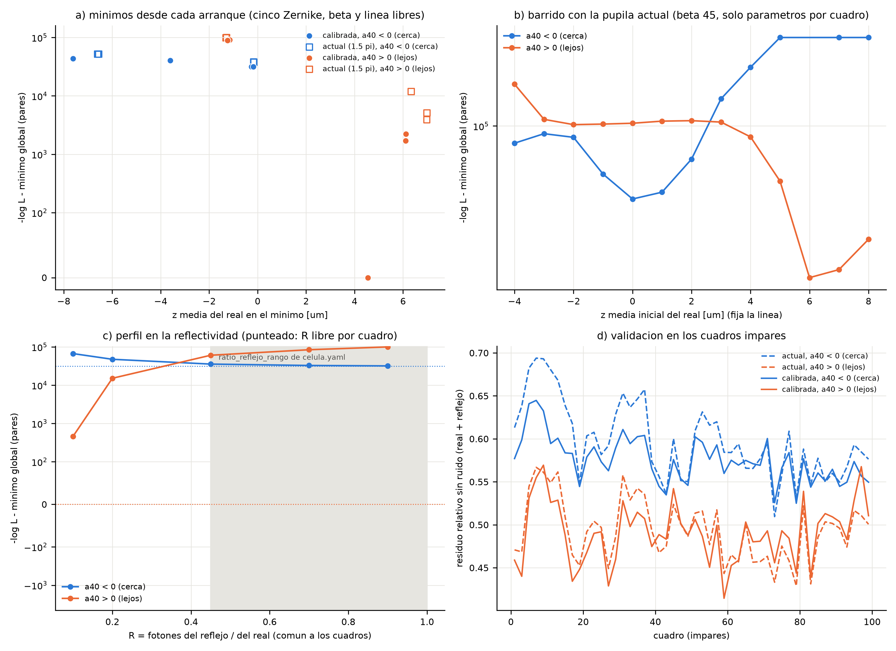
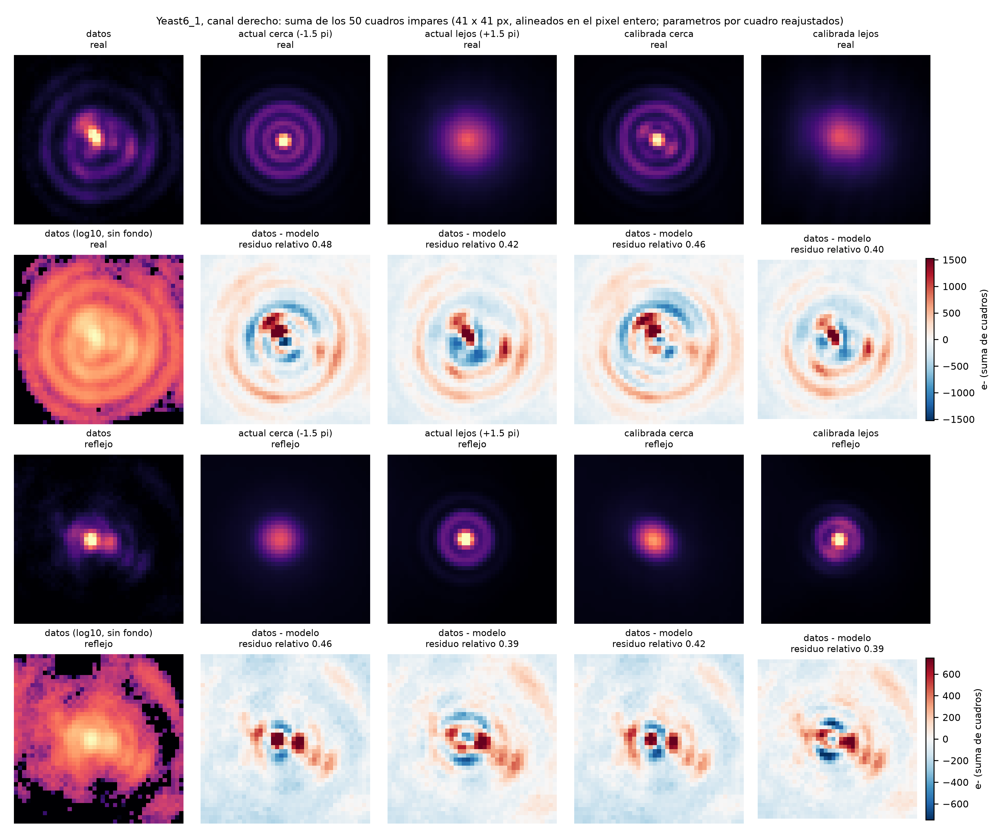
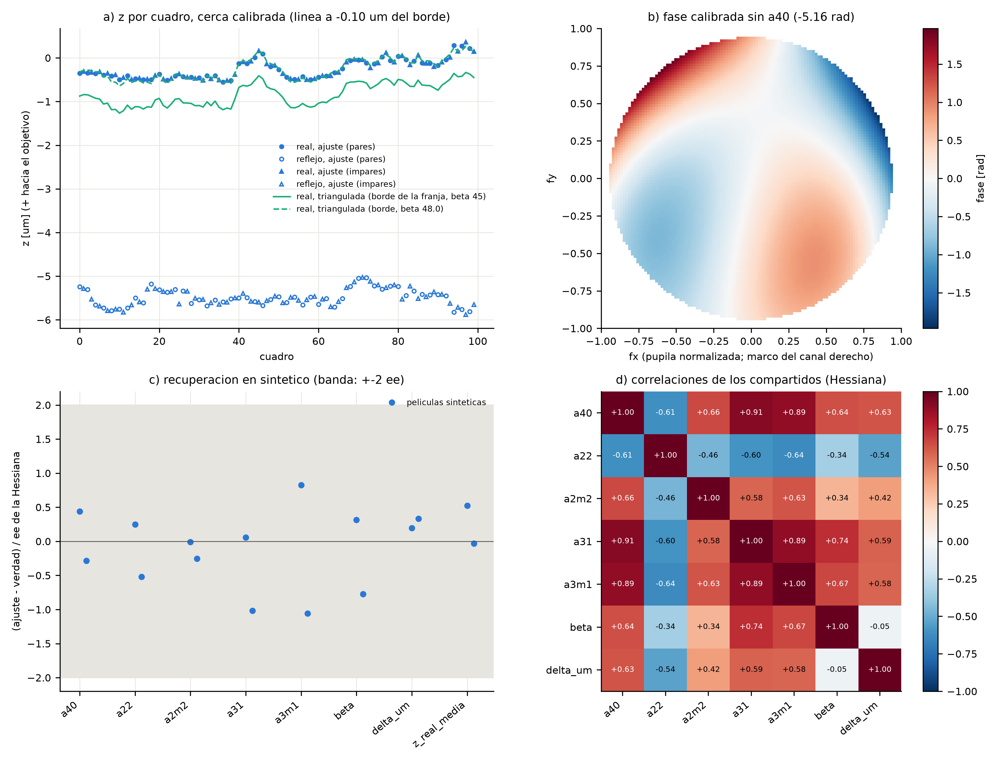
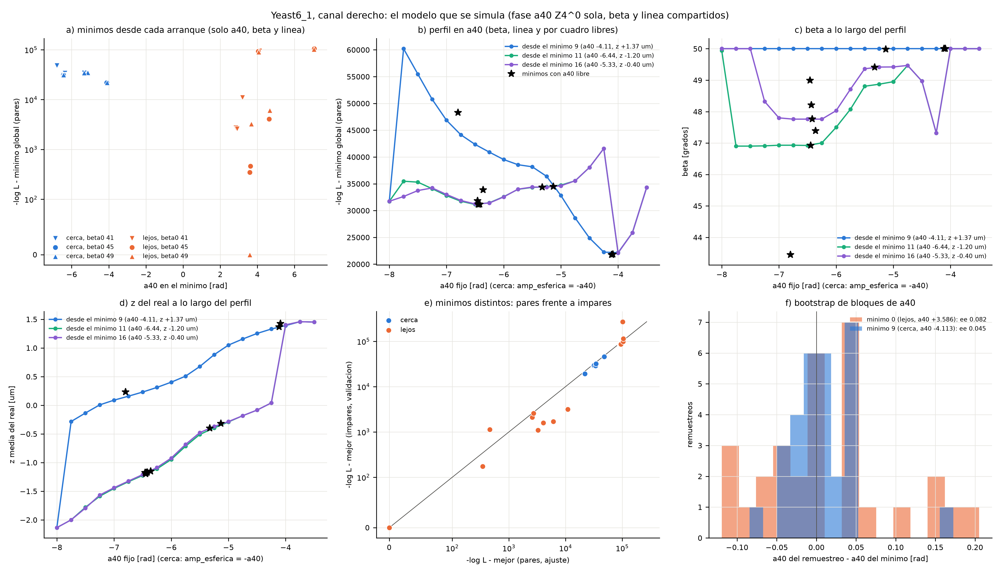

# Calibración de la pupila esférica con Yeast6_1 (canal derecho)

Continuación de `resultados_celula.md` (sección 4), `resultados_psf_real.md` y `resultados_suma_canales.md`. La pregunta es cuánto se acerca la PSF del simulador a la medida si solo se ajustan parámetros de la pupila que ya existe, sin cambiar de modelo. No interviene la red, no se reentrena nada y no se toca `configs/celula.yaml`.

```bash
PY=~/miniforge3/envs/tesis/bin/python
export LD_PRELOAD=$HOME/miniforge3/envs/tesis/lib/libstdc++.so.6
$PY figuras/calibracion_pupila.py --cache datos.npz                    # barrido, arranques, validacion, incertidumbre, sintetico (~4 h en la RTX 3060)
$PY figuras/calibracion_pupila.py --cache datos.npz --perfil-ratio 0.1 0.2 0.45 0.7 0.9   # seccion 3 (~20 min)
$PY figuras/calibracion_pupila.py --cache datos.npz --desde-arranques  # rehace 4-6 sin el barrido ni los arranques (~85 min)
$PY figuras/calibracion_pupila.py --cache datos.npz --solo-esferica    # seccion 7: solo a40, beta y linea (~3 h)
```

La sección 1 sale de la primera orden (barrido y arranques), la sección 3 de la segunda, las secciones 2, 4 y 5 de la tercera, que reutiliza las tablas de la primera, y la sección 7 de la cuarta. El script importa la detección de `figuras/analisis_datos_reales.py` y la óptica de `simulador_nuevo/simulador.py` (`Config`, `PSFRecortada` para la verificación) y `geometria_espejo.py`. Escribe:

- las tablas `figuras/calibracion_pupila/calibracion_pupila_*.csv` y `figuras/calibracion_pupila/calibracion_pupila.json`;
- cinco figuras PNG a 300 dpi:
  - `fig_calibracion_pupila_imagenes.png`: datos, modelos y residuos del real y del reflejo;
  - `fig_calibracion_pupila_signo.png`: la elección del signo;
  - `fig_calibracion_pupila_medidas_cerca.png` y `fig_calibracion_pupila_medidas_lejos.png`;
  - `fig_calibracion_pupila_esferica.png`: el modelo que se simula (sección 7).

## Resumen

**La sección 7 corrige la recomendación de cerca de esta tabla.** Con el modelo que se simula (a40 sola, sin astigmatismo ni coma) aparece una cuenca de cerca que las secciones 1–6 no exploraron: real a +1.4 µm, a40 = −4.11 y β en el borde de 50°. Es 9 351 mejor en log L que la rama de −6.40 y, con los cinco Zernike, 15 348 mejor que el mínimo de cerca de abajo. Las filas «β y desfase», «pupila calibrada (cerca)» y «valores para `celula.yaml`» describen ese mínimo anterior; la sección 7 da los nuevos valores y sus cautelas.

| pregunta | respuesta |
|---|---|
| ¿cuánto baja el residuo relativo? | **Poco.** En la imagen suma de los 50 cuadros impares (la medida comparable a la de `resultados_suma_canales.md`): real 0.48 → 0.46 y reflejo 0.46 → 0.42 con la variante cerca (la de entrenamiento); el mejor caso, lejos calibrada, da 0.40 / 0.39. Por cuadro, sin ruido: 0.61 → 0.59 en cerca. **Ningún ajuste baja de ~40 %.** Lo que queda son los lóbulos que dependen de la polarización (`resultados_psf_real.md`) y el fondo estructurado, que esta pupila escalar no puede producir |
| ¿qué signo de a40 gana? | **Sin restricciones gana lejos** (a40 > 0), por 31 500 en log L en los cuadros pares y 29 900 en los impares. Pero lo hace con un espejo que refleja el 10 % (fotones del reflejo / del real = 0.095), 47 000 fotones en el real (3 veces la fotometría) y la línea espejo/plano focal a 5.4 µm del borde de la franja. **Con la reflectividad en el rango calibrado por fotometría, [0.45, 1], gana cerca por 25 000 a 68 000** (sección 3). Cerca, con la reflectividad libre por cuadro, elige 0.90 ± 0.08 y pone la línea en el borde de la franja (−0.10 µm) sin que nada la empuje |
| β y desfase de la línea | **cerca: β = 48.0° (bootstrap 45.2–48.0°), línea a −0.10 µm del borde [−0.19, +0.25]**; real a z = −0.26 µm (−0.55 a +0.36 entre cuadros), reflejo a −5.5 µm. Es la triangulación de `resultados_celula.md` con β = 48° en lugar de 45°. Lejos: β = 44.2° [43.7, 45.5], línea a +5.40 µm [5.31, 5.49], real a +4.5 µm, reflejo a +0.17 µm |
| pupila calibrada (cerca) | a40 = −5.16 rad = **−1.64π** [−5.27, −4.93], astigmatismo de 1.33 rad (a22 −0.49, a2m2 −1.23) y coma de 0.86 rad (a31 −0.83, a3m1 +0.20), en el marco del canal derecho. Los IC son del bootstrap de bloques |
| ¿se recupera en sintético? | **Sí, todos.** En dos películas sintéticas por variante, con la misma geometría, fotones, fondo y cuadros, los siete compartidos y la z media se recuperan a ≤ 1.1 ee de la Hessiana en cerca y a ≤ 2.3 ee en lejos, y el signo de a40 se recupera siempre (el otro signo queda ≥ 55 000 peor). Con una partícula, todos los parámetros se pueden calibrar *si el modelo fuera el correcto* |
| incertidumbre | La del bootstrap de bloques es **4–16 veces** la de la Hessiana (2–9 veces si se escala por la sobredispersión, deviance/ν = 2.7–3.1). Domina el desajuste del modelo, no el ruido. Hay correlaciones fuertes: a40–a31 +0.9 (Hessiana y bootstrap), a40–a2m2 +0.86, a2m2–δ +0.91, β–δ −0.89 (bootstrap) en cerca |
| modelo que se simula (sección 7) | Solo a40, β y línea. Sin restricciones gana lejos (+3.59, reflejo con el 9 % de los fotones del real, el mismo modo de la sección 3). **En cerca gana a40 = −4.113 (bootstrap −4.169 a −4.030)**, con β en el borde de 50°, la línea a +1.52 µm del borde de la franja y el real a +1.37 µm. **El mínimo de −6.40 es real** (11 de 18 arranques, y reproducido con los cinco Zernike), pero queda 9 351 peor en los pares y 9 575 en los impares |
| valores para `celula.yaml` | **Superados por la sección 7** (`amp_esferica` ≈ 4.11, condicionado a β ≤ 50°). Los de las secciones 1–6: `anillos_hacia_objetivo: true` (cerca, como ya lanza `lanzar_espejo.sh cerca`), **`amp_esferica: 5.16`** (1.64π; hoy 1.5π), `espejo_angulo_eje_rango_deg`: el [40, 50] actual contiene el β medido (45–48°); se puede estrechar a [44, 50]. `ratio_reflejo_rango` [0.45, 1.0] se queda. **No** se recomienda agregar el astigmatismo ni la coma todavía (sección 6) |

## 0. Datos y modelo

**Datos.**

- Canal derecho de Yeast6_1 (columnas desde el corte de `analisis_datos_reales.py`), 100 cuadros, con el par real/reflejo detectado en todos.
- Los datos van en e⁻ = (ADU − nivel oscuro del cuadro) × 0.45, sin interpolar:
  - nivel oscuro: 97.73 ADU, media recortada fuera de las aperturas, por cuadro (como `psf_real.py`);
  - ruido de lectura: 2.17 ADU = 0.97 e⁻ (mediana de la varianza de las diferencias de cuadros / 2, fuera de las aperturas; el rms es 2.90 ADU).
- Por cuadro, una ventana de 112 × 112 px centrada en el punto medio del par. El ajuste usa dos discos de 22 px de radio alrededor del real y del reflejo detectados, dentro de la apertura: 3040 px por cuadro.
- Los cuadros pares (50) se ajustan y los impares (50) se reservan para la validación.

**Modelo.** Es la pupila de `simulador_nuevo` con sus valores por defecto: NA 1.1, n 1.333, 530 nm, 98.48 nm/px, M = 256, blur de 0.6 px e integración sobre el píxel. Lleva el recorte de pupila del espejo, el mismo para el real y el reflejo (`mascara_recorte`, espejo infinito), y la normalización de `PSFRecortada`. La fase es

  fase = a40·Z4⁰ + a22·Z2² + a2m2·Z2⁻² + a31·Z3¹ + a3m1·Z3⁻¹

con la normalización de `fase_esferica`: valor máximo 1 en el disco, así que a40 = 1.5π es la pupila actual. Detalles:

- Los términos usan Z2^±2 = ρ² cos/sin 2θ y Z3^±1 = (3ρ³ − 2ρ) cos/sin θ, con θ el azimut de (fx, fy) en el marco del canal derecho (x = columna − corte, y = fila).
- El desenfoque es el físico, q = −z (+z hacia el objetivo), con la máscara en +f.
- **El signo de a40 es la variante:** a40 > 0 equivale a `anillos_hacia_objetivo: false` (lejos) y a40 < 0 a `true` (cerca), con amp_esferica = |a40|. El simulador con `true` usa q = +z y la máscara en −f, que es la PSF de −a40 con q = −z reflejada r → −r. Por eso, en esa representación, a31 y a3m1 cambian de signo.
- **Verificación:** con a22 = … = 0 y la máscara binaria, el modelo en torch reproduce `PSFRecortada` a 8·10⁻¹⁶ del pico con los dos signos. El ajuste usa una máscara con borde en rampa de 1/4 de paso de la rejilla, para que sea continua en β. Esa rampa cambia la PSF en 0.9 % del pico, y la −log L en ≤ 15 unidades en los dos mínimos principales (≤ 190 en todos los arranques, `nll_mascara_binaria`), frente a diferencias de ≥ 1 700 entre mínimos.

**Geometría.** `GeometriaEspejo` con phi = −169.9° (dirección media reflejo → real, fija) y la línea espejo/plano focal en el borde de la franja (`perfil_franja`, a −32.0 px del punto medio), corrida δ a lo largo de m.

- **Parámetros compartidos:** los cinco Zernike, β ∈ [40, 50]° (β = 45 + 5·tanh u) y δ.
- **Por cuadro:** x e y del real; su distancia al espejo d; fotones del real; fotones del reflejo; fondo uniforme.
- **d en lugar de z:** z = (d − s cos β)/sin β, con s la coordenada a lo largo de m desde la línea. Con z libre por cuadro, δ sería una dirección plana del ajuste, porque correr la línea δ equivale a z → z + δ/tan β en todos los cuadros.
- **El reflejo sale de la geometría:** su posición lateral es p − 2d cos β·m y su z' = z − 2d sin β. La geometría se verifica contra `GeometriaEspejo.reflejar_nm` y `distancia_nm`.

**Verosimilitud.** Poisson con ruido de lectura gaussiano, en la aproximación de Poisson desplazada (d + σ² ~ Poisson(μ + σ²)). Se minimiza con L-BFGS en torch (float64, GPU) en tres etapas: primero fotones y fondo, después los parámetros por cuadro y al final todo.

## 1. Arranques y mínimos



**Barrido** (panel b; `calibracion_pupila_barrido.csv`). Con la pupila actual (±1.5π) y β = 45°, la línea se pone para que la z media del real sea z0 ∈ [−4, +8] µm, y se ajustan solo los parámetros por cuadro.

- **Perfiles:** el de cerca tiene su mínimo en z0 = 0 y otro local en −4 µm. El de lejos tiene su mínimo en +6 µm y otro, mucho peor, en −2 µm.
- **Arranques:** los dos mejores mínimos locales de cada signo, cada uno con β0 de 41, 45 y 49°. Son 12 ajustes con todo libre y 12 con la pupila actual (a40 = ±1.5π y sin otros términos; β y δ libres).
- **Atascos:** con cerca y z0 ≥ +5 µm, los fotones del real caen a ~0 y el ajuste se atasca. Un arranque de cerca en z0 = −4 µm terminó en NaN y se descartó.

**Mínimos distintos de la pupila calibrada** (cuadros pares; `calibracion_pupila_arranques.csv`):

| −log L − mínimo global | variante | a40 | β | δ | z real / z' | reflejo / real |
|---|---|---|---|---|---|---|
| 0 | lejos | +2.58 | 44.2° | +5.40 µm | +4.54 / +0.17 µm | 0.10 |
| 1 706 / 2 227 | lejos | +3.59 / +3.61 | 50.0° (borde) | +7.18 µm | +6.1 / +0.6 µm | 0.09 |
| **31 514** (×2) | **cerca** | **−5.16** | **48.0°** | **−0.10 µm** | **−0.26 / −5.49 µm** | **0.89** |
| 31 583 | cerca | −5.03 | 48.7° | −0.07 µm | −0.17 / −5.47 µm | 0.93 |
| 40 240 | cerca | −2.10 | 40.0° (borde) | −0.83 µm | −3.6 / −7.2 µm | 1.8 |
| 43 583 | cerca | −5.21 | 40.6° | −4.97 µm | −7.6 / −11.6 µm | 1.1 |
| 88 905–90 658 | lejos | +3.98 a +4.11 | 42.5–49.0° | −1.0 a −2.3 µm | −1.2 / −6.7 a −7.6 µm | 0.9–1.6 |

**Pupila actual** (a40 = ±1.5π, β y δ libres): cerca −log L −4 253 856 (β 49.5°, δ −0.14 µm, z −0.15 µm); lejos −4 287 617 (β 50.0°, en el borde; δ +8.23 µm, z +6.98 µm). La calibración mejora cerca en 6 159 y lejos en 3 913 unidades de log L.

El paisaje es multimodal en z (z, a40 y β se compensan). Desde β0 = 41 y z0 = −1 µm, la primera corrida exploratoria encontró en cerca un mínimo de −4 260 526 (a40 −6.40, β 46.9°, z −1.1 µm), 511 mejor que el de la tabla y que no aparece desde z0 = 0. Esa corrida usaba arranques en z0 = −1 y +6 µm y se reemplazó por la del barrido. Por lo tanto los mínimos de cerca no están agotados. Dentro de esa rama, z, a40 y β se mueven juntos (sección 4).

## 2. Imágenes



La figura suma los 50 cuadros impares, con los compartidos de cada ajuste y los parámetros por cuadro reajustados. Los recortes van alineados en el píxel entero del real y del reflejo de la cerca calibrada.

- **Real:**
  - las dos cerca tienen un núcleo compacto y anillos concéntricos, y la calibrada agrega dos manchas laterales débiles;
  - las dos lejos son un **disco difuso sin núcleo ni anillos**, el mismo modo de falla que `resultados_suma_canales.md` encontró con z libre («disco difuso a |z| ≈ 8–9 µm»);
  - ninguna reproduce el núcleo de dos lóbulos de los datos ni los anillos excéntricos.
- **Reflejo:** los datos tienen un núcleo compacto con dos lóbulos a lo largo de m. Cerca da una mancha compacta y lejos un núcleo con anillos (el reflejo casi en foco). Ninguna tiene los lóbulos.
- **Residuo relativo de la imagen suma** (disco de 22 px), real / reflejo:

  | | actual cerca | actual lejos | calibrada cerca | calibrada lejos |
  |---|---|---|---|---|
  | real | 0.48 | 0.42 | 0.46 | 0.40 |
  | reflejo | 0.46 | 0.39 | 0.42 | 0.39 |

## 3. ¿Qué signo? El perfil en la reflectividad

La −log L sin restricciones prefiere lejos por ~31 500, pero ese mínimo es físicamente raro:

- **Reflectividad:** los fotones del reflejo son 0.095 ± 0.011 los del real en todos los cuadros (0.07–0.11). En el simulador ese cociente es `ratio_reflejo`, la reflectividad del espejo. La calibración fotométrica de `resultados_recorte_pupila.md` y `resultados_psf_real.md` da 0.82–0.91 con cerca.
- **Fotones del real:** 47 000 e⁻ de media, frente a ~16 000 en cerca y a la fotometría de `resultados_psf_real.md` (24 000 en el disco de 2.5 µm de la imagen media).
- **Fondo:** baja de 8.2 a 6.2 e⁻/px. El disco difuso del real absorbe el halo y la autofluorescencia de la célula, que el fondo uniforme no modela.
- **Línea espejo/plano focal:** queda a 5.40 µm del borde de la franja, casi sobre la posición lateral del real. Cerca, con δ libre, la pone en el borde (−0.10 µm).

**Perfil.** Se fija el cociente de fotones del reflejo y del real en R para todos los cuadros (una sola reflectividad) y se reajusta todo lo demás desde el mejor arranque de cada signo (`calibracion_pupila_ratio.csv`, panel c):

| R | −log L cerca | −log L lejos | cerca − lejos (log L) | a40 / β / z real en cerca | a40 / β / z real en lejos |
|---|---|---|---|---|---|
| 0.1 | −4 224 749 | −4 291 067 | −66 318 | −8.72 / 40.3° / −2.6 µm | +2.60 / 44.2° / +4.5 µm |
| 0.2 | −4 244 122 | −4 276 376 | −32 255 | −8.79 / 40.0° / −2.5 µm | +4.02 / 42.9° / +5.4 µm |
| **0.45** | −4 256 005 | −4 231 065 | **+24 941** | −6.20 / 42.4° / −1.1 µm | +5.28 / 40.0° / +5.9 µm |
| **0.7** | −4 258 867 | −4 207 385 | **+51 482** | −5.40 / 47.3° / −0.36 µm | +11.1 / 40.0° / +11.1 µm |
| **0.9** | −4 259 666 | −4 191 839 | **+67 828** | −5.04 / 48.6° / −0.18 µm | +12.0 / 40.0° / +11.6 µm |
| libre por cuadro | −4 260 015 (R = 0.90) | −4 291 530 (R = 0.095) | −31 515 | −5.16 / 48.0° / −0.26 µm | +2.58 / 44.2° / +4.5 µm |

- **Lejos solo gana con R ≤ 0.2:** un espejo que pierde el 80–90 % de la luz. Con R ≥ 0.45 se va al borde de β (40°), y con R ≥ 0.7 a una a40 sin sentido (+11 rad).
- **Cerca casi no depende de R** en el rango calibrado: pierde 349 unidades de log L con R = 0.9 y 4 010 con R = 0.45.
- **Conclusión:** la ventaja de lejos sin restricciones viene de usar el real como un disco difuso que absorbe el fondo estructurado, a costa de un reflejo con el 10 % de los fotones. **Con una reflectividad física, la variante es cerca**, por 25 000 a 68 000 unidades de log L. Es la misma lectura que `resultados_celula.md` sacaba de la forma («favorece a cerca si el borde de la franja es la línea espejo/plano focal»). Ahora además el ajuste pone la línea en el borde por sí solo.
- Las Δ log L están infladas por la sobredispersión (deviance/ν ≈ 3). Escaladas, la ventaja de cerca con R ≥ 0.45 sigue siendo ≥ 8 000.

## 4. Parámetros calibrados e incertidumbre



**Cerca** (`calibracion_pupila_parametros_cerca.csv`; bootstrap de 30 remuestreos de bloques de 5 cuadros pares consecutivos):

| parámetro | valor | ee Hessiana | ee Hessiana × √(deviance/ν) | ee bootstrap | bootstrap 2.5–97.5 % |
|---|---|---|---|---|---|
| a40 | −5.159 rad (−1.642π) | 0.015 | 0.027 | 0.116 | −5.27 a −4.93 |
| a22 | −0.492 | 0.016 | 0.029 | 0.182 | −0.91 a −0.29 |
| a2m2 | −1.233 | 0.015 | 0.026 | 0.212 | −1.35 a −0.69 |
| a31 | −0.835 | 0.043 | 0.077 | 0.182 | −1.09 a −0.52 |
| a3m1 | +0.204 | 0.027 | 0.047 | 0.102 | −0.00 a +0.35 |
| β | 48.03° | 0.07° | 0.12° | 0.88° | 45.2 a 48.04° |
| δ (línea) | −0.105 µm | 0.011 | 0.020 | 0.128 | −0.19 a +0.25 µm |
| z media del real | −256 nm | 9 | 16 | 54 | −389 a −176 nm |

- **Por cuadro:**
  - el real va de −0.55 a +0.36 µm y el reflejo de −5.9 a −5.0 µm;
  - el real coincide con la triangulación desde el borde de la franja con β = 48° (−0.26 µm de media);
  - fotones del real: 16 200 de media (5 500–33 400, con el fotoblanqueo);
  - reflejo / real: 0.90 ± 0.08;
  - fondo: 8.2 e⁻/px.
- **Astigmatismo:** 1.33 rad, con eje a −56° en el marco del canal (−66° de m). **Coma:** 0.86 rad, hacia +166°.
- **β en el bootstrap:** 16 de los 30 remuestreos quedan en 48.038°, el valor del ajuste, y el resto solo baja, hasta 45.0°. La explicación probable es que la −log L tiene pequeños quiebres en β por la máscara discretizada (cada muestra del borde de la pupila que cambia de lado) y que el L-BFGS arrancado en el mínimo se queda en el quiebre. El intervalo de β es entonces unilateral: **β ≈ 45–48°**.
- **Correlaciones de los compartidos** (|r| ≥ 0.7, Hessiana / bootstrap; `calibracion_pupila_correlaciones_cerca.csv`):
  - a40–a31: +0.91 / +0.90;
  - a40–a3m1: +0.89 / +0.25;
  - a40–a2m2: +0.66 / +0.86;
  - a40–a22: −0.61 / −0.79;
  - a22–a2m2: −0.46 / −0.86;
  - a2m2–δ: +0.42 / +0.91;
  - β–δ: −0.05 / −0.89;
  - a31–a3m1: +0.89 / +0.45;
  - a31–β: +0.74 / −0.39.

  Con la z media del real, a40, a31 y a3m1 dan +0.87 a +0.89 (Hessiana). La esférica, la coma y la z absoluta se compensan, y el bootstrap mezcla esa compensación con β y δ, lo que explica las diferencias de signo entre los dos estimadores.

**Lejos**, para comparar (`calibracion_pupila_parametros_lejos.csv`, figura `fig_calibracion_pupila_medidas_lejos.png`):

| parámetro | a40 | a22 | a2m2 | a31 | a3m1 | β | δ | z real |
|---|---|---|---|---|---|---|---|---|
| valor | +2.576 (+0.82π) | +0.721 | +0.790 | −0.347 | −0.681 | 44.20° | +5.405 µm | +4544 nm |
| bootstrap 2.5–97.5 % | 2.36–2.78 | 0.38–0.87 | 0.54–0.91 | −0.57 a −0.14 | −0.84 a −0.44 | 43.7–45.5° | 5.31–5.49 | 4447–4631 |
| ee Hessiana / bootstrap | 0.007 / 0.107 | 0.018 / 0.139 | 0.016 / 0.107 | 0.015 / 0.116 | 0.011 / 0.113 | 0.04 / 0.43° | 0.004 / 0.049 | 4 / 52 |

En lejos las correlaciones fuertes son a40–β (−0.58 / −0.89), a3m1–δ (−0.51 / −0.89), a22–a2m2 (+0.43 / +0.87) y a31–β (−0.73 / −0.74).

## 5. Validación

**a. Recuperación en sintético** (`calibracion_pupila_sintetico_{cerca,lejos}.csv`, panel c de cada figura de medidas).

- **Cómo se genera:** con la pupila calibrada de cada variante, la geometría y los parámetros por cuadro ajustados en los 100 cuadros (pares e impares), Poisson + ruido de lectura de 0.97 e⁻, y cuantización a ADU.
- **Cómo se ajusta:** los cuadros pares, como los datos, desde el mejor arranque de cada signo (β0 = 45°).
- **Resultado:** dos películas por variante.

| | cerca | lejos |
|---|---|---|
| \|error\| / ee de la Hessiana, máximo | 1.06 (a3m1) | 2.32 (δ); 2.30 (a22) |
| error en a40 | +0.003 / −0.002 rad | −0.004 / −0.008 rad |
| error en β | +0.01 / −0.03° | −0.03 / −0.01° |
| error en δ | +2 / +3 nm | −6 / −3 nm |
| error en la z media | +1.6 / −0.1 nm | −5.3 / −3.1 nm |
| signo de a40 recuperado | 2 de 2; el otro, 58 000–59 000 peor | 2 de 2; el otro, 55 000 peor |

**Todos los parámetros se recuperan con una partícula** cuando el modelo es el correcto, el signo incluido. Los errores de lejos llegan a ~2.3 ee: la Hessiana subestima un poco, o queda un sesgo pequeño frente a la dispersión del bootstrap. El límite real no es la identificabilidad sino el desajuste del modelo con los datos: el bootstrap de los datos es 4–16 veces más ancho que la Hessiana.

**b. Cuadros impares** (`calibracion_pupila_validacion.csv`, `calibracion_pupila_residuos_impares.csv`). Con los compartidos de cada ajuste fijos, se reajustan solo los parámetros por cuadro de los 50 cuadros impares:

| | log L − mejor (impares) | ídem (pares) | deviance/ν | residuo sin ruido: real / reflejo / total | con ruido, total |
|---|---|---|---|---|---|
| actual cerca (−1.5π) | −35 701 | −37 673 | 3.18 | 0.624 / 0.569 / 0.613 | 0.651 |
| **calibrada cerca** | **−29 865** | −31 515 | 3.10 | **0.601 / 0.524 / 0.586** | 0.628 |
| actual lejos (+1.5π) | −4 030 | −3 913 | 2.76 | 0.517 / 0.441 / 0.501 | 0.549 |
| calibrada lejos | 0 | 0 | 2.71 | 0.497 / 0.460 / 0.489 | 0.539 |

- **La calibración se sostiene fuera de muestra.** En los impares, cerca mejora 5 836 en log L (6 159 en los pares) y lejos 4 030 (3 913).
- **Residuo** (‖datos − modelo‖ / ‖datos − fondo‖ en los discos, restando la varianza esperada): baja 0.03 en cerca y 0.01 en lejos. En lejos el reflejo empeora (0.44 → 0.46).
- El residuo por cuadro (panel d de la figura del signo) sigue el mismo orden en los 50 cuadros.

**c. Incertidumbre:** sección 4.

## 6. Valores recomendados para `configs/celula.yaml`

No se modifica el archivo. **Esta tabla queda superada por la sección 7**, porque su mínimo de cerca no era el mejor. Valores de las secciones 1–6, con la variante cerca:

| campo | hoy | recomendado | por qué |
|---|---|---|---|
| `anillos_hacia_objetivo` | `false` (el lanzador pone `true` para cerca) | `true` (cerca) | sección 3, condicionado a la reflectividad física; el z-stack de beads sigue siendo la prueba directa. CLAUDE.md pide no cambiar el valor por defecto hasta entonces, así que basta con seguir entrenando la variante cerca |
| `amp_esferica` | 4.712 (1.5π) | **5.16 (1.64π)**; bootstrap 4.93–5.27 | a40 calibrada. Depende algo de la reflectividad: 5.04 con R = 0.9 y 5.40 con R = 0.7 |
| `espejo_angulo_eje_rango_deg` | [40, 50] | [40, 50], o [44, 50] si se quiere estrechar | β medido 45–48°; con la pupila actual sale 49.5° |
| `angulo_espejo_eje_deg` (centro) | 45 | 47 | ídem |
| `ratio_reflejo_rango` | [0.45, 1.0] | sin cambio | R = 0.90 ± 0.08 por cuadro |
| `fotones_rango` | [1000, 30000] | sin cambio | real: 5 500–33 400 e⁻ en el canal derecho |
| `fondo_rango` | [5, 40] | sin cambio para este ajuste | fondo uniforme junto a la partícula: 8.2 e⁻/px; `resultados_psf_real.md` ya sugiere bajar el mínimo a ~1 lejos de la célula |
| astigmatismo y coma | no existen en `Config` | **no agregarlos todavía** | ver abajo |

**Por qué no el astigmatismo ni la coma:**

- **Haría falta otro modelo.** `simulador.Config` no tiene esos términos: agregarlos sería un campo nuevo, fuera de esta tarea. En la representación del simulador con `anillos_hacia_objetivo: true` serían a22 = −0.49, a2m2 = −1.23, a31 = +0.83 y a3m1 = −0.20 (los impares cambian de signo), en el marco de la cámara.
- **Pueden ser de la polarización y no del objetivo.** Los ajustes del canal derecho tienen que acomodar su núcleo de dos lóbulos, que **depende de la polarización**: en el canal izquierdo no aparece (`resultados_psf_real.md`). Un astigmatismo y una coma ajustados en un solo canal no se pueden atribuir al objetivo. La geometría no lo decide: el eje del astigmatismo (−56°) forma ~69° con el par de lóbulos del real (+55°), ni paralelo ni perpendicular, y en una PSF desenfocada esa relación depende del lado del foco.
- **Están mal determinados con estos datos:** el bootstrap de a2m2 va de −1.35 a −0.69 y el de a31 de −1.09 a −0.52, correlacionados con a40, β y la línea.
- **Alternativa mientras llega el z-stack de beads** (que medirá el patrón en los dos canales sin la partícula moviéndose): sortear un astigmatismo y una coma aleatorios de ~1 rad en el entrenamiento, como aumentación. Es un cambio en el simulador y no se hizo aquí.

## 7. Solo la esférica: el modelo que se simula

```bash
$PY figuras/calibracion_pupila.py --cache datos.npz --solo-esferica   # ~3 h en la RTX 3060
```

El ajuste usa la fase de `simulador_nuevo` sin términos extra, a40·Z4⁰ con a40 de signo libre (sin astigmatismo ni coma). β ∈ [40, 50]° y la línea δ son compartidos, y los parámetros por cuadro son los de antes: x, y, d, fotones del real, fotones del reflejo y fondo. Todo lo demás (datos, máscara en rampa, verosimilitud, cuadros pares para ajustar e impares para validar) es lo de la sección 0. Como antes, a40 < 0 es la variante cerca, con `amp_esferica` = −a40.

- **Arranques:** a40 = ±4.71, ±5.16 y ±6.40, cada uno con β0 de 41, 45 y 49°.
- **z inicial del real:** −1 y 0 µm con a40 < 0 (la zona del mínimo de −6.40 y el mínimo del barrido de cerca); +6 y −2 µm con a40 > 0 (los mínimos locales del barrido).
- **Total:** 36 ajustes.

**Salidas:**

- `calibracion_pupila_esferica_arranques.csv`: un ajuste por fila.
- `calibracion_pupila_esferica_minimos.csv`: los 28 mínimos distintos (misma −log L a menos de 2 y mismos a40, β y δ redondeados), con la −log L en los pares y en los impares. En los impares se reajustan solo los parámetros por cuadro.
- `calibracion_pupila_esferica_perfil.csv`: perfil en a40 de las ramas de cerca.
- `calibracion_pupila_esferica_cinco.csv`: la prueba con los cinco Zernike.
- `calibracion_pupila_esferica_bootstrap_{cerca,lejos}.csv` y `calibracion_pupila_esferica.json`.



### Mínimos

Mínimos representativos (−log L respecto del mejor; los demás están en el CSV):

| mínimo | variante | arranques que llegan | a40 | β | δ | z real / z' | log L − mejor (pares) | ídem (impares) | reflejo / real | N real | fondo |
|---|---|---|---|---|---|---|---|---|---|---|---|
| 0 | lejos | 1 (+4.71, 49°, +6 µm) | **+3.586** | 50.0° (borde) | +7.17 µm | +6.10 / +0.62 µm | **0** | **0** | 0.093 | 65 300 | 5.5 |
| 1–2, 5 | lejos | 3 | +3.59 a +3.67 | 49.4–50.0° | +7.09 a +7.16 µm | +6.1 / +0.6 a +0.7 µm | −345 a −3 246 | −174 a −1 128 | 0.09 | 64 000 | 5.5–5.7 |
| 3–4 | lejos | 2 (β0 41°) | +2.84 / +2.91 | 43.6 / 44.5° | +5.7 / +5.8 µm | +4.8 a +4.9 / +0.4 µm | −2 578 a −2 721 | −2 095 a −2 584 | 0.10 | 50 000 | 6.2 |
| 6–8 | lejos | 3 (+6.40) | +3.19 a +4.67 | 43.0–50.0° | +5.7 a +8.2 µm | +5.1 a +7.0 µm | −4 066 a −10 970 | −1 580 a −3 168 | 0.10–0.11 | 52 000–66 000 | 6.2–6.7 |
| **9** | **cerca** | 1 (−6.40, 45°, 0 µm) | **−4.113** | **50.0° (borde)** | **+1.52 µm** | **+1.37 / −4.17 µm** | **−21 776** | **−19 154** | **0.85** | 13 600 | 8.2 |
| 10 | cerca | 1 (−6.40, 49°, 0 µm) | −4.089 | 50.0° (borde) | +1.57 µm | +1.43 / −4.14 µm | −21 828 | −19 081 | 0.84 | 13 700 | 8.2 |
| 11–14 | cerca | **11** | **−6.42 a −6.46** | 46.9–49.0° | −0.77 a −1.24 µm | −1.17 a −1.20 / −6.2 a −6.5 µm | −31 127 a −31 832 | −28 696 a −29 269 | 0.68–0.76 | 19 000 | 8.4–8.6 |
| 15 | cerca | 1 | −6.360 | 47.4° | −0.83 µm | −1.15 / −6.22 µm | −33 877 | −28 741 | 0.69 | 18 600 | 8.7 |
| 16–17 | cerca | 3 | −5.33 / −5.13 | 49.4 / 50.0° | −0.44 / −0.46 µm | −0.40 a −0.32 / −5.8 µm | −34 358 a −34 491 | −31 678 a −31 782 | 0.92–0.99 | 16 400 | 8.3–8.4 |
| 18 | cerca | 1 (−6.40, 41°, 0 µm) | −6.799 | 43.5° | +1.35 µm | +0.23 / −4.14 µm | −48 269 | −45 526 | 0.41 | 18 900 | 8.6 |
| 19–27 | lejos | 9 (z0 −2 µm) | +4.03 a +7.06 | 48.0–50.0° | −7.3 a −1.2 µm | −2.9 a −0.7 µm | −89 660 a −104 480 | −86 199 a −269 884 | 0.02–1.4 | 11 000–22 000 | 10 |

Los 18 arranques de cerca caen en cuatro zonas de z del real: +1.4 µm (mínimos 9 y 10), −1.2 µm (11–15, 12 arranques), −0.3 a −0.4 µm (16–17) y +0.2 µm (18). Los mínimos 1–2 y 5 son el 0 con otro β; 11–14 y 9–10 también difieren solo en β y δ, con ≤ 705 en log L entre ellos. Son los quiebres de la máscara discretizada en β (sección 4): el L-BFGS se detiene en distintos quiebres de la misma cuenca. La −log L con la máscara binaria del simulador difiere de la de la rampa en ≤ 62 en los 28 mínimos, y en ≤ 31 en los mínimos 0 y 9.

### ¿Cuál gana?

- **Sin restricciones gana lejos** (mínimo 0), por 21 776 en log L en los pares y 19 154 en los impares. Es el mismo modo de la sección 3: el reflejo con el 9 % de los fotones del real, el real con 65 000 fotones (4.8 veces los de cerca) y difuso a +6.1 µm, y el fondo bajo (5.5 frente a 8.2 e⁻/px). Con la esférica sola no se repitió el perfil en la reflectividad. Con los cinco Zernike, ese perfil daba la ventaja a cerca en cuanto R ≥ 0.45.
- **En la variante cerca gana el mínimo 9:** a40 = −4.113, β en el borde de 50°, la línea a +1.52 µm del borde de la franja, el real a +1.37 µm (hacia el objetivo) y el reflejo a −4.17 µm. La reflectividad le sale física sin pedirla: 0.85 en los pares y 0.85 en los impares. Le gana a la rama de −6.4 por 9 351 en log L en los pares y 9 575 en los impares, así que la ventaja se sostiene fuera de muestra. Con la sobredispersión (deviance/ν = 3.04) eso equivale a ~3 100. En los impares el mínimo 10, de la misma cuenca, queda 73 por encima del 9: dentro del ruido de los quiebres.

### ¿Es real el mínimo de 6.40?

**Sí, es un mínimo local real, pero no es el de cerca.**

- **Reproducibilidad:** con la esférica sola, 11 de los 18 arranques de cerca caen en él (a40 −6.42 a −6.46, z −1.2 µm); un duodécimo, el mínimo 15, se detuvo 2 750 más arriba en la misma cuenca. Con los cinco Zernike, el arranque de la corrida exploratoria (a40 −1.5π, β0 41°, z0 −1 µm) da otra vez −4 260 526.38 (a40 −6.399, β 46.91°, z −1.13 µm). La corrida exploratoria queda reproducida al centésimo.
- **Perfil en a40** (panel b, continuación desde los mínimos 9, 11 y 16). En la rama de z ≈ −1.2 µm, la −log L tiene un mínimo en a40 ≈ −6.45 y sube hacia los dos lados:
  - hacia −7.25 sube 3 000;
  - hacia −5.25, donde el real sube a −0.4 µm, sube 3 300;
  - con a40 ≥ −4.0, la continuación salta a la rama de z ≈ +1.4 µm.

  Los mínimos 16–17 (a40 ≈ −5.1 a −5.3, la zona del mínimo de cerca de las secciones 1–6) son bolsillos de < 100 unidades sobre esa misma ladera, y no tienen cuenca propia.
- **Envolvente del perfil** (el mejor de las tres ramas en cada a40), respecto del mínimo 9:

  | a40 | −3.50 | −3.75 | −4.00 | −4.25 | −4.50 | −4.75 | −5.00 | −5.50 | −6.00 | −6.50 | −7.00 | −7.50 | −8.00 |
  |---|---|---|---|---|---|---|---|---|---|---|---|---|---|
  | −log L − mínimo 9 | 12 561 | 4 088 | 335 | 473 | 3 108 | 6 842 | 11 043 | 12 558 | 10 773 | 9 377 | 11 019 | 11 965 | 9 951 |
  | z real [µm] | +1.45 | +1.46 | +1.40 | +1.33 | +1.25 | +1.16 | +1.05 | −0.51 | −0.92 | −1.22 | −1.45 | −1.79 | −2.14 |

  La z del real es la que separa las dos cuencas, con el real 1.4 µm por encima o 1.2 µm por debajo del foco. Con a40 = −8 aparece otra rama más, con el real a −2.1 µm y β en 50°, ~10 000 peor; la grilla no sigue más allá.

### Los cinco Zernike desde el nuevo mínimo

Desde el mínimo 9, liberando los cinco Zernike, el ajuste llega a **−4 275 363**:

- a40 −4.268, a22 −0.832, a2m2 +0.633, a31 −1.012, a3m1 +0.239;
- β 50.0° (borde), δ +1.22 µm, z real +1.25 µm.

Es 15 348 mejor que el mínimo de cerca de las secciones 1–6 (−4 260 015, a40 −5.16) y 14 837 mejor que el de −6.40. **El mínimo de cerca de las secciones 1–6 no era el mejor de cerca:** esa búsqueda no exploró la rama con el real por encima del foco y β en el borde. Lejos con los cinco Zernike (−4 291 530) sigue 16 167 por delante sin restricciones, con el mismo modo de reflectividad baja. Esta comparación es solo en los pares, y el astigmatismo de este mínimo (a2m2 cambió de signo) no tiene validación ni bootstrap.

### Incertidumbre de a40 (bootstrap de bloques)

Treinta remuestreos de bloques de 5 cuadros pares consecutivos, desde cada mínimo, con a40, β, δ y los parámetros por cuadro libres:

| | valor | ee Hessiana | ee Hessiana × √(deviance/ν) | ee bootstrap | bootstrap 2.5–97.5 % | mediana |
|---|---|---|---|---|---|---|
| **a40, cerca (mínimo 9)** | **−4.113 rad (−1.309π)** | 0.0042 | 0.0074 | **0.045** | **−4.169 a −4.030** | −4.103 |
| δ, cerca | +1.523 µm | 0.0038 | 0.0066 | 0.091 | +1.437 a +1.759 | +1.510 |
| z media del real, cerca | +1 367 nm | 3 | 5 | 51 | +1 313 a +1 482 | +1 385 |
| a40, lejos (mínimo 0) | +3.586 rad | 0.0054 | 0.0090 | 0.082 | +3.481 a +3.764 | +3.594 |

- **β:** en los 30 remuestreos de cada mínimo queda en 50°, el borde, así que no tiene intervalo.
- **Bootstrap frente a Hessiana:** el ee del bootstrap es ~11 veces el de la Hessiana en cerca y ~15 en lejos. La sobredispersión explica un factor de ~1.7; el resto es desajuste del modelo, como en la sección 4.
- **Rango del intervalo de a40 en cerca:** la mitad que el de la calibración con los cinco Zernike (4.93–5.27), porque con la esférica sola nada compensa a40.

### Qué cambia para `celula.yaml`

No se modifica el archivo. Con el modelo que se simula y la variante cerca, el mejor ajuste da **`amp_esferica` ≈ 4.11 (1.31π; bootstrap 4.03–4.17)**, por debajo de la actual 1.5π (4.71), con β = 50° y el real a +1.4 µm. Eso **reemplaza la recomendación de 5.16 de la sección 6**, que venía de un mínimo de cerca que no era el mejor. Tres cautelas antes de usarlo:

- **β está en el borde de 50°** en el ganador de cerca (y en el de lejos), en el ajuste y en todo el bootstrap. La cota se activa: el ajuste quiere β ≥ 50°, y a40, δ y z están condicionados a β ≤ 50°. Hay que repetir con una cota más ancha (`BETA_H` en el script) antes de fijar β. La geometría de `resultados_datos_reales.md` midió β ≈ 45°.
- **La línea ya no queda en el borde de la franja:** se corre +1.52 µm (15 px). La lectura de la sección 3, que decía que cerca ponía la línea en el borde por sí sola, valía para el mínimo de las secciones 1–6, no para este.
- **Dos cuencas de cerca:** separadas por la z del real (+1.4 frente a −1.2 µm), con a40 −4.1 y −6.4. La diferencia de log L es grande (9 351 en pares y 9 575 en impares, ~3 100 con la sobredispersión), pero una sola partícula no tiene cómo comprobar de qué lado del foco está. El z-stack de beads, con z conocida, lo decide.

## Supuestos y limitaciones

- **Una sola partícula, un canal.** La pupila calibrada es la del canal derecho, con su polarización. Su núcleo de dos lóbulos no es escalar (`resultados_psf_real.md`), y ningún ajuste de esta pupila lo reproduce: el residuo no baja de ~40 % en la imagen suma ni de ~0.5 por cuadro.
- **Fondo uniforme por cuadro.** La autofluorescencia de la célula, el halo y la franja del espejo no están modelados. Esto es lo que permite el mínimo de lejos con el real difuso (sección 3).
- **Sin recorte de energía en la ventana.** La PSF se calcula entera (M = 256) y se recorta a la ventana sin renormalizar, así que los fotones son totales, comparables con `fotones_rango`.
- **El blur no se ajusta:** blur_extra_px = 0.6 queda fijo, porque no es un parámetro de la pupila.
- **Paisaje multimodal en z.** En cerca hay al menos dos cuencas, con el real a +1.4 µm y a −1.2 µm (sección 7). La de −1.2 µm es la del mínimo de −6.40. Las secciones 1–6 no encontraron la mejor. El bootstrap arranca en un mínimo y no explora los otros.
- **β en el borde de 50°** en los ganadores de la sección 7: la cota [40, 50] se activa y no se probó una más ancha.
- **β tiene quiebres** por la discretización de la máscara del espejo, así que su intervalo es unilateral (sección 4).
- **Sobredispersión:** deviance/ν = 2.7 (lejos) y 3.1 (cerca). Las Δ log L ordenan hipótesis pero no son probabilidades. La sección 3 da la ventaja de cerca también escalada.
- **El ruido de lectura es la mediana de los píxeles** (0.97 e⁻). Los píxeles ruidosos del sCMOS dentro de los discos no se excluyen.
- **phi queda fija** en la dirección media reflejo → real (−169.9°). El borde de la franja forma ~6.5° con t (`resultados_datos_reales.md`), y esa inclinación no se modela.
