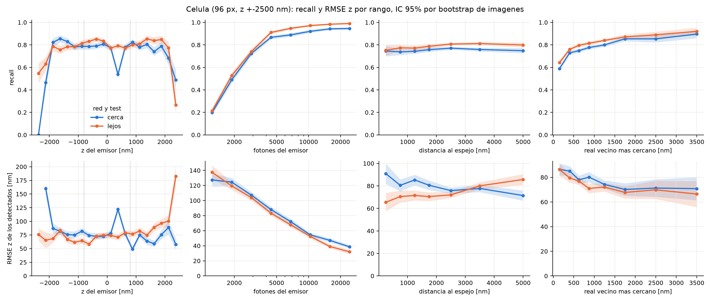
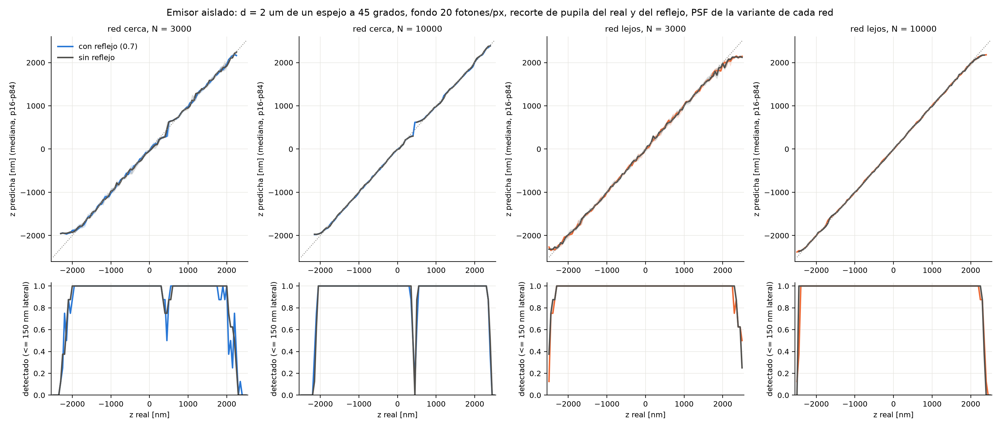
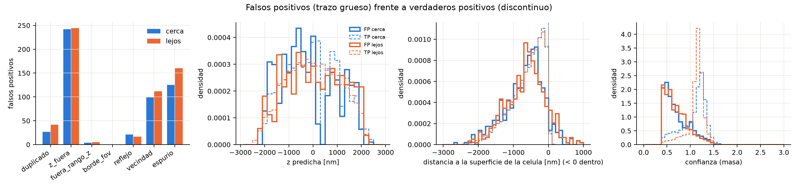
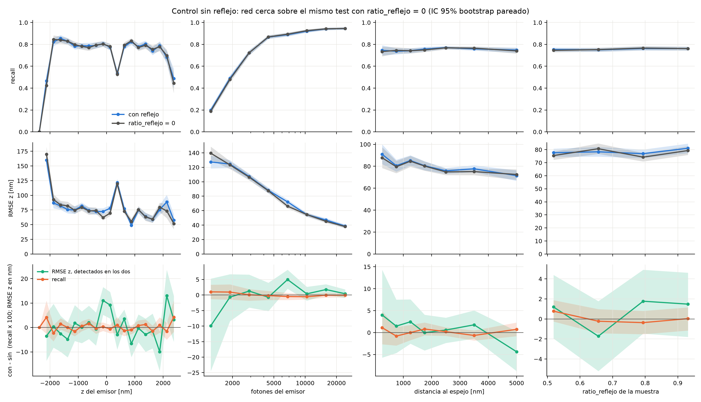
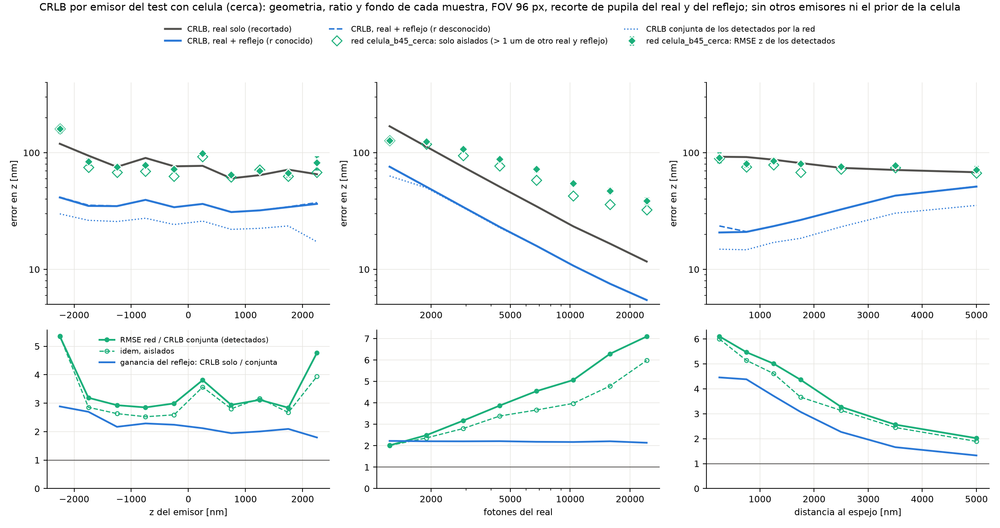
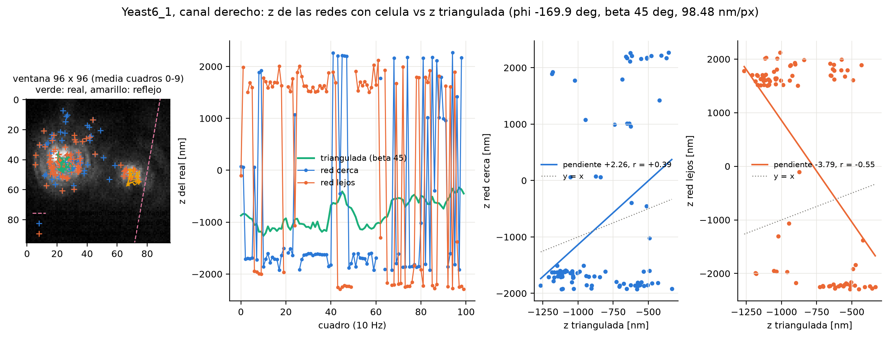
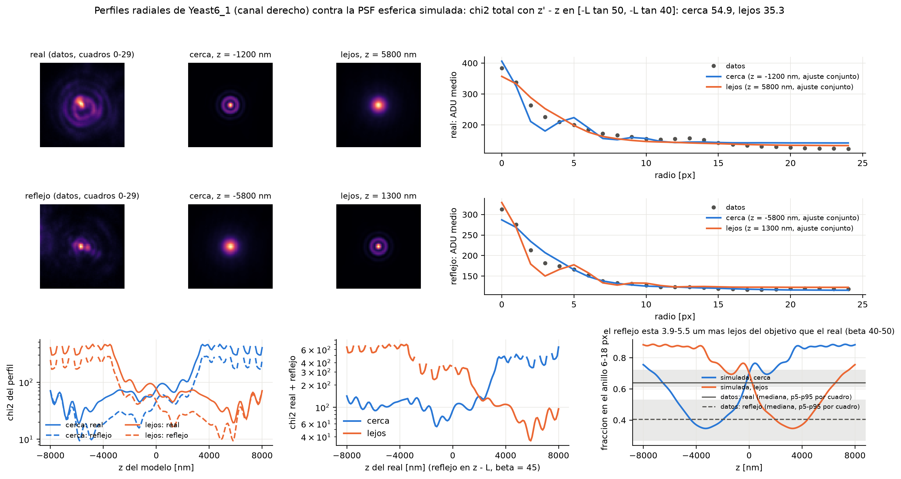

# Corridas con célula: diagnóstico, control sin reflejo, CRLB y datos reales

Corridas `hypatia_celula_b45_cerca_20261110-234627` (la principal) y `hypatia_celula_b45_lejos_20261110-234617`, entrenadas con `localizacion/configs/celula.yaml` (96 px, z ±2500 nm, célula de 4–6 µm tangente al espejo, β ∈ [40, 50]°, `ratio_reflejo` ∈ [0.45, 1.0], recorte de pupila del real y del reflejo, canal de distancia al espejo). Cada una se evalúa sobre su test (`localizacion/datos/test_celula_b45_<variante>`, 2000 imágenes, semilla 3). Los dos tests tienen exactamente los mismos emisores (posiciones, fotones, fondo y geometría); solo cambia la PSF. «cerca» y «lejos» son `anillos_hacia_objetivo` True y False. Convención: +z hacia el objetivo; el reflejo siempre está más lejos del objetivo que el real (z' − z = −2 d sin β).

Todas las cifras salen de:

```bash
PY=~/miniforge3/envs/tesis/bin/python
export LD_PRELOAD=$HOME/miniforge3/envs/tesis/lib/libstdc++.so.6        # para los que corren la red en la GPU
C=localizacion/corridas/hypatia_celula_b45_cerca_20261110-234627
# control: el mismo test con ratio_reflejo = 0, y las dos evaluaciones en la misma maquina
$PY localizacion/generar_espejo.py --config localizacion/configs/celula.yaml --anillos-hacia-objetivo --split test --n 2000 \
    --salida localizacion/datos/test_celula_b45_cerca_sin_reflejo --set "datos.ratio_reflejo_rango=[0.0, 0.0]"   # ~70 s
$PY localizacion/evaluate.py $C/mejor.pt localizacion/datos/test_celula_b45_cerca_sin_reflejo --figuras 6
$PY localizacion/evaluate.py $C/mejor.pt localizacion/datos/test_celula_b45_cerca --salida $C/evaluacion_local_test_celula_b45_cerca --figuras 0
# 1 y 2 (solo lee las evaluaciones; ~1 min)
$PY figuras/diagnostico_celula.py --control $C/evaluacion_local_test_celula_b45_cerca $C/evaluacion_test_celula_b45_cerca_sin_reflejo
# 3 (~5 min por variante con 14 procesos)
$PY figuras/crlb_espejo.py --celula --procesos 14
# informacion de Fisher en z (sin red, segundos), curva de transferencia (~10 min) y datos reales (~2 min)
$PY figuras/red_celula.py fisher
$PY figuras/red_celula.py transferencia
$PY figuras/red_celula.py reales
```

La parte 1 usa las evaluaciones de Hypatia (`evaluacion_test_celula_b45_<variante>`, las de las cifras del enunciado). La evaluación local del test de cerca da lo mismo (TP 9799 frente a 9800, el mismo RMSE). Los IC son al 95 %, por bootstrap de imágenes (2000 remuestreos), porque los emisores de una imagen no son independientes.

## Resumen

| | resultado |
|---|---|
| recall y RMSE z por z (cerca) | Hay dos agujeros. Recall **0** en z < −2250 nm (126 emisores) y 0.47 en [−2250, −2000]: la red nunca predice z < −1982 nm. Recall 0.54 y RMSE z 122 nm en z ∈ [250, 500] nm: la red no predice nada entre 300 y 600 nm. Lejos tiene un solo agujero, en el otro extremo: recall 0.27 y RMSE 183 nm en [2250, 2500], porque no predice z > 2180 nm |
| \|z\| > 800 nm | No es peor que el centro. Cerca: recall 0.746 / 0.799 / 0.694 y RMSE z 82 / 71 / 86 nm en \|z\| ≤ 800 / 800–1600 / > 1600. Lo malo está solo en los bordes de la célula (\|z\| > 2 µm) y en el agujero de +400 nm |
| origen de los agujeros | La red. Una curva de transferencia con emisores aislados los reproduce con y sin reflejo, mientras que la información de Fisher en z es suave en todo el rango (17–40 nm a 10⁴ fotones) y simétrica entre variantes: PSF_cerca(z) = PSF_lejos(−z). Las dos redes fallan del lado compacto de su PSF a \|z\| > 2 µm, y solo cerca tiene el agujero en +400 nm |
| fotones y vecinos | El recall va de 0.20 a 0.95 entre 1000 y 30000 fotones, y de 0.59 a 0.90 según el vecino más cercano esté a < 300 nm o a > 3 µm. El 72 % de los FN tienen < 3000 fotones y el 38 % tienen un real a < 500 nm. Con > 9000 fotones y \|z\| ≤ 800 nm, cerca pierde el 8 % y lejos el 0.7 % |
| distancia al espejo | El recall es plano (0.74–0.77). El RMSE z de cerca sube cerca del espejo (91 nm a d < 0.5 µm frente a 71 nm a 4–6 µm); el de lejos hace lo contrario (65 frente a 86 nm) |
| 518 FP de cerca | 242 son el mismo emisor con \|dz\| > 300 nm (mediana 449 nm), 125 espurios, 99 a 150–450 nm lateral de un real, 27 duplicados (dz mediana 1.8 µm), 21 sobre reflejos y 4 sobre emisores fuera de `en_rango_z`. El 93 % cae dentro de la célula y no hay concentración en el borde. Su confianza mediana es 0.63 (TP: 1.16), pero subir el umbral empeora el Jaccard |
| control sin reflejo | **La red no usa el reflejo para z.** Con − sin, sobre los mismos emisores: RMSE z +0.7 nm [−0.8, +2.3], recall +0.07 puntos [−0.5, +0.6], sin dependencia del ratio, de los fotones ni de la distancia al espejo. En \|z\| ≤ 800 nm el reflejo incluso empeora el RMSE z (+3.5 nm [+1.2, +5.8]). Con reflejo hay 118 FP más (517 frente a 399), 43 de ellos a < 1 µm de un reflejo |
| CRLB (cerca, test real, por emisor) | Real solo (recortado): 78 nm RMS. Real + reflejo: 35 nm, una ganancia de 2.2×, de 4.4× a d < 1 µm. Sobre los detectados: 54 nm solo y 25 nm conjunta, frente a 78.5 nm de la red (73 nm los aislados). La red está **3.2× por encima de la cota conjunta y 1.5× por encima de la del real solo**, con un piso de ~35–40 nm en z a muchos fotones, donde la cota es 5–12 nm. En lejos el reflejo da menos información (ganancia 1.5×: 78 → 51 nm) |
| datos reales, red | **No confirma ninguna variante.** Las dos redes alternan entre dos modos en los extremos opuestos del rango: cerca −1.7 µm (73 % de los cuadros) y +1.9 µm; lejos +1.7 µm (61 %) y −2.2 µm. Ponen ~7 detecciones más por cuadro sobre los anillos. Dentro del modo dominante, cerca no sigue a la z triangulada (corr +0.05 [−0.47, +0.37]); lejos casi no (corr +0.32, pendiente 0.23). Las correlaciones globales (+0.39 y −0.55) salen de los saltos de modo, no del seguimiento |
| datos reales, forma de la PSF | **No decide por sí sola; con la z absoluta favorece a cerca.** El real tiene mucho más anillo que el reflejo: fracción de la señal en 6–18 px de 0.64 [p5–p95 por cuadro: 0.61–0.72] frente a 0.41 [0.27–0.53]. Las dos variantes lo reproducen (desajuste 0.009 y 0.002; χ² del perfil radial 55 y 35), pero en ramas opuestas. Cerca pone el real a z ≈ −1.2…−0.2 µm y el reflejo a ≈ −5.8 µm, compatible con la z triangulada si el borde de la franja es la línea espejo/plano focal (−1.8…+0.1 µm con β 40–50°). Lejos exige el real a ≈ +5.8…6.5 µm y el reflejo a +1.3 µm, los dos por encima del foco, con la línea a ~6.8 µm del borde de la franja |

## 1. Diagnóstico de las corridas



### Por z

Recall y RMSE z por rangos de 250 nm (`figuras/diag_celula_rangos.csv`, tabla `z`):

| z [nm] | n | recall cerca | RMSE z cerca | sesgo z cerca | recall lejos | RMSE z lejos | sesgo z lejos |
|---|---|---|---|---|---|---|---|
| [−2500, −2250) | 126 | **0** | — | — | 0.55 | 76 | +59 |
| [−2250, −2000) | 217 | 0.47 | 160 | +149 | 0.63 | 65 | +16 |
| [−2000, −1750) | 389 | 0.82 | 87 | +37 | 0.79 | 69 | −16 |
| [−750, −500) | 912 | 0.79 | 74 | −4 | 0.83 | 58 | +6 |
| [0, 250) | 960 | 0.77 | 78 | −30 | 0.77 | 74 | −4 |
| [250, 500) | 995 | **0.54** | **122** | −26 | 0.79 | 71 | −5 |
| [500, 750) | 911 | 0.78 | 77 | +52 | 0.77 | 79 | −5 |
| [750, 1000) | 848 | 0.82 | 49 | −3 | 0.80 | 77 | −2 |
| [2000, 2250) | 255 | 0.68 | 89 | −30 | 0.77 | 101 | −67 |
| [2250, 2500) | 117 | 0.49 | 58 | −40 | **0.27** | **183** | −173 |

| \|z\| [nm] | n | recall cerca | RMSE z cerca | recall lejos | RMSE z lejos |
|---|---|---|---|---|---|
| ≤ 800 | 6024 | 0.746 [0.734, 0.758] | 81.6 [79.1, 84.0] | 0.808 [0.797, 0.819] | 71.8 [69.4, 74.2] |
| 800–1600 | 4786 | 0.799 [0.786, 0.812] | 71.3 [68.6, 73.8] | 0.803 [0.791, 0.816] | 72.1 [69.6, 74.6] |
| > 1600 | 2133 | 0.694 [0.672, 0.715] | 86.2 [82.1, 90.2] | 0.746 [0.727, 0.766] | 89.7 [86.0, 93.5] |

- **|z| > 800 nm no es el problema.** Entre 800 y 1600 nm, cerca rinde mejor que en el centro. La pérdida a |z| > 1600 nm se concentra en los últimos ~400 nm de un extremo: el de abajo en cerca, el de arriba en lejos.
- Con > 9000 fotones (tabla `z_abs_fotones`), en |z| ≤ 800 nm cerca detecta el 91.7 % y lejos el 99.3 %; en 800–1600 nm, el 99.0 % y el 99.0 %. La diferencia global de recall entre las dos redes (0.757 frente a 0.796) sale casi entera de los dos agujeros de cerca.
- Si se empareja solo en lateral (≤ 150 nm, sin tolerancia en z), el 2.5 % de los emparejados de cada red tiene |dz| > 300 nm. Cerca **nunca predice z < −1982 nm** (lejos llega a −2382) y no predice z entre ~300 y ~600 nm. A los emisores con z ∈ [375, 500) les asigna una mediana de 621 nm, y la mitad no se detecta ni lateralmente. Lejos nunca predice z > 2181 nm.

**Curva de transferencia** (`figuras/fig_red_celula_transferencia.png`): un emisor aislado por imagen a d = 2 µm de un espejo a 45°, con fondo de 20 fotones/px, 8 repeticiones por z, recorte de pupila y la PSF de la variante de cada red.



| | cerca, N = 10⁴ | lejos, N = 10⁴ |
|---|---|---|
| detectado en z ≤ −2200 nm | 0 (también con N = 3000 desde −2350) | 1.00 |
| z predicha en z = −2100 / −2000 nm | −1976 / −1948 | −2107 / −1999 |
| z ∈ [400, 450] nm | detectado 0.12–0.50; predice exactamente 300.0 nm (un plano de la rejilla) o 618 nm | sin problema |
| detectado en z = 2400 / 2500 nm | 0.38 / 0 | 0.12 / 0 (predice ≤ 2180) |
| RMSE z en [−2000, 2000], con / sin reflejo | 39 / 35 nm | 25 / 26 nm |

Los dos defectos de cerca aparecen igual con y sin reflejo (ratio 0.7 o 0), así que no dependen de él. La información de Fisher en z de un emisor solo (N = 10⁴, b = 20) no tiene ningún pico en +400 nm: √(1/I_zz) vale 15–19 nm en [0, 600] nm, y 30–40 nm en z < −2 µm, que es peor pero finito. Además es simétrica entre variantes: `fisher_cerca(z) = fisher_lejos(−z)` con diferencia relativa ≤ 2·10⁻⁵ (`$PY figuras/red_celula.py fisher` → `figuras/red_celula_fisher_z.csv`). Los agujeros los aprendió la red; la física no los impone:

- El tope de |z| ≈ 2 µm cae, en las dos redes, del lado compacto (sin anillos) de su PSF: z < 0 en cerca, z > 0 en lejos. Ahí la PSF casi no cambia de forma (pico ~15·10⁻³ de −2.5 a −1.9 µm en cerca) y la célula da muy pocos emisores de entrenamiento: la densidad uniforme en volumen cae como R² − z² hacia los polos. La red aprende a no ir más allá.
- El agujero de +400 nm solo existe en cerca y no tiene contraparte en lejos (−400 nm). Es una discontinuidad aprendida en la asignación de z: los emisores quedan en el plano de 300 nm o saltan a 620 nm, y la mitad cae bajo el umbral. Para saber si es estable, convendría compararlo con `ultimo.pt` o con otra semilla de entrenamiento. Este análisis no lo hace.

### Por fotones, distancia al espejo y vecinos

| | cerca | lejos |
|---|---|---|
| recall, 1000–1530 → 19600–30000 fotones | 0.20 → 0.945 | 0.21 → 0.990 |
| RMSE z, mismos rangos | 127 → 39 nm | 137 → 32 nm |
| recall por d al espejo (0–0.5 … 4–6 µm) | 0.75, 0.74, 0.74, 0.76, 0.77, 0.76, 0.75 | 0.75, 0.77, 0.77, 0.79, 0.81, 0.81, 0.80 |
| RMSE z por d (0–0.5 → 4–6 µm) | 91 [83, 99] → 71 [67, 76] nm | 65 [57, 74] → 86 [81, 91] nm |
| recall con un real a < 300 nm / > 3 µm | 0.59 / 0.90 | 0.64 / 0.92 |
| recall con el reflejo de otro emisor a < 300 nm / > 3 µm | 0.67 / 0.79 | 0.76 / 0.83 |
| recall por profundidad en la célula | plano (0.74–0.78) | plano (0.79–0.81) |

- De los 3143 FN de cerca, 2261 (72 %) tienen < 3000 fotones y 1190 (38 %) tienen otro real a < 500 nm. La célula concentra 1–12 emisores en un disco de ~50 px, así que la superposición pesa bastante: hay 1480 emisores evaluables con un vecino a < 300 nm.
- La distancia al espejo casi no cambia el recall. El RMSE z de cerca empeora cerca del espejo (+20 nm a d < 0.5 µm), justo donde el reflejo daría más información (sección 3) y donde real y reflejo se superponen.

### Falsos positivos



Clase de cada FP, la primera que cumple, a ≤ 150 nm lateral (`figuras/diag_celula_fp.csv`):

| clase | cerca | lejos |
|---|---|---|
| `z_fuera`: el mismo emisor evaluable, no detectado, con \|dz\| > 300 nm | 242 (\|dz\| mediana 449 nm) | 244 (491 nm) |
| `espurio`: nada a < 450 nm | 125 | 160 |
| `vecindad`: un real a 150–450 nm | 99 | 112 |
| `duplicado`: un emisor ya detectado (segunda detección, dz mediana) | 27 (1762 nm) | 42 (2075 nm) |
| `reflejo` | 21 | 17 |
| `fuera_rango_z`: emisor en el FOV con z fuera de ±2500 | 4 | 5 |
| `borde_fov` | 0 | 0 |
| total | 518 | 580 |

- **Casi la mitad de los FP no son falsos:** son el emisor real con un error de z mayor que la tolerancia de 300 nm. Cuentan dos veces, como FP y como FN. Los `duplicado` están a ~1.8 µm en z de su emisor: una segunda lectura de la misma PSF en otro z.
- **Fuera de rango, borde y reflejos pesan poco:** 4 + 0 + 21 de 518.
- **Posición respecto de la célula:** el 93 % de los FP de cerca cae dentro de la célula y solo el 3 % a más de 300 nm fuera (TP: 99 % y 0 %). El 17 % está a < 250 nm de la superficie (TP: 27 %). No hay acumulación en el borde.
- **z predicha:** el 20 % tiene |z| > 1600 nm (TP: 15 %). Los FP de cerca también tienen el hueco de 300–600 nm.
- **Confianza:** la mediana es 0.63 frente a 1.16 de los TP. Quitar detecciones con conf < 0.6 deja 282 FP, pero baja el recall a 0.697 (cerca) y el Jaccard de 0.728 a ~0.68. El umbral actual (0.4, de `check_postproc.py`) sigue siendo mejor.

## 2. Control sin reflejo



`test_celula_b45_cerca_sin_reflejo` es el mismo test regenerado con `datos.ratio_reflejo_rango=[0, 0]`. Respecto del test de Hypatia, las posiciones, fotones, fondo, geometría, célula, `en_fov` y `snr` coinciden bit a bit (|Δ| ≤ 10⁻¹¹), y `photons_reflejo = 0`. Lo único que cambia es la luz del reflejo y, por eso, la realización del Poisson. Las dos evaluaciones son locales con la misma red. Diferencias pareadas con − sin, con IC por bootstrap pareado de imágenes (`figuras/diag_celula_control.csv`):

| | con reflejo | ratio 0 | con − sin [IC 95 %] |
|---|---|---|---|
| recall | 0.757 | 0.756 | +0.0007 [−0.0050, +0.0064] |
| RMSE z, detectados de cada uno | 78.5 nm | 77.4 nm | +1.1 [−0.7, +2.9] nm |
| RMSE z, detectados en los dos (9130) | 72.2 nm | 71.5 nm | +0.7 [−0.8, +2.3] nm |
| RMSE lateral, detectados en los dos | | | +0.1 [−0.4, +0.6] nm |
| FP | 517 | 399 | +118 |
| FP a < 150 / 500 / 1000 nm de un reflejo | 20 / 53 / 84 | 3 / 14 / 41 | |

Por rango, la diferencia de RMSE z sobre los detectados en los dos es:

| | con − sin |
|---|---|
| \|z\| ≤ 800 / 800–1600 / > 1600 nm | **+3.5 [+1.2, +5.8]** / −1.4 [−4.1, +1.4] / −2.4 [−6.3, +1.4] nm |
| d al espejo 0–0.5 / 0.5–1 / 2–3 / 4–6 µm | +4.0 [−5.7, +14.3] / +1.5 [−4.7, +7.5] / +0.6 [−2.4, +3.4] / −4.4 [−8.8, +0.3] nm |
| ratio_reflejo 0.45–0.59 / 0.59–0.73 / 0.73–0.86 / 0.86–1.0 | +1.2 / −1.7 / +1.8 / +1.5 nm (todos con IC que incluyen 0) |
| > 19600 fotones | +0.4 [−0.9, +1.8] nm |

**La red no usa el reflejo para estimar z.** Si lo usara, el RMSE con reflejo sería menor y la mejora crecería con el ratio, con los fotones y al acercarse al espejo (sección 3). No pasa nada de eso. El único efecto que se mide es negativo: cerca del foco el reflejo empeora un poco la z (+3.5 nm) y agrega FP, 43 de ellos a < 1 µm de un reflejo y el resto lejos. La curva de transferencia lo confirma con emisores aislados: el RMSE z con y sin reflejo es el mismo (39 frente a 35 nm en cerca, 25 frente a 26 nm en lejos, N = 10⁴).

## 3. CRLB con célula y recortes en el test



`figuras/crlb_espejo.py --celula` calcula la CRLB de cada emisor evaluable del test, no en una rejilla canónica:

- con la geometría (β, φ, línea), el `ratio_reflejo` y el **mapa de fondo exacto** de su muestra, regenerado con el flujo `fondo` del simulador (la media coincide con `fondo_medio` de `muestras.csv`);
- con la imagen entera de 96 × 96 como ROI, así que incluye el corte del FOV;
- con real y reflejo con el recorte de pupila (`PSFRecortada`, z exacta, derivada en z con paso de 10 nm);
- con parámetros (x, y, z, N, b), donde b es un desplazamiento sobre el fondo conocido;
- en tres versiones: el real solo, real + reflejo con r conocido, y con r desconocido (parámetro de molestia; da casi lo mismo: +0.1 nm global, +3 nm a d < 0.5 µm).

No incluye a los otros emisores ni el prior de la célula. Por eso, además del RMSE de la red, se da el de los emisores **aislados** (sin otro real ni otro reflejo a < 1 µm lateral; 30 % de los evaluables). Las tablas por rango están en `figuras/crlb_celula_rangos_b45_<variante>.csv`.

| RMS de √CRLB_z / RMSE z | cerca | lejos |
|---|---|---|
| real solo, todos los evaluables | 77.6 nm | 77.9 nm |
| real + reflejo, todos | 35.1 nm (×2.2) | 51.3 nm (×1.5) |
| real solo / conjunta, sobre los detectados por la red | 53.7 / 24.7 nm | 54.7 / 36.2 nm |
| RMSE z de la red (aislados) | 78.5 (72.8) nm | 75.0 (70.9) nm |
| RMSE red / CRLB conjunta (detectados) | 3.2 | 2.1 |
| RMSE red / CRLB del real solo (detectados) | 1.46 | 1.37 |

| fotones | 1000–1530 | 3580–5480 | 8380–12800 | 19600–30000 |
|---|---|---|---|---|
| cerca: CRLB solo / conjunta (detectados) | 145 / 63 | 50 / 23 | 23 / 10.8 | 11.6 / 5.4 nm |
| cerca: RMSE red (aislados) | 127 (127) | 88 (77) | 55 (43) | 39 (33) nm |
| lejos: CRLB solo / conjunta (detectados) | 152 / 101 | 50 / 32 | 23 / 14.8 | 11.8 / 7.2 nm |
| lejos: RMSE red (aislados) | 137 (143) | 83 (71) | 53 (37) | 32 (21) nm |

| d al espejo | 0–0.5 µm | 1–1.5 µm | 2–3 µm | 4–6 µm |
|---|---|---|---|---|
| cerca: ganancia del reflejo (CRLB solo / conjunta) | 4.5 | 3.7 | 2.3 | 1.3 |
| cerca: RMSE red / CRLB conjunta (detectados) | 6.1 | 5.0 | 3.3 | 2.0 |

- **El reflejo podría reducir a la mitad el error en z** en cerca (×2.2), y a un cuarto a d < 1 µm. En cerca el reflejo cae del lado compacto de la PSF (z' entre −2 y −8 µm), donde su forma cambia con z' y su localización lateral es buena. En lejos cae del lado de los anillos y aporta menos (×1.5).
- La red **no llega ni a la cota del real solo** (1.46×). Solo en el rango de menos fotones (< 1530) queda por debajo de esa cota (127 frente a 145 nm), por el prior de la célula y por el sesgo de supervivencia de los detectados. A muchos fotones se queda en un piso de ~35–40 nm en z (aislados: 33 nm cerca, 21 nm lejos) y de ~8.5 nm lateral, donde la cota es 5–12 nm. Ese piso no depende del reflejo: está igual en el control. No es la rejilla (dz = 100 nm, ×4 lateral) ni el centro de masa de ±2 planos: el error no depende de la posición dentro de la celda y ningún estimador subplano alternativo lo mejora (`resultados_cuantizacion.md`). Lo lateral de los aislados es 3.8–4.2 nm por eje, por debajo de la cota de redondeo; los ~8.5 nm son el RMSE 2D de todos los emisores, que incluye la superposición.
- Que el cociente RMSE/CRLB conjunta crezca hacia el espejo es justo lo que se espera de una red que ignora el reflejo, porque ahí el reflejo informa más.

## 4. Datos reales (Yeast6_1, canal derecho)

`figuras/red_celula.py reales` usa la detección, las pistas, los pares y el borde de la franja de `figuras/analisis_datos_reales.py` (resultados en `resultados_datos_reales.md`). El canal derecho son las columnas 840–1695 a 98.48 nm/px; la partícula y su reflejo están presentes en los 100 cuadros.

### Geometría y z triangulada

- φ = −169.9° (dirección media reflejo → real), separación 4633 nm (a lo largo de m, L = 4630 nm).
- La línea espejo/plano focal se toma en el borde nítido de la franja del espejo, a −32.0 px del punto medio del par. Es un supuesto: `resultados_datos_reales.md` señala que el borde forma ~5° con t.
- β = 45°, por el acople en m y el comentario de la adquisición.
- La triangulación es z_real = −s_M / tan β + (L/2) tan β (s_M: punto medio a lo largo de m desde la línea), verificada contra `GeometriaEspejo`. A 45°, z_real = −s_reflejo.
- z triangulada: media −836 nm, std 260 nm, rango −1265 a −333 nm. Con β = 40° la media es −1813 nm y con 50° es +115 nm (corr > 0.99 con la de 45°), unos **0.19 µm por grado** alrededor de 45°. Coincide con dz/dβ = s_M / sin²β + (L/2) / cos²β = 10.9 µm/rad con s_M = 3.15 µm y L/2 = 2.32 µm. Correr la línea 1 µm a lo largo de m desplaza la z 1 µm (a 45°): **el desfase absoluto depende de β y, sobre todo, de la línea; la correlación y la pendiente, no.**

### La red sobre la ventana de 96 px



La ventana está centrada en el punto medio del par (x0 = 303, y0 = 399 en coordenadas locales), dentro de la apertura de campo. El canal de distancia sale de la línea estimada, y la red corre cuadro a cuadro. La z de la red es la de la detección a ≤ 3 px del real (`figuras/red_celula_reales_resumen.csv`, por cuadro en `red_celula_reales.csv`):

| | red cerca | red lejos |
|---|---|---|
| real detectado | 91 % de los cuadros | 92 % |
| z de la red | −777 ± 1537 nm | +248 ± 1855 nm |
| modo dominante (fracción) / el otro | −1706 nm (73 %) / +1921 nm | +1689 nm (61 %) / −2217 nm |
| z triangulada media en el modo dominante / en el otro | −898 / −690 nm | −957 / −657 nm |
| global: corr, pendiente, desfase (red − tri) | +0.39 [+0.10, +0.63], +2.3, +64 nm | −0.55 [−0.71, −0.34], −3.8, +1087 nm |
| dentro del modo dominante: corr, pendiente | **+0.05 [−0.47, +0.37]**, +0.05 [−0.27, +0.54] | +0.32 [+0.17, +0.54], +0.23 [+0.14, +0.56] |
| pasos cuadro a cuadro: corr | +0.11 | −0.22 |
| otras detecciones por cuadro (sobre el reflejo) | 7.6 (0.3) | 7.4 (1.0) |
| confianza mediana del real | 0.75 | 0.81 |
| línea corrida ±10 px: modo dominante | −1703 / −1709 nm | +1687 / +1691 nm |
| ventana centrada en el real: modo dominante | −1714 nm | +1687 nm |

Los IC son por bootstrap de bloques de 10 cuadros.

- **Ninguna red sigue a la z triangulada.** Las dos alternan entre los extremos opuestos de su rango, y sus modos dominantes son imágenes especulares (−1.7 frente a +1.7 µm). Las dos leen la misma forma, cerca del extremo compacto de su PSF, que es donde las redes están saturadas (sección 1). Las correlaciones globales salen de que el otro modo aparece más cuando la z triangulada es mayor, no de un seguimiento. Dentro del modo dominante, cerca no sigue nada. Lejos muestra una pendiente de 0.23, lejos de 1 y pegada a su saturación.
- **La red ignora el canal de distancia para z:** correr la línea ±10 px (±1 µm, que a 45° desplaza la z triangulada 1 µm) mueve el modo dominante menos de 6 nm.
- **La PSF real está fuera de la familia simulada.** Tiene un núcleo con dos lóbulos y anillos asimétricos (`fig_red_celula_reales_psf.png`), sobre los que la red pone ~7 detecciones por cuadro. Además el fondo dentro de la apertura está ~3.5 ADU sobre el de fuera (~1.6 e⁻/px con 0.46 e⁻/ADU; el entrenamiento usa 5–40 fotones/px), y hay autofluorescencia de la célula y la franja del espejo.
- Con esto, la prueba con la red **no confirma ninguna variante**. «Cerca coincide y lejos no» no se cumple: ninguna coincide.

### Forma de la PSF: el lado de los anillos



Sin la red, se compara el perfil radial medio (cuadros 0–29, alineados en subpíxel) del real y del reflejo con el de `PSFRecortada` de cada variante, con la geometría de los datos (`figuras/red_celula_reales_perfiles.csv`). El reflejo está siempre más lejos del objetivo que el real, entre L tan 40° = 3.9 µm y L tan 50° = 5.5 µm.

- **Fracción de la señal en el anillo de 6–18 px**, después de restar el fondo (mediana a 20–25 px), por cuadro:
  - real: 0.64 [p5–p95: 0.61–0.72];
  - reflejo: 0.41 [0.27–0.53].

  Las distribuciones no se solapan.
- **Simulada** (búsqueda en z ∈ [−8, +8] µm):
  - en cerca vale 0.76 a −8 µm, tiene un mínimo de 0.35 cerca de −3.3 µm y sube a ~0.75 en 0…+1 µm;
  - en lejos es la misma curva reflejada (z → −z): ≥ 0.7 para z ≤ 0 y solo baja a ~0.4 con z ≳ +2 µm.

  El par de los datos (real 0.64, reflejo 0.41, con el reflejo 3.9–5.5 µm más lejos del objetivo) se puede reproducir en las dos variantes:

  | | cerca | lejos |
  |---|---|---|
  | fracción en el anillo: mejor (z_real, β), desajuste | (−0.2 µm, 42.5°), 0.009 | (+6.5 µm, 44.5°), 0.002 |
  | χ² del perfil radial con z' − z ∈ [−L tan 50°, −L tan 40°] | 54.9, z_real = −1.2 µm, z' = −5.8 µm | 35.3, z_real = +5.8 µm, z' = +1.3 µm |
  | ajuste libre (real / reflejo por separado) | −5.8 / −5.8 µm (χ² 19.5 / 9.4) | +5.8 / +5.8 µm (idénticos, por la simetría) |

- **La forma no decide la variante.** Cada variante tiene una rama que la reproduce. La diferencia está en la z absoluta que implica:
  - **cerca:** real ≈ 0.2–1.2 µm debajo del foco y reflejo ≈ 5.8 µm debajo. Es compatible con la z triangulada usando el borde de la franja como línea espejo/plano focal (−0.84 µm a 45°; −1.8 a +0.1 µm con β 40–50°);
  - **lejos:** real ≈ 6 µm por encima del foco y reflejo ≈ 1.3 µm por encima. Para que la triangulación lo dé, la línea espejo/plano focal tendría que estar ~6.8 µm del borde de la franja, del lado del real y más allá de él. Es decir, el borde de la franja no sería esa línea, y la adquisición habría enfocado ~6 µm por debajo de la partícula.

  La primera lectura es la natural: la franja como intersección del espejo con el plano focal y el foco cerca de la levadura. Eso **favorece a cerca**, pero queda condicionado a esos dos supuestos, que `resultados_datos_reales.md` ya marca como no probados (el borde forma ~5° con t). El ajuste radial además es tosco: lo domina el núcleo y no reproduce los dos lóbulos ni la asimetría.

Esto matiza lo que se veía a ojo en `resultados_recorte_pupila.md` («con lejos un reflejo a z' ≈ −4.5 µm sería un anillo ancho»): eso vale si el real está cerca del foco, pero no si está ~6 µm por encima. Lo que los datos de Yeast6_1 permiten afirmar es que, si la franja marca la línea del espejo en el plano focal, la variante es cerca. **El z-stack de beads sigue siendo la prueba que decide:** fija a la vez la dirección del desenfoque (con la platina) y la posición del foco, sin depender de la red ni de la franja.

## Lo que sigue

1. **Hacer que la red use el reflejo.** Hay ×2.2 de margen teórico en z (×4 cerca del espejo) y la red no aprovecha nada. Opciones:
   - campo receptivo: el reflejo está a 2 d cos β del real, 30–45 px a d = 2–3 µm y hasta ~90 px a d = 6 µm, y habría que comprobar que la red lo alcanza;
   - supervisar también el reflejo, o la z' como canal auxiliar;
   - entrenar más con emisores aislados cerca del espejo.

   El control de este documento sirve como prueba de aceptación: con − sin < 0 en RMSE z y creciendo con el ratio.
2. **Agujeros de z de cerca:** en esta corrida `ultimo.pt` = `mejor.pt` y no hay checkpoints intermedios. El de +400 nm es estable frente a d, fondo, fotones, ratio y β (`resultados_cuantizacion.md`); falta otra semilla para saber si es de esta corrida. Para el tope de −2 µm, extender el rango axial del entrenamiento (`z_rango_nm` ±3000 con la célula) o sobremuestrear los polos de la célula.
3. **Piso de ~35 nm en z a muchos fotones:** no es cuantización ni el post-procesado (`resultados_cuantizacion.md`), así que dz = 50 nm no se justifica por eso. Queda en la red: que use el reflejo (punto 1) y su precisión propia en z.
4. **Datos reales:** para decidir la variante con estos datos falta fijar la línea espejo/plano focal (¿es el borde de la franja?) o la posición del foco; un z-stack de beads lo resuelve. Además, antes de pedirle z a la red sobre datos reales hay que acercar la PSF simulada a la medida (z-stack de beads: amplitud de la máscara esférica, aberraciones, los dos lóbulos) y el fondo (~2 fotones/px). Hoy la red está fuera de distribución. `resultados_calibracion_pupila.md` ajusta la pupila (esférica, astigmatismo, coma, β y la línea) a estos datos: con una reflectividad física la variante es cerca, con a40 ≈ 1.64π, β ≈ 45–48° y la línea en el borde de la franja; el residuo sigue en ~40 %.

## Supuestos y limitaciones

- La CRLB es de un emisor sin vecinos y sin prior. La comparación justa con la red es la de los aislados.
- En el control, la red entrenada con reflejo ve imágenes sin reflejo (ratio 0, fuera del rango de entrenamiento [0.45, 1.0]). Eso solo podría favorecer la hipótesis «usa el reflejo», y aun así no aparece ninguna diferencia.
- Datos reales: una sola partícula y 100 cuadros. La forma de la PSF es simétrica entre variantes bajo z → −z, así que la decisión depende de la z absoluta (línea y foco). β y la línea no están calibrados, así que el desfase absoluto entre la z de la red y la triangulada no es interpretable (~0.19 µm por grado de β alrededor de 45°, y 1 µm por cada µm que se corra la línea). La fracción en el anillo depende de la estimación del fondo.
- `figuras/red_celula.py reales` importa `figuras/analisis_datos_reales.py`.
