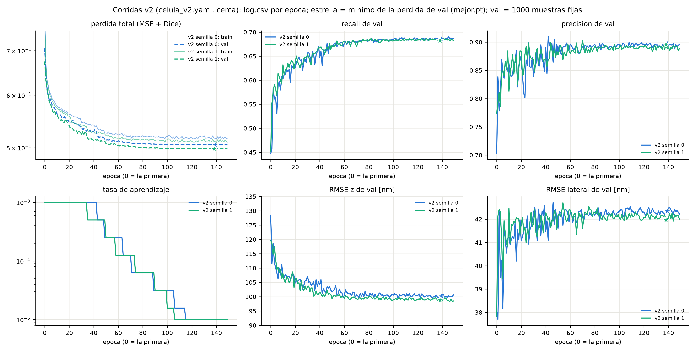
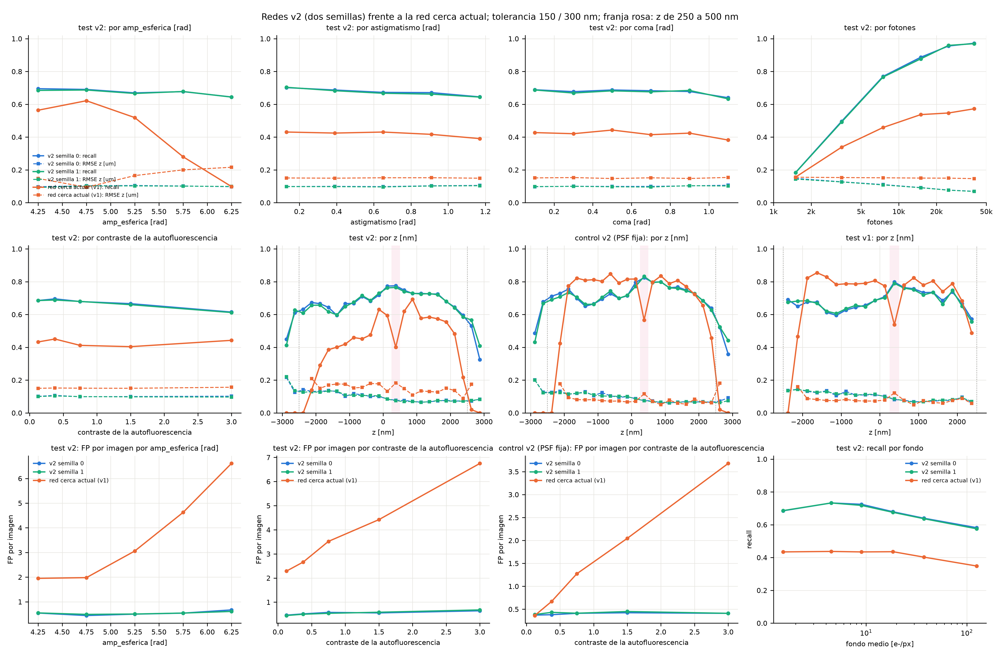
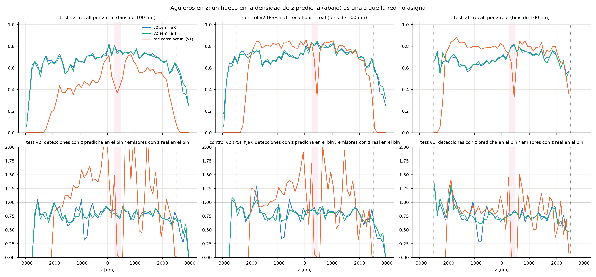
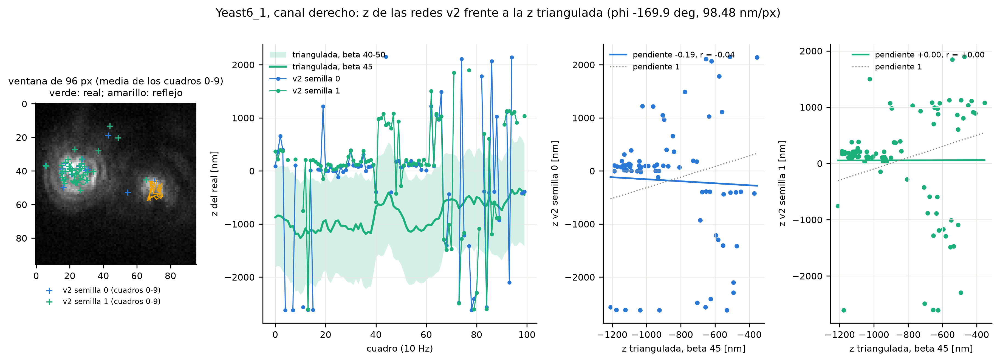

# Corridas v2 con célula: convergencia, tests y datos reales

Evaluación de las dos corridas v2 de Hypatia: `hypatia_celula_v2_b45_cerca_s0_20261114-090158` y `_s1_20261114-090158`. Las dos se entrenaron con `localizacion/configs/celula_v2.yaml` (variante cerca, 150 épocas) y solo difieren en `entrenamiento.semilla`, es decir, en la inicialización y el orden; los datos son los mismos. Se comparan con la red cerca actual, `hypatia_celula_b45_cerca_20261110-234627`. El simulador v2 y la línea base de esa red están en `resultados_simulador_v2.md`, y el diagnóstico de la red actual en `resultados_celula.md`.

No se reentrenó nada, ni se usó Hypatia. Se evaluó `mejor.pt` de cada semilla, sin tocar `postproc` (umbral 0.4) y con tolerancia 150 / 300 nm.

```bash
PY=~/miniforge3/envs/tesis/bin/python
export LD_PRELOAD=$HOME/miniforge3/envs/tesis/lib/libstdc++.so.6
for s in s0 s1; do
  C=$(ls -d localizacion/corridas/hypatia_celula_v2_b45_cerca_${s}_*)
  for t in test_celula_v2_b45_cerca test_celula_v2_psf_fija_b45_cerca test_celula_b45_cerca; do
    $PY localizacion/evaluate.py $C/mejor.pt localizacion/datos/$t --salida $C/evaluacion_local_$t --figuras 4   # 2-6 min
  done
done
$PY figuras/celula_v2.py convergencia evaluacion       # solo lee log.csv y las evaluaciones (~1 min)
$PY figuras/celula_v2.py reales                        # corre las dos redes sobre Yeast6_1 (~3 min)
```

Salidas en `figuras/`:
- `celula_v2_convergencia.csv`;
- `celula_v2_global.csv`, `celula_v2_rangos.csv` y `celula_v2_z.csv`;
- `celula_v2_reales.csv` (por cuadro) y `celula_v2_reales_resumen.csv`;
- las figuras `fig_celula_v2_{convergencia,evaluacion,z,reales}.png` (300 dpi).

La evaluación local de s0 sobre el test v2 da exactamente la de Hypatia (8826 TP, 1082–1083 FP). Para la red actual se usan las evaluaciones de la línea base. Los IC son al 95 %. En los tests, el bootstrap es de imágenes (2000 remuestreos, pareado entre redes porque son las mismas imágenes). En Yeast6_1, el bootstrap es de bloques de 10 cuadros.

## Resumen

| | resultado |
|---|---|
| convergencia | **Las dos convergieron.** El mínimo de la pérdida de validación está en la época 139 (s0) y en la 138 (s1). La lr llegó a su mínimo (10⁻⁵) en la 115 y en la 106. En las épocas 130–149 ninguna serie tiene una pendiente con IC que excluya 0: la pérdida, el recall, la precisión y el RMSE z de validación están planos. El recall de validación no se mueve más de 0.004 desde la época 80 |
| test v2 | El recall pasa de 0.419 a **0.675 / 0.672** y la precisión de 0.427 a 0.891; los FP por imagen, de 3.66 a 0.54. El RMSE z baja de 151 a **101 / 99 nm** y el sesgo z, de +39 a +3 / +5 nm. El RMSE lateral sube de 39.5 a 42 nm |
| control (PSF fija) | El recall sube de 0.666 a **0.717 / 0.714** y la precisión de 0.753 a 0.92. **El RMSE z empeora de 81 a 96 / 94 nm** (+15 / +13 nm, IC [+13, +17] / [+11, +15]) |
| test v1 | **Empeora:** recall de 0.757 a **0.692 / 0.690** (−0.065 [−0.073, −0.058]), RMSE z de 78.5 a **100.3 / 100.7 nm**, sesgo z de +0.7 a −20 / −22 nm y FP por imagen de 0.26 a 0.41. La pérdida está del lado compacto de la PSF (z < 0), con pocos fotones y con fondo alto |
| PSF | La red ya no depende de la esférica: el recall va de 0.69 a 0.645 entre 4.0 y 6.5 rad (la actual iba de 0.62 a 0.10), y el RMSE z queda en 92–105 nm. Astigmatismo y coma restan ~0.05 de recall de un extremo al otro. **La coma sigue corriendo la posición lateral:** el RMSE lateral pasa de 25 a 60 nm a lo largo de su rango, igual que con la red actual (24 → 55) |
| autofluorescencia y fondo | Los FP por imagen casi no dependen del contraste (0.46 → 0.64; la actual iba de 2.3 a 6.8). El recall baja de 0.685 a 0.615 con contraste 2–4, y de 0.73 a 0.58 entre fondos de 3–6 y > 50 e⁻/px |
| fotones | Test v2: recall 0.18 → 0.97 y RMSE z 146 → 69 nm. **El piso de z a muchos fotones sube:** 66–67 nm frente a 39–45 de la red actual en el test v1 y en el control |
| agujeros en z | **Desapareció el de +400 nm** en las dos semillas: recall 0.77 en [250, 500) nm en el test v2 (la actual: 0.40) y densidad de z predicha normal. **Cubre ±3000 a medias:** predice hasta +2.9 µm, pero nunca por debajo de −2.65 µm. El tope del lado compacto pasó de −1.98 a −2.65 µm; en [−3000, −2750] el recall es 0.45 / 0.41, con un sesgo de +210 nm. **s0 tiene un hueco nuevo, propio:** casi no predice z en [−850, −775] nm (11 detecciones, frente a ~150 de s1), en los tres tests. No le cuesta recall, porque los emisores caen en el plano vecino dentro de la tolerancia |
| semillas | Indistinguibles en casi todo. Las diferencias s0 − s1 tienen IC que incluyen 0 en recall, precisión y RMSE lateral, en los tres tests. Las únicas excepciones son el RMSE z del control (+2.3 nm [+0.7, +3.7]) y el sesgo z en el v2 (−1.7 nm) y en el v1 (+1.4 nm), todas de 2.3 nm o menos. Solo el 5 % de los emisores lo detecta una semilla y no la otra. Todos los defectos aparecen en las dos, salvo el hueco de −800 nm de s0 |
| Yeast6_1 | **Ninguna semilla pasa ningún criterio**, con ningún β en [40, 50]° ni con ninguna ventana. Hay saltos entre modos: 29 de 76 pasos (s0) y 20 de 87 (s1) son de más de 1 µm. La correlación es −0.04 [−0.40, +0.30] y 0.00 [−0.38, +0.41], y la pendiente −0.19 [−2.05, +1.76] y 0.00 [−1.67, +1.11]. Las detecciones extra bajan de 7.6 a ~2 por cuadro, pero el real se detecta en el 77 % y el 88 % de los cuadros (la actual: 91 %) |

## 1. Convergencia



`log.csv` ya tiene la lr usada en cada época (coincide con `log_iter.csv`) y las métricas de validación por época (`metricas_val: true`). Validación son 1000 muestras fijas (`seed_val` 2), las mismas para las dos semillas.

| | s0 | s1 |
|---|---|---|
| mínimo de val_total (`mejor.pt`) | época **139**: 0.5049 | época **138**: 0.4980 |
| `mejor.pt` actualizado en las épocas 140–149 | nunca | nunca |
| caídas de la lr (factor 0.5) | 43, 49, 64, 71, 89, 106, 115 | 35, 50, 58, 74, 90, 100, 106 |
| lr = lr_min (10⁻⁵) desde la época | 115 | 106 |
| val en la mejor época: recall / precisión / Jaccard | 0.686 / 0.897 / 0.636 | 0.683 / 0.896 / 0.632 |
| val en la mejor época: RMSE lateral / z | 42.3 / 100.2 nm | 42.0 / 98.8 nm |

Tendencia en las épocas 130–149, con la pendiente por 10 épocas, el IC 95 % (el mayor de los ee de OLS y de Newey-West con lag 3, como `figuras/convergencia.py`) y la desviación estándar entre épocas:

| serie | s0: pendiente / 10 épocas [IC] | s1 | DE entre épocas (s0 / s1) |
|---|---|---|---|
| val_total | −0.00007 [−0.00016, +0.00002] (−0.014 %) | −0.00004 [−0.00019, +0.00011] (−0.008 %) | 0.00012 / 0.00019 |
| val_mse | +0.00004 [−0.00009, +0.00017] | −0.00001 [−0.00012, +0.00010] | 0.00017 / 0.00014 |
| val_recall | +0.0007 [−0.0004, +0.0017] | −0.0008 [−0.0015, +0.0000] | 0.0014 / 0.0011 |
| val_precision | +0.0002 [−0.0018, +0.0022] | −0.0003 [−0.0028, +0.0021] | 0.0026 / 0.0032 |
| val_rmse_z_nm | +0.08 [−0.19, +0.34] nm | −0.27 [−0.55, +0.01] nm | 0.34 / 0.39 nm |
| train_total | −0.0007 [−0.0021, +0.0007] | −0.0007 [−0.0021, +0.0008] | 0.0018 / 0.0019 |

Medias de validación por ventana de 10 épocas:

| épocas | 0–9 | 20–29 | 40–49 | 60–69 | 80–89 | 100–109 | 120–129 | 140–149 |
|---|---|---|---|---|---|---|---|---|
| recall s0 / s1 | 0.552 / 0.573 | 0.638 / 0.639 | 0.659 / 0.665 | 0.679 / 0.679 | 0.683 / 0.683 | 0.686 / 0.683 | 0.685 / 0.684 | 0.687 / 0.684 |
| RMSE z s0 / s1 [nm] | 112.4 / 112.8 | 105.0 / 104.1 | 103.0 / 100.9 | 101.1 / 99.6 | 100.5 / 99.7 | 100.5 / 99.2 | 100.3 / 99.1 | 100.2 / 98.9 |

- **Las dos curvas quedaron planas.** Ninguna serie baja de forma significativa en las últimas 20 épocas, y la lr está en su mínimo desde hace 35–44 épocas, así que más épocas con este esquema no cambiarían nada. Las métricas de detección se estabilizan antes que la pérdida: recall y RMSE z apenas se mueven desde la época ~80.
- **No hay sobreajuste.** Train (muestras nuevas en cada época) queda 0.012–0.013 por encima de val sin abrirse. Las dos semillas son las mismas épocas con otro orden, y las curvas se superponen.
- **Pérdida y métricas no van juntas entre semillas.** La pérdida de validación de s1 queda 1–2 % por debajo de la de s0 desde la época ~20 (1.3 % al final), pero las métricas en los tests son iguales (sección 3). Una diferencia de pérdida de ese tamaño no sirve para elegir una semilla.

## 2. Tests



Los tres tests tienen 2000 imágenes y semilla 3:
- **v2** (`test_celula_v2_b45_cerca`): la distribución de entrenamiento de las redes v2.
- **control** (`test_celula_v2_psf_fija_b45_cerca`): las mismas imágenes con la PSF de entrenamiento de la red actual (4.71 rad, sin aberraciones).
- **v1** (`test_celula_b45_cerca`): el test de la red actual, con cámara, fondo, fotones y z en ±2500 nm de `celula.yaml`.

Los emisores evaluables son los que tienen `en_fov & en_rango_z`, con el rango del test.

| test | red | recall | precisión | FP por imagen | RMSE lateral | RMSE z | sesgo z |
|---|---|---|---|---|---|---|---|
| v2 | actual | 0.419 | 0.427 | 3.66 | 39.5 nm | 150.8 nm | +39.4 nm |
| | **s0** | **0.675** [0.665, 0.686] | 0.891 | 0.54 | 42.0 | **100.9** [99.0, 102.7] | +3.0 |
| | **s1** | **0.672** [0.661, 0.682] | 0.891 | 0.54 | 42.3 | **99.4** [97.5, 101.2] | +4.7 |
| control | actual | 0.666 | 0.753 | 1.43 | 21.6 | 80.9 | +4.6 |
| | **s0** | **0.717** [0.706, 0.727] | 0.920 | 0.41 | 23.1 | **96.2** [94.4, 98.0] | −7.9 |
| | **s1** | **0.714** [0.704, 0.724] | 0.916 | 0.43 | 22.8 | **94.0** [92.2, 95.7] | −7.1 |
| v1 | actual | 0.757 | 0.950 | 0.26 | 21.2 | 78.5 | +0.7 |
| | **s0** | **0.692** [0.681, 0.702] | 0.917 | 0.41 | 20.9 | **100.3** [98.6, 102.1] | −20.4 |
| | **s1** | **0.690** [0.679, 0.701] | 0.914 | 0.42 | 20.9 | **100.7** [98.9, 102.4] | −21.8 |

Diferencias pareadas con la red actual (s0; las de s1 son iguales a ±0.003 de recall y ±2 nm):

| test | Δ recall | Δ precisión | Δ FP por imagen | Δ RMSE z |
|---|---|---|---|---|
| v2 | **+0.257** [+0.243, +0.270] | +0.463 | −3.12 | **−49.9** [−53.2, −46.5] nm |
| control | **+0.050** [+0.042, +0.058] | +0.167 | −1.02 | **+15.3** [+13.1, +17.5] nm |
| v1 | **−0.065** [−0.073, −0.058] | −0.033 | +0.15 | **+21.9** [+19.8, +24.0] nm |

**Lectura.** La red v2 rinde en su distribución lo que la red actual rinde en la suya: recall 0.675 frente a 0.757, en un test más difícil (más emisores en los polos, fondos más bajos, PSF variable). Fuera de su distribución la red actual se cae: 0.419 en el v2. La robustez se paga en la PSF de entrenamiento de la red actual. En el control gana recall y precisión, por el fondo y la autofluorescencia del v2, pero pierde 15 nm de RMSE z. En el v1 pierde en todo menos en la precisión lateral. Es lo que `resultados_simulador_v2.md` (sección 7) anticipaba: una red que no conoce la esférica de la muestra tiene menos información para fijar la escala de z.

### Por PSF (test v2)

| amp_esferica [rad] | 4.0–4.5 | 4.5–5.0 | 5.0–5.5 | 5.5–6.0 | 6.0–6.5 |
|---|---|---|---|---|---|
| recall s0 / s1 / actual | 0.695 / 0.685 / 0.564 | 0.690 / 0.687 / 0.622 | 0.670 / 0.666 / 0.519 | 0.677 / 0.678 / 0.280 | 0.645 / 0.644 / **0.098** |
| RMSE z s0 / s1 / actual [nm] | 97 / 92 / 148 | 103 / 102 / 94 | 105 / 102 / 165 | 102 / 101 / 200 | 97 / 99 / 216 |
| sesgo z s0 / s1 / actual [nm] | −27 / −25 / −111 | +2 / +4 / +23 | +5 / +5 / +133 | +6 / +8 / +177 | +32 / +34 / +183 |
| FP por imagen s0 / s1 / actual | 0.55 / 0.55 / 1.95 | 0.44 / 0.49 / 1.98 | 0.50 / 0.51 / 3.06 | 0.54 / 0.54 / 4.62 | 0.67 / 0.61 / 6.61 |

| astigmatismo [rad] | 0–0.26 | 0.26–0.52 | 0.52–0.78 | 0.78–1.04 | 1.04–1.3 |
|---|---|---|---|---|---|
| recall s0 / s1 / actual | 0.702 / 0.704 / 0.431 | 0.687 / 0.683 / 0.425 | 0.673 / 0.667 / 0.431 | 0.671 / 0.662 / 0.417 | 0.645 / 0.644 / 0.391 |
| RMSE z s0 / s1 [nm] | 99 / 98 | 99 / 98 | 98 / 96 | 103 / 102 | 105 / 103 |
| RMSE lateral s0 / s1 / actual [nm] | 41 / 41 / 38 | 42 / 43 / 39 | 42 / 42 / 39 | 42 / 42 / 41 | 44 / 44 / 41 |

| coma [rad] | 0–0.2 | 0.2–0.4 | 0.4–0.6 | 0.6–0.8 | 0.8–1.0 | 1.0–1.2 |
|---|---|---|---|---|---|---|
| recall s0 / s1 / actual | 0.689 / 0.687 / 0.427 | 0.677 / 0.669 / 0.421 | 0.687 / 0.682 / 0.443 | 0.683 / 0.676 / 0.415 | 0.678 / 0.684 / 0.424 | 0.640 / 0.633 / 0.382 |
| RMSE z s0 / s1 [nm] | 97 / 98 | 100 / 100 | 99 / 97 | 99 / 95 | 103 / 104 | 106 / 102 |
| **RMSE lateral** s0 / s1 / actual [nm] | **25 / 25 / 24** | 29 / 29 / 29 | 34 / 35 / 34 | 42 / 42 / 41 | 51 / 52 / 47 | **60 / 60 / 55** |

- **La esférica dejó de importar.** El recall es casi plano en todo el rango, el RMSE z no depende de la amplitud y el sesgo z va de −27 a +32 nm (la red actual iba de −111 a +183). Los FP por imagen no suben con la amplitud.
- **La coma no se aprendió en lateral.** El RMSE lateral crece con la coma igual en las redes v2 y en la actual, una red que nunca vio coma. Es casi todo el exceso lateral del test v2: 42 nm, frente a 23 nm en el control sin aberraciones. Las redes v2 detectan con coma, pero ubican el emisor donde lo pondría una red sin coma. La causa queda abierta: la orientación de la coma es aleatoria y el corrimiento depende de z, así que la red tendría que estimar las dos cosas de la imagen.

### Por autofluorescencia, fondo y fotones

| contraste (amplitud de la célula / fondo medio) | < 0.25 | 0.25–0.5 | 0.5–1 | 1–2 | 2–4 |
|---|---|---|---|---|---|
| imágenes | 314 | 294 | 508 | 828 | 56 |
| recall v2: s0 / s1 / actual | 0.685 / 0.685 / 0.433 | 0.695 / 0.688 / 0.451 | 0.679 / 0.680 / 0.412 | 0.666 / 0.660 / 0.404 | 0.615 / 0.612 / 0.443 |
| FP por imagen, v2: s0 / s1 / actual | 0.46 / 0.45 / 2.29 | 0.51 / 0.50 / 2.66 | 0.58 / 0.54 / 3.52 | 0.55 / 0.58 / 4.42 | 0.64 / 0.68 / **6.75** |
| FP por imagen, control: s0 / s1 / actual | 0.37 / 0.39 / 0.36 | 0.38 / 0.43 / 0.67 | 0.41 / 0.41 / 1.27 | 0.42 / 0.45 / 2.05 | 0.41 / 0.41 / **3.68** |

| fondo medio [e⁻/px] | < 3 | 3–6 | 6–12 | 12–25 | 25–50 | > 50 |
|---|---|---|---|---|---|---|
| recall v2: s0 / s1 / actual | 0.685 / 0.686 / 0.434 | 0.733 / 0.733 / 0.437 | 0.725 / 0.718 / 0.434 | 0.679 / 0.675 / 0.436 | 0.640 / 0.637 / 0.402 | 0.582 / 0.575 / 0.348 |
| recall v1: s0 / s1 / actual | — | 0.734 / 0.747 / 0.873 (79 im.) | 0.756 / 0.745 / 0.792 | 0.754 / 0.751 / 0.791 | 0.679 / 0.679 / 0.756 | 0.639 / 0.636 / 0.704 |

| fotones | 1000–2000 | 2000–5000 | 5000–10⁴ | 10⁴–2·10⁴ | 2·10⁴–3·10⁴ | 3·10⁴–5·10⁴ |
|---|---|---|---|---|---|---|
| v2: recall s0 / actual | 0.184 / 0.156 | 0.496 / 0.338 | 0.770 / 0.458 | 0.887 / 0.537 | 0.956 / 0.547 | 0.972 / 0.573 |
| v2: RMSE z s0 / s1 / actual [nm] | 148 / 144 / 155 | 127 / 126 / 153 | 110 / 108 / 152 | 92 / 91 / 150 | 77 / 76 / 150 | **70 / 69** / 147 |
| control: recall s0 / actual | 0.238 / 0.297 | 0.577 / 0.579 | 0.809 / 0.751 | 0.909 / 0.812 | 0.963 / 0.830 | 0.979 / 0.835 |
| control: RMSE z s0 / s1 / actual [nm] | 139 / 131 / 129 | 120 / 116 / 105 | 102 / 102 / 82 | 86 / 86 / 66 | 74 / 73 / 53 | **67 / 63 / 45** |
| v1: recall s0 / actual | **0.145 / 0.304** | **0.604 / 0.748** | 0.880 / 0.898 | 0.955 / 0.933 | 0.983 / 0.948 | — |
| v1: RMSE z s0 / s1 / actual [nm] | 137 / 143 / 130 | 125 / 126 / 102 | 103 / 102 / 69 | 83 / 83 / 49 | **66 / 65 / 39** | — |
| v1: RMSE lateral s0 / actual [nm] | 40 / 41 | 28 / 27 | 19 / 17 | 15 / 11 | 14 / 8.5 | — |

- **Autofluorescencia:** con la red v2, los FP ya no crecen con el contraste. Lo que queda es una pérdida de recall de ~0.07 en el contraste más alto.
- **Fondo:** el recall cae con fondo alto en los dos tests (0.73 → 0.58 en el v2). En el v1, donde el 59 % de los emisores está en imágenes con fondo de 25–50 e⁻/px, la red v2 pierde 0.04–0.08 frente a la actual en todos los rangos (0.14 en 3–6 e⁻/px, con solo 79 imágenes). El entrenamiento v2 sortea el fondo log-uniforme en [1, 40], así que ve menos fondos altos que `celula.yaml` (uniforme en [5, 40]).
- **Fotones:** en el v1, la red v2 pierde casi todo el recall en los emisores débiles (< 5000 fotones: −0.16 y −0.14) y gana un poco con > 10⁴. El **piso de z sube** de 39–45 nm a 63–67 nm, y el lateral, de 8.5–10 a 14–15 nm. Esto es compatible con el precio de no conocer la esférica: a muchos fotones la cota la pone el modelo, no el ruido. No se midió (haría falta la CRLB con la esférica como parámetro de molestia).

### Por z: agujeros y cobertura



Recall por z real en bins de 250 nm. Los rangos más relevantes (todos en `figuras/celula_v2_rangos.csv`):

| z [nm] | [−3000, −2750) | [−2750, −2500) | [−2250, −2000) | [−1500, −1250) | [0, 250) | **[250, 500)** | [1000, 1250) | [2250, 2500) | [2500, 2750) | [2750, 3000) |
|---|---|---|---|---|---|---|---|---|---|---|
| n (v2) | 109 | 316 | 719 | 701 | 534 | 507 | 586 | 479 | 309 | 120 |
| v2: recall s0 / s1 / actual | 0.45 / 0.41 / 0 | 0.61 / 0.63 / 0 | 0.67 / 0.66 / 0.14 | 0.60 / 0.60 / 0.40 | 0.77 / 0.76 / 0.59 | **0.78 / 0.77 / 0.40** | 0.73 / 0.73 / 0.58 | 0.60 / 0.59 / 0.22 | 0.53 / 0.57 / 0.02 | 0.33 / 0.41 / 0 |
| v2: RMSE z s0 / s1 [nm] | 216 / 220 | 125 / 136 | 132 / 129 | 130 / 133 | 85 / 84 | 77 / 74 | 65 / 65 | 74 / 72 | 72 / 76 | 84 / 83 |
| v2: sesgo z s0 / s1 [nm] | **+212 / +215** | +94 / +100 | +28 / +28 | −7 / −2 | −15 / −8 | −8 / −5 | +7 / +9 | −15 / −11 | −26 / −5 | −39 / −40 |
| control: recall s0 / s1 / actual | 0.49 / 0.43 / 0 | 0.68 / 0.67 / 0 | 0.73 / 0.71 / 0.42 | 0.65 / 0.66 / 0.81 | 0.80 / 0.77 / 0.82 | **0.82 / 0.83 / 0.57** | 0.76 / 0.76 / 0.79 | 0.64 / 0.63 / 0.46 | 0.52 / 0.52 / 0.02 | 0.36 / 0.44 / 0 |
| v1: recall s0 / s1 / actual | — | — | 0.65 / 0.68 / 0.47 | 0.61 / 0.62 / 0.83 | 0.71 / 0.70 / 0.77 | **0.80 / 0.79 / 0.54** | 0.73 / 0.72 / 0.78 | 0.57 / 0.56 / 0.49 | — | — |

- **El agujero de +400 nm desapareció en las dos semillas.** En [250, 500) nm el recall es 0.77–0.83 en los tres tests, más alto que el de sus vecinos. La densidad de z predicha frente a la de z real (fila de abajo de la figura) vale 0.70–0.77 en los bins de 300 y 400 nm: lo normal para un recall de ~0.75. La red actual tenía ahí 0.04 y 0.
- **Cobertura de ±3000 nm: parcial.**
  - Del lado de los anillos (z > 0), las redes v2 predicen hasta +2866 / +2905 nm. El recall cae de 0.65 a 0.33–0.41 en el último cuarto de µm, sin saturar (sesgo −40 nm).
  - Del lado compacto (z < 0), **nunca predicen por debajo de −2653 / −2655 nm**. La rejilla llega a −3200 con los planos del margen, así que es un tope aprendido, como el de −1982 nm de la red actual, pero 670 nm más abajo. En [−3000, −2750] el recall es 0.45 / 0.41 con un sesgo de +212 nm: lo que se detecta queda en ~−2700, dentro de la tolerancia. En bins de 100 nm, [−3000, −2900] tiene recall 0.06 y [−2900, −2800], 0.35 / 0.33.
- **El lado compacto es el débil en todo el rango.** En el v2, z < 0 da un RMSE z de 100–140 nm, frente a 65–85 nm con z > 0. En z ∈ [−1500, −250], el recall de las redes v2 es 0.65–0.73 en el control y 0.60–0.66 en el v1, frente a 0.78–0.85 de la red actual. Con z > 0 la diferencia es chica: de −0.04 a +0.03 en el control y de −0.02 a −0.07 en el v1, sin contar el agujero de +400 nm de la actual. La pérdida del v1 sale sobre todo del lado compacto y de los emisores débiles. Es el lado donde la PSF de cerca cambia poco con z y donde la esférica aleatoria más confunde la escala de z.
- **Hueco propio de s0 en z ≈ −800 nm.** s0 casi no asigna z en [−850, −775] nm: 11 detecciones en 75 nm del test v2, frente a ~150 de s1 en el mismo intervalo. La razón de densidades en los bins de −900 y −800 nm es 0.31 / 0.37 para s0 y 0.73 / 0.71 para s1 en el v2. Pasa igual en el control (s0: 0.35 / 0.36; s1: 0.65 / 0.68) y en el v1 (s0: 0.30 / 0.29; s1: 0.63 / 0.60). El recall no cae (0.62–0.77 en las dos semillas), porque los emisores se reparten a los planos vecinos con un sesgo de −35 a −74 nm, dentro de la tolerancia de 300 nm. Es el mismo tipo de discontinuidad aprendida que el +400 nm de la red actual, pero más chica y en otro lugar. Que una semilla lo tenga y la otra no confirma que estos huecos son del entrenamiento, no de la física.
- El histograma de z predicha en pasos de 25 nm tiene una periodicidad de 100 nm (el paso de los planos) en las dos semillas. Es la cuantización conocida (`resultados_cuantizacion.md`), no un agujero.

## 3. Variabilidad entre semillas

Diferencias pareadas s0 − s1, sobre los mismos emisores e imágenes, con IC por bootstrap de imágenes:

| test | Δ recall | Δ precisión | Δ FP por imagen | Δ RMSE lateral | Δ RMSE z | Δ sesgo z |
|---|---|---|---|---|---|---|
| v2 | +0.0035 [−0.0003, +0.0071] | +0.0002 [−0.005, +0.006] | +0.002 [−0.028, +0.031] | −0.23 [−0.61, +0.15] nm | +1.5 [−0.0, +3.1] nm | **−1.7 [−3.3, −0.2] nm** |
| control | +0.0027 [−0.0012, +0.0063] | +0.004 [−0.001, +0.009] | −0.021 [−0.046, +0.004] | +0.23 [−0.14, +0.62] nm | **+2.3 [+0.7, +3.7] nm** | −0.8 [−2.3, +0.6] nm |
| v1 | +0.0014 [−0.0024, +0.0053] | +0.003 [−0.002, +0.007] | −0.014 [−0.037, +0.010] | −0.05 [−0.35, +0.24] nm | −0.3 [−1.9, +1.3] nm | **+1.4 [+0.02, +2.8] nm** |

Emisor a emisor:

| test | detectado por las dos | solo s0 | solo s1 | por ninguna |
|---|---|---|---|---|
| v2 | 64.8 % | 2.8 % | 2.4 % | 30.0 % |
| control | 69.0 % | 2.7 % | 2.4 % | 26.0 % |
| v1 | 66.7 % | 2.5 % | 2.4 % | 28.4 % |

- **Las métricas globales no distinguen las semillas.** De 18 diferencias, solo tres tienen un IC que excluye 0: dos sesgos z y un RMSE z, todos de 2.3 nm o menos. La diferencia de 1.3 % en la pérdida de validación no aparece en ninguna métrica.
- **Las dos fallan en los mismos emisores.** Solo el 5 % de los emisores lo detecta una semilla y no la otra. Los FN (26–30 %) son casi todos comunes.
- **Defectos en las dos:** el tope de −2.65 µm del lado compacto (−2653 y −2655 nm), el lado compacto débil, la caída del recall con fondo alto y con fotones bajos en el v1, el RMSE lateral que crece con la coma (25 → 60 nm en las dos), el piso de 63–67 nm en z y el fracaso en Yeast6_1.
- **Defecto de una sola:** el hueco de −800 nm de s0. Con dos semillas no se puede saber cuántos de estos huecos chicos son típicos. Lo que se ve es que aparecen al azar según la semilla, no en un lugar fijo.

## 4. Yeast6_1 (canal derecho)



El procedimiento es el de `red_celula.py reales` (`resultados_celula.md`, sección 4): la detección, las pistas, el par y el borde de la franja vienen de `analisis_datos_reales.py`.
- **Ventana:** 96 × 96 px centrada en el punto medio del par.
- **Canal de distancia:** se calcula desde la línea espejo/plano focal, que se toma en el borde de la franja (φ = −169.9°).
- **z de la red:** la de la detección a ≤ 3 px del real.

La red no depende de β: el canal de distancia solo usa la línea en el plano focal. Por eso, cambiar β entre 40 y 50° solo cambia la z triangulada, con una media de −1813 nm a 40°, −836 nm a 45° y +115 nm a 50°.

**Criterios**, fijados por el enunciado antes de ver los resultados. La forma de aplicarlos se fijó también antes de correr la red:
- **sin saltos entre modos:** ningún |Δz| > 1000 nm entre cuadros consecutivos con el real detectado. La z triangulada nunca cambia más de 245–292 nm entre cuadros (según β), y los dos modos de la red actual estaban a 3.6 µm uno del otro;
- **correlación** de Pearson con la z triangulada > 0.7;
- **pendiente** de la recta z_red ~ z_tri (OLS) en [0.7, 1.3].

Un criterio se pasa por la estimación puntual. Además se indica si el IC 95 % (bootstrap de bloques de 10 cuadros) queda entero del lado bueno («dentro»), del lado malo («fuera») o cruza el umbral.

| | s0 | s1 | red actual |
|---|---|---|---|
| real detectado | 77 % de los cuadros | 88 % | 91 % |
| detecciones extra por cuadro (sobre el reflejo) | 1.86 (0.22) | 1.99 (0.11) | 7.6 (0.3) |
| confianza mediana del real | 0.76 | 0.94 | 0.75 |
| z de la red | −183 ± 1183 nm | +55 ± 937 nm | −777 ± 1537 nm |
| saltos > 1 µm / pasos | **29 / 76** (38 % [16, 58]), máximo 4.6 µm | **20 / 87** (23 % [12, 41]), máximo 4.5 µm | 31 / 90 |
| correlación, β 45° | **−0.04** [−0.40, +0.30] | **+0.00** [−0.38, +0.41] | +0.39 [+0.10, +0.63] |
| pendiente, β 45° | **−0.19** [−2.05, +1.76] | **+0.00** [−1.67, +1.11] | +2.3 [+0.5, +4.0] |
| desfase medio (red − tri), β 45° | +683 nm | +903 nm | +64 nm |

Por β (ventana en el punto medio):

| β | z_tri media | s0: corr [IC] | s0: pendiente [IC] | s1: corr [IC] | s1: pendiente [IC] |
|---|---|---|---|---|---|
| 40° | −1813 nm | −0.04 [−0.43, +0.33] | −0.18 [−1.87, +1.59] | −0.04 [−0.40, +0.39] | −0.13 [−1.51, +0.99] |
| 42.5° | −1318 | −0.04 [−0.43, +0.32] | −0.19 [−2.03, +1.69] | −0.02 [−0.39, +0.40] | −0.07 [−1.63, +1.02] |
| 45° | −836 | −0.04 [−0.40, +0.30] | −0.19 [−2.05, +1.76] | +0.00 [−0.38, +0.41] | +0.00 [−1.67, +1.11] |
| 47.5° | −361 | −0.04 [−0.39, +0.26] | −0.19 [−2.05, +1.46] | +0.02 [−0.36, +0.42] | +0.10 [−1.66, +1.14] |
| 50° | +115 | −0.03 [−0.38, +0.23] | −0.18 [−2.18, +1.23] | +0.05 [−0.34, +0.43] | +0.20 [−1.67, +1.20] |

**Veredicto por criterio** (igual en los cinco β y en las cuatro ventanas: punto medio, línea ±10 px, centrada en el real):

| criterio | s0 | s1 |
|---|---|---|
| sin saltos entre modos | **no pasa** (29 saltos; IC de la fracción [16, 58] %) | **no pasa** (20 saltos; [12, 41] %) |
| correlación > 0.7 | **no pasa**: −0.03 a −0.04; IC entero por debajo de 0.7 («fuera») con todos los β | **no pasa**: −0.04 a +0.05; «fuera» con todos los β |
| pendiente en [0.7, 1.3] | **no pasa**: −0.18 a −0.19; el IC cruza el intervalo (de −2 a +1.8: no informa) | **no pasa**: −0.13 a +0.20; el IC cruza (de −1.7 a +1.2) |

En las ventanas de sensibilidad los números se mueven poco: saltos 29–32 (s0) y 16–23 (s1), correlación −0.19 a +0.01, pendiente −0.71 a +0.07. Con la ventana centrada en el real, el IC de la pendiente de s1 queda entero por debajo de 0.7 («fuera»).

- **Las redes v2 no siguen a la partícula.**
  - En los cuadros 0–39 se quedan en una z casi fija: mediana +74 nm en s0 (p10–p90 de −2600 a +380, con saltos sueltos a −2.6 µm) y +173 nm en s1 (de +25 a +373). La z triangulada varía ahí entre −1265 y −840 nm (β 45°).
  - Desde el cuadro ~40 alternan entre +1 µm, −0.4…−1.5 µm y −2.6 µm, sin relación con la triangulada.
  - La correlación es nula en las dos y los IC excluyen con claridad el umbral de 0.7.
- **Frente a la red actual, cambia el defecto, no el resultado.**
  - La red actual tenía dos modos especulares en los extremos (−1.7 y +1.9 µm), una correlación de +0.39 que salía de los saltos y 7.6 detecciones extra por cuadro sobre los anillos.
  - Las v2 ponen ~2 detecciones extra por cuadro, la mayoría lejos del reflejo, y una z central (~+0.1 µm) la mayor parte del tiempo. Pero pierden el real en el 12–23 % de los cuadros y siguen saltando.
  - Que la v2 vea menos «emisores» en los anillos es coherente con haber entrenado con esféricas más fuertes y con fondo bajo. Que no siga la z indica que la PSF real sigue fuera de la familia simulada: dos lóbulos, anillos asimétricos y polarización (`resultados_psf_real.md`), cosas que un modelo escalar con esférica, astigmatismo y coma no cubre.
- El desfase absoluto (+0.7 a +0.9 µm a 45°; ~0 a 50°) no es interpretable sin calibrar β y la línea (`resultados_celula.md`, sección 4).

## Lo que sigue

1. **Elegir una semilla:** da lo mismo en las métricas. s1 no tiene el hueco de −800 nm y detecta el real en más cuadros de Yeast6_1, así que es la candidata si hay que elegir una.
2. **Lado compacto (z < 0) y tope de −2.65 µm:** es el defecto común a las dos semillas y el que explica la pérdida en el v1. Opciones:
   - más peso a los polos o a z < 0 en el muestreo;
   - extender la rejilla más allá de −3000 nm, para que el tope aprendido caiga fuera del rango que importa;
   - medir la CRLB con la esférica desconocida, para saber cuánto del piso de 65 nm en z es inevitable.
3. **Coma en lateral:** comprobar con una curva de transferencia (emisor aislado, coma fija y orientación conocida) si la red corrige el corrimiento del centroide. Hoy el RMSE lateral con coma 1.0–1.2 rad es 60 nm, igual que el de una red que no vio coma.
4. **Datos reales:** con la PSF de este modelo, ninguna red pasa los criterios. Antes de otro entrenamiento hace falta la PSF medida (z-stack de beads), no solo un rango más ancho de los parámetros escalares.
5. **Checkpoints intermedios:** `epoca_009.pt` … `epoca_149.pt` están disponibles para ver en qué época aparece el hueco de −800 nm de s0. No se evaluaron.

## Supuestos y limitaciones

- **Tests:** solo dos semillas, así que la variabilidad entre semillas es una estimación gruesa. El test v2 es de la misma distribución que el entrenamiento v2: compararlo con la red actual mide sobre todo cuánto se cae la actual fuera de su distribución.
- **Control y v1:** las redes v2 ven ahí una PSF (4.71 rad, sin aberraciones) que está dentro de su rango de entrenamiento. El v1 tiene además otra cámara (0.46 e⁻/ADU, offset 99), que `evaluate.py` lee de su `config_simulador.json`.
- **Desglose por PSF:** es solo del test v2. En el control, las columnas de PSF son las del v2 y solo sirven para agrupar imágenes.
- **Yeast6_1:** una partícula y 100 cuadros. Los criterios de saltos y de pendiente dependen de la triangulación, que supone que la línea espejo/plano focal es el borde de la franja. La correlación no depende de esa línea, y con cualquier β está lejos de 0.7.
