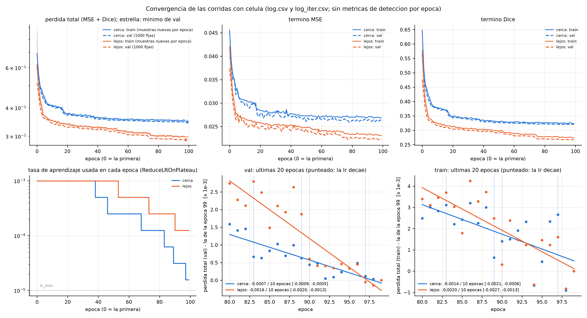

# Convergencia del entrenamiento de las corridas con célula

Revisé solo los logs de `localizacion/corridas/hypatia_celula_b45_cerca_20261110-234627` y `hypatia_celula_b45_lejos_20261110-234617` (100 épocas cada una, `configs/celula.yaml`), sin correr la red. Las épocas se cuentan desde 0, como en `log.csv` y en los checkpoints.

```bash
PY=~/miniforge3/envs/tesis/bin/python
$PY figuras/convergencia.py [--ultimas 20]     # segundos -> fig_convergencia.png (300 dpi), convergencia_*.csv
```



## Resumen

| | cerca | lejos |
|---|---|---|
| mínimo de la pérdida de validación | época **99** (la última): 0.3466 | época **98**: 0.2894 (en la 99, 0.2895) |
| `mejor.pt` actualizado en las últimas 10 épocas | 4 veces (90, 92, 98, 99) | 7 veces (90, 91, 92, 93, 95, 97, 98) |
| pendiente de val, épocas 80–99 | −7.2·10⁻⁵ por época [−9.3, −5.2]·10⁻⁵: **−0.21 % cada 10 épocas** | −1.6·10⁻⁴ por época [−2.0, −1.3]·10⁻⁴: **−0.56 % cada 10 épocas** |
| término MSE de val, épocas 80–99 | **plano**: −0.02 % / 10 épocas [IC incluye 0]; mínimo en la época 78 | sigue bajando: −0.82 % / 10 épocas |
| lr al final | 1.56·10⁻⁵, tras 6 caídas (lr_min = 1·10⁻⁵) | 1.25·10⁻⁴, tras 3 caídas |
| lectura | casi convergida con este esquema: la lr ya está en el piso y la pérdida apenas baja | no convergida: baja 2.7 veces más rápido que cerca y le quedan 3–4 caídas de lr |
| métricas de detección por época | **no se guardan**: `log.csv` solo tiene pérdidas (total, MSE, Dice) de train y val, la lr y el tiempo; ver la propuesta al final | |

## 1. Pérdidas por época

`log.csv` tiene `epoca, lr, train_total, train_mse, train_dice, val_total, val_mse, val_dice, mejor, t_epoca_s`. La pérdida total es MSE + Dice. No hay recall, precisión, Jaccard ni RMSE por época. Las de la evaluación final (`resultados_celula.md`) son solo de `mejor.pt`.

- **Train** se mide en modo entrenamiento sobre **muestras nuevas en cada época** (`renovar_por_epoca: true`: la época e usa las muestras e·20000 … (e+1)·20000 − 1 de `seed_train`). Por eso también estima el error fuera de muestra.
- **Val** son 1000 muestras fijas (`seed_val`) en modo evaluación.
- No hay sobreajuste: desde la época 5, train queda entre −0.001 y +0.012 (cerca) y entre +0.002 y +0.014 (lejos) por encima de val, sin abrirse.
- La pérdida de val pasa de 0.603 (cerca) y 0.514 (lejos) en la época 0 a 0.460 y 0.378 en la época 3. Por ventanas de 20 épocas:

| val_total, pendiente relativa por cada 10 épocas | 0–19 | 20–39 | 40–59 | 60–79 | 80–99 |
|---|---|---|---|---|---|
| cerca | −17.7 % | −1.74 % | −0.90 % | −0.51 % | −0.21 % |
| lejos | −16.7 % | −1.49 % | −2.61 % | −2.39 % | −0.56 % |
| **val_mse**, cerca | −15.6 % | −0.15 % | −1.16 % | −0.87 % | −0.02 % |
| val_mse, lejos | −15.7 % | −0.45 % | −2.66 % | −2.39 % | −0.82 % |

(`figuras/convergencia_ventanas.csv`)

- Cerca se desacelera de forma monótona.
- Lejos tuvo una segunda fase de mejora (épocas 40–79, −2.4 a −2.6 % por 10 épocas) que coincide con sus dos primeras caídas de lr (53 y 73). En la curva se ven escalones en 73 y 90.
- Cerca tiene un escalón en las épocas 16–18 (val de 0.397 a 0.374), todavía con lr = 10⁻³. No es el scheduler; es un cambio de fase del propio entrenamiento.

## 2. ¿Siguen bajando al final?

Ajuste lineal de cada serie contra la época en las épocas 80–99. El error estándar es el mayor entre el de OLS y el de Newey-West con lag 3, porque los residuos de épocas consecutivas están correlacionados. Datos en `figuras/convergencia_tendencia.csv`.

| épocas 80–99 | pendiente por época | IC 95 % | cambio en 10 épocas | relativo | DE del residuo |
|---|---|---|---|---|---|
| cerca, val_total | −7.23·10⁻⁵ | [−9.30, −5.15]·10⁻⁵ | −0.00072 | −0.21 % | 0.00024 |
| cerca, val_mse | −5.2·10⁻⁷ | [−1.23, +1.12]·10⁻⁵ | −0.000005 | −0.02 % | 0.00016 |
| cerca, val_dice | −7.18·10⁻⁵ | [−9.37, −4.98]·10⁻⁵ | −0.00072 | −0.22 % | 0.00026 |
| cerca, train_total | −1.39·10⁻⁴ | [−2.14, −0.65]·10⁻⁴ | −0.0014 | −0.40 % | 0.00098 |
| lejos, val_total | −1.63·10⁻⁴ | [−1.98, −1.28]·10⁻⁴ | −0.0016 | −0.56 % | 0.00046 |
| lejos, val_mse | −1.84·10⁻⁵ | [−2.58, −1.10]·10⁻⁵ | −0.00018 | −0.82 % | 0.00010 |
| lejos, val_dice | −1.45·10⁻⁴ | [−1.76, −1.13]·10⁻⁴ | −0.0015 | −0.54 % | 0.00042 |
| lejos, train_total | −2.01·10⁻⁴ | [−2.73, −1.28]·10⁻⁴ | −0.0020 | −0.67 % | 0.00095 |

- **Las dos siguen bajando** (el IC excluye 0 en la pérdida total de train y de val), **pero poco**. Diez épocas más moverían val un 0.2 % (cerca) o un 0.6 % (lejos), unas 3 veces la dispersión entre épocas consecutivas.
- **Cerca:** lo que baja es solo el Dice. El MSE de val, que mide cuánto se parece la salida al target gaussiano, está plano desde la época ~78. Con la lr ya en 1.56·10⁻⁵, más épocas de este esquema no lo cambiarían.
- **Lejos:** bajan los dos términos y la lr todavía es 1.25·10⁻⁴. Reanudar (`train.py --reanudar ... --set entrenamiento.epocas=150`) probablemente da otro escalón en la próxima caída de lr. Cuánto se traduce en RMSE o recall no se sabe: falta la relación entre pérdida y métricas por época.
- Cuidado: en las épocas 80–99 la lr cambia (cerca en 83, 89 y 97; lejos en 90), así que una recta es una simplificación. Lo que se reporta es la tendencia media de esa ventana.

## 3. Scheduler de la tasa de aprendizaje

`train.py` usa AdamW (lr 10⁻³, weight_decay 10⁻⁴) y `torch.optim.lr_scheduler.ReduceLROnPlateau(opt, factor=0.5, patience=3, min_lr=1e-5)` sobre `val_total`, con un paso al final de cada época. Los valores salen de `configs/celula.yaml` (`factor_lr: 0.5`, `paciencia_lr: 3`, `lr_min: 1.0e-5`). Dos detalles:

- En estas corridas, la columna `lr` de `log.csv` se escribía **después** de `plan.step`, así que es la lr de la época siguiente. La usada en cada época es la de `log_iter.csv`; se verificó que es constante dentro de cada época. *Corregido el 2026-11-12: las corridas nuevas guardan la lr usada en la época (ver la sección 4).*
- `ReduceLROnPlateau` en modo `rel` con el `threshold` por defecto (10⁻⁴) solo cuenta como mejora una bajada de más del 0.01 %. `mejor.pt`, en cambio, se guarda con cualquier bajada (`<`). Por eso la lr puede caer en épocas en que `mejor.pt` sí se actualiza. La lr cae en la cuarta época seguida sin mejora suficiente (`patience = 3`).

lr usada en cada época (`figuras/convergencia_lr.csv`):

| | 1·10⁻³ | 5·10⁻⁴ | 2.5·10⁻⁴ | 1.25·10⁻⁴ | 6.25·10⁻⁵ | 3.13·10⁻⁵ | 1.56·10⁻⁵ |
|---|---|---|---|---|---|---|---|
| cerca | 0–37 | 38–45 | 46–67 | 68–82 | 83–88 | 89–96 | 97–99 |
| lejos | 0–52 | 53–72 | 73–89 | 90–99 | — | — | — |

**Sí decayó en las dos.** Cerca cayó 6 veces y quedó a una caída del mínimo: la siguiente se recortaría a 10⁻⁵. Lejos solo 3 veces, porque mejoró de forma más sostenida, y terminó con una lr 8 veces mayor.

## 4. Checkpoints cada N épocas y métricas de validación por época

**Implementado (2026-11-12)** como se propuso abajo, con valores por defecto que no cambian nada:

- `entrenamiento.checkpoint_cada: 0` y `entrenamiento.metricas_val: false` en `localizacion/config.py`;
- `epoca_XXX.pt`, y `val_recall`, `val_precision`, `val_jaccard`, `val_rmse_lat_nm`, `val_rmse_z_nm` en `log.csv`, calculadas en la misma pasada que la pérdida de validación (`train.perdida_val`), más un panel en `curvas.png`;
- `log.csv` ahora guarda en `lr` la lr usada en la época;
- `_agregar_fila` reescribe el CSV con la unión de columnas si una corrida se reanuda activando `metricas_val`.

Uso: `--set entrenamiento.checkpoint_cada=10 entrenamiento.metricas_val=true`, o en Hypatia `EXTRA_SET="entrenamiento.checkpoint_cada=10 entrenamiento.metricas_val=true"`, que admite espacios pero no comas.

Tests en `localizacion/tests/test_entrenamiento.py`:

- `test_checkpoint_cada_metricas_val_y_lr_de_la_epoca`: 2 épocas de `smoke.yaml`. Comprueba `epoca_000.pt` y `epoca_001.pt` con `checkpoint_cada=1` y solo `epoca_001.pt` con `checkpoint_cada=2`, las columnas nuevas en [0, 1] y `lr` igual a la de `log_iter.csv`. El test cambia el scheduler por uno que baja la lr al final de cada época, para que el desfase anterior fallara.
- `test_agregar_fila_con_columnas_nuevas`.
- La prueba existente verifica que por defecto no aparece nada nuevo.

**Validación:** `perdida_val` con la red `hypatia_celula_b45_cerca` (`mejor.pt`) sobre `localizacion/datos/test_celula_b45_cerca` da recall 0.7572, precisión 0.9496, Jaccard 0.7279, RMSE lateral 21.20 nm y RMSE z 78.49 nm. `evaluate.py` da 0.7572, 0.9498, 0.7280, 21.20 y 78.49: la precisión sale 0.0002 más baja, por los emisores no evaluables.

### Propuesta original

Hoy solo hay `mejor.pt` y `ultimo.pt` (en cerca son el mismo), y `log.csv` solo guarda pérdidas. El cambio mínimo, compatible hacia atrás (los valores por defecto dejan todo como está y las configs y corridas viejas no cambian):

**Config** (`localizacion/config.py`, `ConfigEntrenamiento`), dos campos nuevos con su validación:

```python
checkpoint_cada: int = 0      # > 0: guarda tambien epoca_XXX.pt cada tantas epocas (0: no)
metricas_val: bool = False    # recall, precision, Jaccard y RMSE de val en log.csv cada epoca
...
_exige(self.checkpoint_cada >= 0, "checkpoint_cada debe ser >= 0")
```

**`localizacion/train.py`**, en el bucle de épocas, después de `guardar_checkpoint(carpeta / "ultimo.pt", ...)`:

```python
if e.checkpoint_cada and (epoca + 1) % e.checkpoint_cada == 0:
    guardar_checkpoint(carpeta / f"epoca_{epoca:03d}.pt", cfg, modelo, **estado)
```

Pesa 4.6 MB cada uno: 46 MB por corrida de 100 épocas con `checkpoint_cada: 10`. Sirven para `evaluate.py` y para repetir la curva de transferencia y el barrido del agujero (`resultados_cuantizacion.md`) a lo largo del entrenamiento.

**Métricas de validación.** Una función nueva en `train.py`, junto a `perdida_val`, que reutiliza la misma pasada por el loader de validación:

```python
def metricas_val(modelo, loader, rejilla, cfg, amp, dispositivo):
    """recall, precision, Jaccard y RMSE (lateral, z) de val con postproc.detectar y metricas.evaluar."""
    # por batch: pred = modelo(x); det = detectar(pred, rejilla, cfg.postproc)
    # GT = pos[valido] del batch (x_px, y_px, z_nm), video_id = indice global de la imagen
    # al final: resumen(*evaluar(det, gt, pixel_nm, 150, 300)) -> dict con las claves de metricas.resumen
```

Se llama con `if e.metricas_val:` justo después de `perdida_val`, y las claves se agregan a la fila de `log.csv` como `val_recall`, `val_precision`, `val_jaccard`, `val_rmse_lat_nm` y `val_rmse_z_nm`. Para no recorrer dos veces el loader, `perdida_val` puede devolver además las detecciones (un argumento opcional `detectar_con=cfg.postproc`). `utils.graficar_log` ya grafica todo lo que empiece por `train_` / `val_` cuando tiene pareja. Para las métricas sin pareja en train hace falta un panel más, en `graficar_log`, para las columnas `val_*` que no tienen `train_*`.

- **Costo:** detección en GPU y emparejamiento húngaro de 1000 imágenes, del orden de segundos frente a ~326 s por época.
- **Diferencia con `evaluate.py`:** el lote de validación solo trae los emisores evaluables (`_pos_en_fov`). Una detección sobre un emisor fuera del FOV o fuera de `en_rango_z` contaría como FP, no como «no cuenta». La precisión por época sería algo pesimista (en el test hay 166 emisores así de 13109), pero sirve para la tendencia. Para que sea exacta habría que llevar también esas posiciones en el item, por ejemplo como `pos_ignorar`.
- **Uso:** con `--set entrenamiento.checkpoint_cada=10 entrenamiento.metricas_val=true`, o en Hypatia por `EXTRA_SET`, que no admite comas (`hypatia/lanzar_espejo.sh`).
- **Tests:** uno en `localizacion/tests/` que entrene `smoke.yaml` 2 épocas con los dos campos y compruebe que existen `epoca_001.pt` (con `checkpoint_cada: 2`) y las columnas `val_recall`… en `log.csv`.
