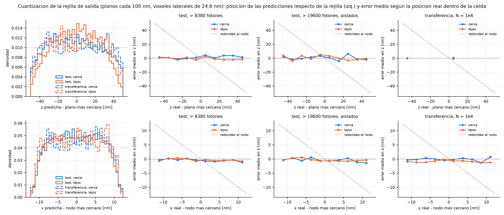
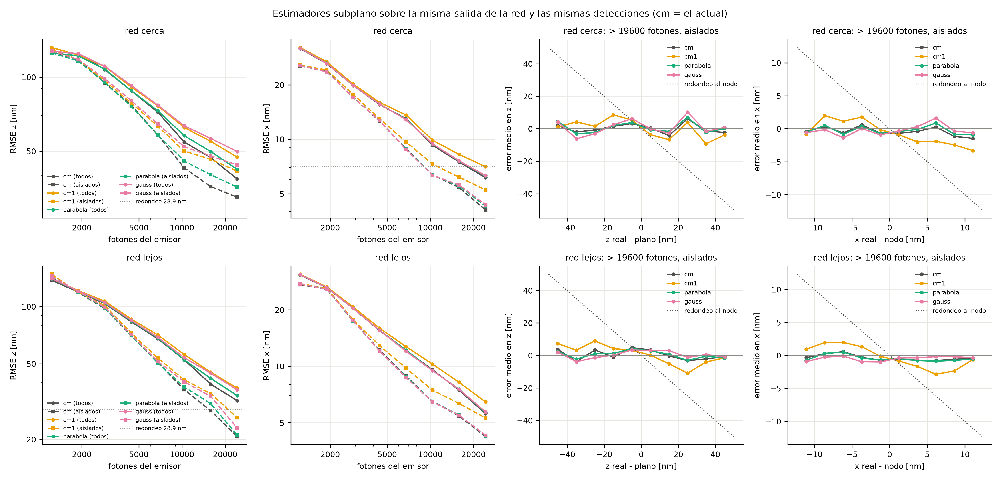
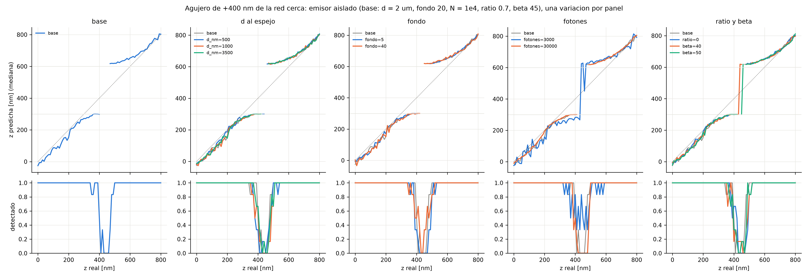

# Piso de error y agujero de +400 nm de las redes con célula

Continuación de `resultados_celula.md`. Las preguntas eran dos:

1. ¿El piso de ~33 nm en z y de ~4–6 nm lateral de las redes `hypatia_celula_b45_cerca` y `_lejos` es cuantización de la rejilla de salida?
2. ¿El agujero de +400 nm de cerca es estable?

Todo es análisis local, sin reentrenar.

La rejilla de salida tiene planos en z = −2500 + j·100 nm y vóxeles laterales de pixel/4 = 24.62 nm, con centros en x_px = (v + 0.5)/4 − 0.5. El post-procesado (`localizacion/postproc.py`) toma cada máximo local 3D y calcula la posición continua por centro de masa en ±2 planos y ±2 vóxeles. Si la posición fuera solo un redondeo al nodo más cercano, el RMSE sería dz/√12 = 28.9 nm en z y 24.62/√12 = 7.1 nm por eje lateral (10.0 nm en 2D).

```bash
PY=~/miniforge3/envs/tesis/bin/python
export LD_PRELOAD=$HOME/miniforge3/envs/tesis/lib/libstdc++.so.6
$PY figuras/red_celula.py transferencia          # ~10 min; ahora guarda red_celula_transferencia_imagenes.csv (x, y, z predichas)
$PY figuras/red_celula.py agujero --n-rep 6      # ~10 min; --reusar resume el CSV por imagen sin correr la red
$PY figuras/cuantizacion.py fases                # 1 y 2: lee evaluaciones y CSV por imagen (segundos)
$PY figuras/cuantizacion.py subplano             # 2 y 3: corre la red sobre los dos tests (~10 min)
$PY figuras/red_celula.py transferencia --variantes cerca --checkpoint cerca localizacion/corridas/hypatia_celula_b45_cerca_20261110-234627/ultimo.pt --salida <otra carpeta>
```

Las figuras son PNG a 300 dpi:

- `figuras/cuantizacion/fig_cuantizacion_fases.png` (partes 1 y 2);
- `figuras/cuantizacion/fig_cuantizacion_subplano.png` (parte 3);
- `figuras/red_celula/fig_red_celula_agujero.png` (parte 4).

Las tablas están en `figuras/cuantizacion/cuantizacion_*.csv` y `figuras/red_celula/red_celula_agujero*.csv`.

## Resumen

| | resultado |
|---|---|
| ¿es cuantización? | **No.** El error no depende de dónde cae la posición real dentro de la celda de la rejilla. Con emisores aislados de 10⁴ fotones, el RMSE z sobre un plano y a mitad de celda es 34.7 frente a 32.9 nm (cerca) y 24.4 frente a 25.3 nm (lejos); el redondeo daría 0 frente a 50 nm. En los tests, el sesgo según la fase real es ±6 nm en z y ±1.5 nm en x, frente a la rampa de ±50 / ±12 nm del redondeo |
| ¿hay atracción hacia los nodos? | Sí, pero pesa poco. Las z predichas se acumulan algo cerca de los planos: el 11–14 % cae a < 5 nm, frente al 10 % si fueran uniformes. Eso equivale a sumar en cuadratura 2.6 nm (cerca) y 5.1 nm (lejos) de RMS a todos los TP, y 0.8 y 2.6 nm a los de > 8380 fotones. En x, y suma 0.7–1.1 nm |
| RMSE a > 19600 fotones, aislados, frente a la cota de redondeo | z: 32.5 nm (cerca) y 20.8 nm (lejos), frente a 28.9 nm. Por eje lateral: 3.8–4.2 nm, frente a 7.1 nm. Lejos y lo lateral quedan **por debajo** de la cota de redondeo, así que la rejilla no los limita. El 32.5 de cerca es parecido a 28.9 por casualidad: su error es igual sobre el plano que entre planos |
| centro de masa exactamente en un plano | Pasa en el 0.07 % de las detecciones de cerca (7 en el test: 5 en z = 300.0 y 2 en 2400.0) y nunca en lejos. Ocurre solo cuando la red pone toda la masa en un único plano, con los demás planos de la ventana en 0 (la hardtanh recorta a 0). La saturación del máximo (17 % en cerca, 9 % en lejos) nunca lo causa. Esos planos son los bordes del agujero (300 nm) y el tope superior de cerca (2400 nm) |
| sesgo propio del centro de masa (sobre el target exacto, σ = 1 vóxel) | ±2 planos: máximo 4.5 nm y RMS 2.4 nm en z (1.1 y 0.6 nm lateral). Con ±1 sería 23.3 y 13.3 nm: la ventana de ±2 de `check_postproc.py` es la correcta |
| estimadores subplano alternativos sobre la misma salida | **Ninguno mejora al centro de masa actual.** A > 19600 fotones, aislados: z de 32.5 → 35.8 (parábola), 41.5 (cm ±1) y 43.9 nm (gaussiana de 3 puntos) en cerca; 20.7 → 21.1, 26.0 y 23.0 nm en lejos. Lateral (x): 4.1 → 4.3, 5.2 y 4.3 nm. Pasa lo mismo en todos los rangos de fotones |
| ¿de dónde viene el piso? | De lo que la red codifica en su salida, no de cómo se lee. La posición entre planos ya está bien representada (sesgo por fase ~0), pero la z que la red pone tiene un error de ~20–35 nm a muchos fotones, cuando la CRLB es ~12 nm sin reflejo y 5–7 nm con él (`resultados_celula.md`, sección 3). Bajar dz o cambiar el estimador no lo resolvería |
| `ultimo.pt` de cerca | **Tiene los mismos pesos que `mejor.pt`** (máxima diferencia 0.0; los dos son de la época 99, la última fue la mejor). La curva de transferencia con `ultimo.pt` es idéntica bit a bit. No hay checkpoints intermedios en ninguna corrida (solo `mejor.pt` y `ultimo.pt`), así que la estabilidad frente al entrenamiento no se puede probar sin otra semilla |
| agujero de +400 nm frente a las condiciones de entrada | **Es estable en todas.** Probé d al espejo 0.5–3.5 µm, fondo 5–40, 3000–30000 fotones, ratio 0 y 0.7, y β de 40 a 50°. En las 11 condiciones la detección cae a 0 (0.33 con 3000 fotones) entre z ≈ 350–390 y 490–530 nm, y la red no devuelve **ninguna** z entre 300.0 y 612–621 nm. Es una propiedad de la red en z, no de la escena |

## 0. `figuras/analisis_datos_reales.py`

No se modificó desde el 2026-11-10 18:31, antes de las corridas de `resultados_celula.md` del 12. `figuras/red_celula.py reales`, corrido de nuevo contra ese archivo, reproduce bit a bit `red_celula_reales.csv`, `red_celula_reales_resumen.csv` y `red_celula_reales_perfiles.csv`. Quedó commiteado (1848d1d) sin cambios. `analisis_datos_reales_multi.py` y las figuras `fig_datos_reales_*` siguen sin commitear.

## 1. Posición de las predicciones respecto de la rejilla



`figuras/cuantizacion/cuantizacion_fases.csv`. Las columnas «< 5 nm» dan la fracción de predicciones a menos de 5 nm del plano o nodo más cercano; si las fases fueran uniformes, sería 0.10 en z y 0.41 por eje lateral. La «atracción» es el RMS de p(s) − s, con p la función cuantil de las fases predichas: lo que la acumulación cerca de los nodos suma al error, en cuadratura, si la fase real es uniforme. Lo es, porque la célula es suave a escala de 100 nm (en el GT es 0.4 nm).

| fuente | n | z a < 5 nm | z exacto (< 0.01 nm) | x / y a < 5 nm | atracción z | atracción x / y |
|---|---|---|---|---|---|---|
| test cerca, todas | 10320 | 0.114 | 0.001 | 0.494 / 0.495 | 2.9 nm | 1.1 / 1.1 nm |
| test cerca, TP > 8380 fotones | 4567 | 0.098 | 0.002 | 0.452 / 0.463 | 0.8 nm | 0.7 / 0.7 nm |
| test lejos, todas | 10884 | 0.136 | 0.000 | 0.488 / 0.491 | 5.4 nm | 1.1 / 1.1 nm |
| test lejos, TP > 8380 fotones | 4789 | 0.113 | 0.000 | 0.441 / 0.451 | 2.6 nm | 0.7 / 0.8 nm |
| GT de los TP (referencia) | 9800 / 10304 | 0.098 | 0 | 0.41 | 0.4 nm | 0.1 nm |
| transferencia, cerca | 2787 | 0.104 | 0.003 | 0.448 / 0.455 | 1.1 nm | 0.8 / 0.8 nm |
| transferencia, lejos | 3106 | 0.102 | 0.000 | 0.464 / 0.459 | 2.3 nm | 0.8 / 0.8 nm |
| barrido del agujero (cerca, base, fuera de 250–650 nm) | 240 | 0.129 | 0.000 | 0.450 / 0.475 | 4.1 nm | 0.7 / 1.1 nm |

- Hay una acumulación moderada cerca de los planos: la densidad a < 10 nm de un plano es 1.7 veces (cerca) y 3.3 veces (lejos) la que hay a 40–50 nm. Casi no hay predicciones exactamente sobre un plano.
- La acumulación es menor con más fotones. Sumada en cuadratura a un error de 20–35 nm, mueve el RMSE en menos de 0.2 nm.

## 2. ¿Depende el error de la posición dentro de la celda?

Con cuantización, el error medio contra la posición real dentro de la celda sería la rampa −(z − plano), y el RMSE crecería de 0 sobre el plano a 50 nm a mitad de celda. Nada de eso aparece (`figuras/cuantizacion/cuantizacion_sesgo_fase.csv`, `cuantizacion_rmse_altos.csv`, `cuantizacion_transferencia_fase.csv`):

| | cerca | lejos |
|---|---|---|
| sesgo z por fase, > 19600 fotones aislados (10 rangos de 10 nm) | −4.2 a +6.2 nm; RMS 3.0 nm | −3.8 a +4.8 nm; RMS 3.0 nm |
| sesgo x por fase, ídem | RMS 0.75 nm | RMS 0.56 nm |
| transferencia, N = 10⁴, RMSE z sobre un plano / a mitad de celda | 34.7 / 32.9 nm (n = 321 / 312) | 24.4 / 25.3 nm (n = 328 / 320) |
| RMSE a > 19600 fotones, todos: z, x, y (lateral 2D) | 38.6, 6.2, 5.9 (8.6) nm | 32.0, 5.6, 5.8 (8.0) nm |
| ídem, aislados | **32.5**, 4.1, 3.8 (5.6) nm | **20.8**, 4.2, 3.9 (5.8) nm |
| cotas de redondeo | z 28.9; por eje 7.1; 2D 10.0 nm | |

- **El piso de z no es cuantización.** Lejos llega a 20.8 nm, por debajo de dz/√12, con la misma rejilla y el mismo post-procesado. El RMSE de cerca (32.5 nm) es igual sobre el plano que entre planos.
- **Lo lateral tampoco.** El «piso de ~8.5 nm» de `resultados_celula.md` era el RMSE lateral 2D de todos los emisores, que incluye la superposición. En los aislados es 3.8–4.2 nm por eje, frente a 7.1 nm de la cota de redondeo.
- **Cuándo el centro de masa devuelve exactamente un plano** (`figuras/cuantizacion/cuantizacion_cm_plano.csv`). La posición es k + Σw·dk / Σw, así que vale exactamente k si Σw·dk = 0. En teoría pasa con pesos simétricos, con una meseta saturada simétrica o con un pico que tiene a 0 todos los demás planos de la ventana. En la práctica solo se da el último caso: el 0.07 % de las detecciones de cerca (todas con los 4 vecinos en z de la columna del máximo en 0) y nunca en lejos. Que el máximo valga 100 (saturado) pasa en el 17 % de las detecciones de cerca y el 9 % de las de lejos, pero ninguna de ellas cae en un plano. Los planos donde ocurre son 300.0 nm (el borde inferior del agujero; en el barrido fino, 98 detecciones de emisores con z real de 350–450 nm) y 2400.0 nm (el tope de cerca). Ahí la red no reparte la masa entre planos, sino que la pone toda en un único plano frontera.
- **Sesgo propio del centro de masa sobre el target exacto** (gaussiana σ = 1 vóxel, ventana ±2): máximo 4.5 nm, RMS 2.4 nm en z. Con ±1 sería 13.3 nm de RMS, así que la ventana de ±2 que eligió `check_postproc.py` está bien.

## 3. Estimadores subplano alternativos



Sobre la misma salida de la red y los mismos máximos, con las mismas detecciones y confianzas que el post-procesado actual, se cambió solo cómo se calcula la posición:

| estimador | qué hace |
|---|---|
| `cm` | el actual: centro de masa, ±2 planos y ±2 vóxeles |
| `cm1` | centro de masa con ±1 |
| `parabola` | parábola por 3 puntos en cada eje a través del máximo |
| `gauss` | parábola en log (gaussiana de 3 puntos), exacta para el target |

`cm` reproduce `evaluate.py`: TP 9799 frente a 9800 de Hypatia en cerca y 10304 frente a 10304 en lejos, con el mismo RMSE. Los datos están en `figuras/cuantizacion/cuantizacion_subplano.csv`.

| RMSE z [nm], aislados | cm | cm1 | parabola | gauss |
|---|---|---|---|---|
| cerca, 1000–1530 fotones | 126.8 | 130.4 | 125.4 | 127.7 |
| cerca, 5480–8380 | 58.2 | 63.3 | 58.3 | 64.6 |
| cerca, 12800–19600 | 35.9 | 46.4 | 40.1 | 47.9 |
| cerca, 19600–30000 | **32.5** | 41.5 | 35.8 | 43.9 |
| lejos, 1000–1530 | 143.1 | 148.0 | 143.9 | 144.5 |
| lejos, 5480–8380 | 50.8 | 53.6 | 50.6 | 51.5 |
| lejos, 12800–19600 | 28.3 | 34.9 | 30.9 | 33.7 |
| lejos, 19600–30000 | **20.7** | 26.0 | 21.1 | 23.0 |

| RMSE x [nm], aislados, 19600–30000 | cm | cm1 | parabola | gauss |
|---|---|---|---|---|
| cerca | **4.1** | 5.2 | 4.3 | 4.3 |
| lejos | **4.2** | 5.3 | 4.3 | 4.3 |

| global (todos los TP) | cm | cm1 | parabola | gauss |
|---|---|---|---|---|
| cerca: RMSE z, x | 78.5, 14.97 | 82.5, 15.48 | 79.2, 15.03 | 83.3, 15.03 |
| lejos: RMSE z, x | 75.0, 14.92 | 78.1, 15.37 | 76.1, 14.97 | 77.0, 14.95 |

- El centro de masa de ±2 es el mejor o empata en todos los rangos.
- La gaussiana de 3 puntos, que sería exacta si la salida fuera el target, empeora a muchos fotones (+11 nm en cerca). La salida de la red no tiene la forma del target en z: es más ancha o asimétrica, y el centro de masa de 5 planos la promedia mejor que una forma ajustada con 3 puntos.
- `cm1` tiene el sesgo de ventana truncada esperado (rampa de ±3 nm en x en la figura).
- **No hay ganancia sin reentrenar que valga la pena por el lado del post-procesado.**

## 4. Agujero de +400 nm de cerca



**Checkpoints.** En `hypatia_celula_b45_cerca`, `mejor.pt` y `ultimo.pt` tienen los mismos pesos (máxima diferencia 0.0). La época 99 fue a la vez la última y la de menor pérdida de validación (0.3466). En lejos, `mejor.pt` es de la época 98 y `ultimo.pt` de la 99. No se guardan checkpoints intermedios en ninguna corrida: hay 30 archivos `.pt` en `localizacion/corridas/`, todos `mejor.pt` o `ultimo.pt`. La curva de transferencia de cerca con `ultimo.pt` da las mismas detecciones y las mismas z, bit a bit.

**Por eso la pregunta «¿lo aprendió esta corrida o lo aprende cualquiera?» no se puede contestar sin reentrenar.** Haría falta otra semilla o guardar checkpoints por época, por ejemplo cada 10. Lo que sí se puede medir sin entrenar es si depende de la entrada.

**Barrido fino.** z de 0 a 800 nm cada 10 nm, 6 imágenes por punto, un emisor aislado con el recorte de pupila. La base es d = 2 µm, fondo 20, N = 10⁴, ratio 0.7 y β = 45°, y se varía una cosa a la vez (`figuras/red_celula/red_celula_agujero_bordes.csv`):

| condición | detección < 0.9 en z real | mínimo de detección | z predicha (mediana) antes → después | z predichas que no aparecen |
|---|---|---|---|---|
| base | 350–490 nm | 0 | 287 → 620 nm | 300.0–615 nm |
| d = 0.5 / 1 / 3.5 µm | 370–530 / 360–500 / 380–500 | 0 / 0 / 0 | 297→630 / 293→619 / 299→620 | 300.0–612 / 615 / 615 |
| fondo 5 / 40 | 360–520 / 350–510 | 0 / 0 | 295→629 / 294→627 | 300.0–617 / 616 |
| 3000 / 30000 fotones | 330–580 / 390–490 | 0.33 / 0 | 261→657 / 299→619 | 300.0–621 / 618 |
| ratio 0 | 380–510 | 0 | 298→622 | 300.0–617 |
| β 40 / 50° | 360–510 / 370–510 | 0 / 0 | 294→630 / 296→624 | 300.0–616 / 616 |

- **El agujero no depende de la escena.** En todas las condiciones la red lleva los emisores de z ≈ 300–350 nm al plano de 300 nm, pierde los de ~400–500 nm y asigna ~620 nm a los de ~500 nm en adelante. Ninguna detección cae en (300, 612–621) nm.
- Con más fotones el agujero se estrecha un poco (390–490 nm con 30000 fotones); con menos se ensancha (330–580 nm con 3000).
- La PSF no tiene nada especial ahí: √(1/I_zz) vale 15–19 nm y es simétrica con lejos (`resultados_celula.md`, sección 1). Es un rasgo de esta red entrenada.
- Para saber si es estable frente al entrenamiento hace falta una corrida nueva. Bastaría la misma `celula.yaml` cerca con otra `seed_train` o guardando checkpoints cada pocas épocas: si el hueco aparece en otro z o no aparece, es de esta corrida.

## Qué cambia en `resultados_celula.md`

- El piso de ~35–40 nm en z a muchos fotones **no** es la rejilla (dz = 100 nm), ni el centro de masa, ni la ventana. Sí lo es que la red no aproveche el reflejo (control sin reflejo) y su precisión propia en z, 1.75× (lejos) y 2.8× (cerca) la CRLB del real solo a > 19600 fotones. Probar dz = 50 nm no se justifica por cuantización.
- El «~8.5 nm lateral» era el RMSE 2D de todos los emisores. En los aislados es 5.6–5.8 nm en 2D (3.8–4.2 por eje), por debajo de la cota de redondeo.
- `ultimo.pt` = `mejor.pt` en cerca. La comprobación del agujero con `ultimo.pt` propuesta allí es trivial y está hecha. El agujero es estable frente a d, fondo, fotones, ratio y β; su estabilidad frente al entrenamiento queda pendiente de otra semilla.
- La sensibilidad de la z triangulada a β es ~0.19 µm por grado alrededor de 45°, no ±1 µm (corregido allí).
