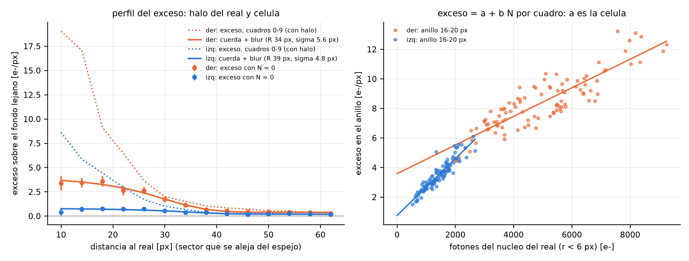
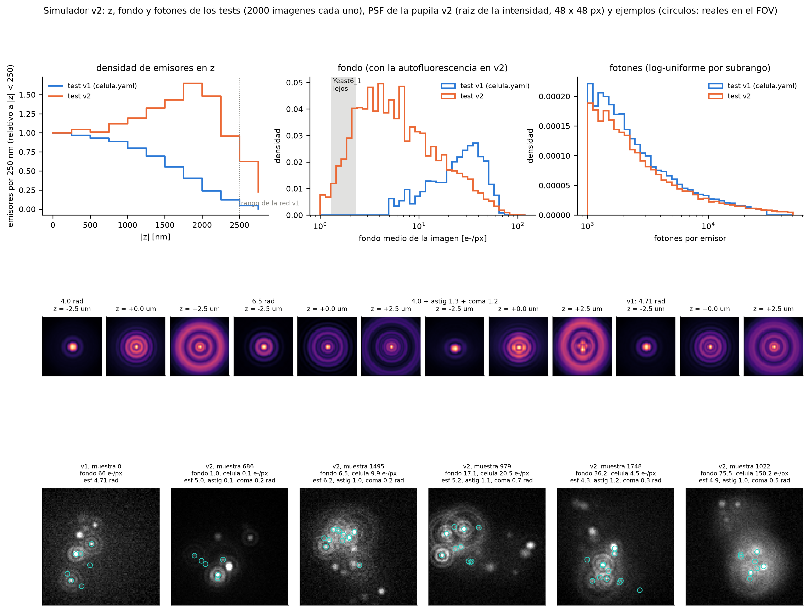
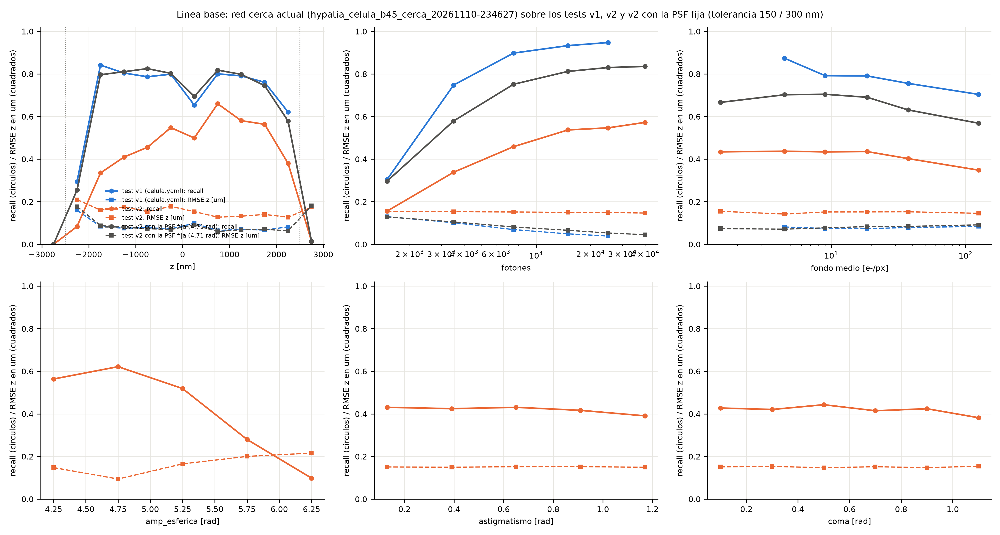

# Simulador v2: parámetros medidos y PSF aleatorizada

Simulador del próximo entrenamiento con célula. Usa los parámetros medidos en Yeast6_1 (`resultados_psf_real.md`, `resultados_suma_canales.md`), la pupila calibrada (`resultados_calibracion_pupila.md`, sección 7) y una PSF que cambia de muestra en muestra. Solo cubre la variante **cerca**, con el signo fijo. La config es `localizacion/configs/celula_v2.yaml`.

Todas las opciones nuevas están apagadas por defecto. Con la config por defecto, el simulador da hoy **exactamente** las mismas imágenes que antes, bit a bit (sección 5). La línea base es la red cerca actual (`hypatia_celula_b45_cerca_20261110-234627`) sobre un test v2 de 2000 imágenes. Las dos corridas v2 de Hypatia están en la sección 7.

```bash
PY=~/miniforge3/envs/tesis/bin/python
$PY figuras/autofluorescencia_celula.py                      # contraste de la célula en Yeast6_1 (~20 s)
$PY localizacion/generar_espejo.py --config localizacion/configs/celula_v2.yaml --anillos-hacia-objetivo \
    --split test --n 2000 --salida localizacion/datos/test_celula_v2_b45_cerca          # ~3 min
$PY localizacion/generar_espejo.py --config localizacion/configs/celula_v2.yaml --anillos-hacia-objetivo \
    --split test --n 2000 --salida localizacion/datos/test_celula_v2_psf_fija_b45_cerca \
    --set datos.psf_amp_esferica_rango=null datos.psf_astig_rango=null datos.psf_coma_rango=null \
          datos.simulador.amp_esferica=4.71238898038469                                  # control: PSF fija
LD_PRELOAD=$HOME/miniforge3/envs/tesis/lib/libstdc++.so.6 $PY localizacion/evaluate.py \
    localizacion/corridas/hypatia_celula_b45_cerca_20261110-234627/mejor.pt localizacion/datos/test_celula_v2_b45_cerca --figuras 6
# (ídem con test_celula_v2_psf_fija_b45_cerca)
$PY figuras/simulador_v2.py                                  # figuras y tablas de este documento
```

## Resumen

| | resultado |
|---|---|
| cámara | Ganancia 0.45 e⁻/ADU y offset 97.75 ADU, medidos. El ruido de lectura se sortea por muestra, uniforme en [2.18, 2.90] ADU (la mediana y el rms medidos), en lugar de 99 ADU y 3.26 ADU |
| fondo | Log-uniforme en [1, 40] e⁻/px. La mediana del fondo medio de la imagen baja de 35 a 16 e⁻/px, y el 10 % de las imágenes queda por debajo de 3.7 (Yeast6_1: 1.3–2.3 lejos de la célula). Se suma la **autofluorescencia de la célula** con su forma y con un contraste uniforme en [0, 4.0] veces el fondo base |
| autofluorescencia medida | Exceso con el real apagado (N = 0) sobre el fondo lejano: **1.83×** en el canal derecho (3.5 e⁻/px sobre 1.9) y **0.46×** en el izquierdo (0.6 sobre 1.3). El perfil encaja con la cuerda de una esfera con un blur de 4.8–5.6 px |
| fotones | Hasta 50 000 por emisor (el real del canal derecho: 35 000–68 000 en total) |
| z | La red cubre ±3000 nm. Con `celula_peso_polos` 0.5, los emisores con \|z\| > 2 µm pasan del 6.3 % al 25 %. La densidad a 2.5–2.75 µm pasa de 0.05 a 0.62 veces la del centro, y a 2.75–3 µm, de 0.00 a 0.23 (el límite lo pone el diámetro de la célula, 4–6 µm) |
| PSF | Por muestra: esférica uniforme en [4.0, 6.5] rad, astigmatismo y coma con magnitud uniforme en [0, 1.3] y [0, 1.2] rad y orientación uniforme. **El real y su reflejo comparten la pupila de la muestra.** Signo fijo: cerca (`anillos_hacia_objetivo: true`) |
| bit a bit | Con los valores por defecto, las imágenes, el GT y la meta coinciden con los del código anterior. Lo verifican `celula.yaml` (cerca, 20 muestras; lejos, 10), `espejo.yaml` y `base.yaml`, además de la regresión del simulador sin espejo. Hay 114 tests en el simulador y 75 en `localizacion`, todos OK |
| coste | 81 ms por muestra localmente, frente a 53 ms con `celula.yaml` (el banco no sirve para la pupila de cada muestra: cada emisor y cada reflejo es una FFT). Con 8 workers da ~100 muestras/s |
| **línea base (red cerca actual)** | test v1: recall 0.757, precisión 0.950, RMSE z 78 nm. **Test v2: recall 0.419, precisión 0.427, RMSE z 151 nm.** Control v2 con la PSF fija de entrenamiento: recall 0.666, precisión 0.753, RMSE z 81 nm |
| lectura | **La aleatorización de la PSF es lo que más pesa.** Con amp_esferica ≥ 6 rad el recall cae a 0.10 y el sesgo en z es de +180 nm. Fuera de la PSF, la red pierde por \|z\| > 2.5 µm (no puede predecirlos), por la autofluorescencia (FP por imagen: de 0.36 a 3.7 al subir el contraste) y algo de recall con fondos altos |

## 1. Qué cambia

| | `celula.yaml` (v1) | `celula_v2.yaml` | fuente |
|---|---|---|---|
| `gain` | 0.46 e⁻/ADU | 0.45 | transferencia de fotones, `resultados_psf_real.md` §4 |
| `offset` | 99 ADU | 97.75 | nivel oscuro fuera de las aperturas (97.78 / 97.73) |
| ruido de lectura | 3.26 ADU | uniforme en [2.18, 2.90] ADU por muestra (`datos.read_noise_rango`) | mediana y rms de las diferencias de cuadros / √2 |
| `fondo_rango` | [5, 40], uniforme | [1, 40], **log-uniforme** (`muestreo_fondo: log`) | fondo de Yeast6_1: 1.3–2.3 e⁻/px |
| autofluorescencia | — | contraste en [0, 4.0] × fondo base, blur 5 px (`fondo_celula_contraste_rango`, `fondo_celula_sigma_px`) | sección 2 |
| `fotones_rango` | [1000, 30000] | [1000, 50000] | real del canal derecho, 35 000–68 000 |
| `z_rango_nm` | ±2500 | ±3000 (61 + 4 planos) | la célula llega a ±3 µm |
| z en la célula | uniforme en el volumen | `celula_peso_polos: 0.5` | sección 3 |
| `amp_esferica` | 4.71 rad (1.5π) | uniforme en [4.0, 6.5] rad por muestra | calibración: 4.11 (cuenca ganadora de cerca) y 6.40 (la otra cuenca), sección 7 |
| astigmatismo | — | magnitud uniforme en [0, 1.3] rad, ángulo uniforme en [0, 180°) | ajuste con los 5 Zernike: \|a2\| = 1.04 |
| coma | — | magnitud uniforme en [0, 1.2] rad, ángulo uniforme en [0, 360°) | ajuste: \|a3\| = 1.04 |
| entrenamiento | — | `checkpoint_cada: 10`, `metricas_val: true`, nombre `celula_v2` | |

No cambian: la geometría del espejo (β en [40, 50]°, φ aleatorio), la célula (diámetro 4–6 µm, contacto en el centro ± 10 px, centro a z = 0), `ratio_reflejo_rango` [0.45, 1], el recorte de pupila del real y del reflejo, la red (`dz` 100 nm), la pérdida y el optimizador.

## 2. Autofluorescencia de la célula en Yeast6_1

`figuras/autofluorescencia_celula.py` → `figuras/fig_autofluorescencia_celula.png`, `figuras/autofluorescencia_celula.csv`.



**Método.** La célula no se ve aislada: alrededor del real está el halo de su PSF, que cae con el fotoblanqueo (núcleo de 5 970 a 2 570 e⁻ en el derecho). Por cuadro y por anillo de 4 px alrededor del real se mide el exceso sobre el fondo lejano:
- centro en la posición del real en ese cuadro;
- sector de ±60° que se aleja del espejo y de la franja;
- fondo lejano: mediana a 60–120 px, dentro de la apertura.

El exceso se ajusta como exceso(r, t) = a(r) + b(r) N(t), con N los fotones del núcleo (r < 6 px). b N es el halo del real, y a(r), lo que queda con el real apagado: la autofluorescencia. Es una cota inferior si la autofluorescencia se blanquea al mismo ritmo que el real.

| canal | fondo lejano | exceso a (N = 0), 8–20 px | **contraste a / fondo** | exceso con el halo, cuadros 0–9 | ajuste cuerda + blur |
|---|---|---|---|---|---|
| der | 1.89 e⁻/px | 3.46 e⁻/px | **1.83** | 15.1 (8.0×) | amplitud 3.56, R 34 px, σ 5.6 px |
| izq | 1.34 | 0.61 | **0.46** | 6.3 (4.7×) | amplitud 0.59, R 39 px, σ 4.8 px |

- a(r) tiene un plateau hasta ~20 px y cae a ~0.4 e⁻/px a 40 px. Es el perfil de una esfera vista en proyección (`perfil_celula`: cuerda √(1 − r²/R²) con blur gaussiano).
- El R ajustado (34–39 px, 3.4–3.8 µm) es mayor que el radio de una célula de 5 µm (25 px). El perfil está centrado en el real, no en la célula, y el real se mueve 15 px en el video: las dos cosas ensanchan el perfil. El simulador usa el radio de la célula de la muestra.
- El rango [0, 4.0] cubre los dos canales con margen (el doble del canal derecho, por si la autofluorescencia se blanquea con el real y la medida la subestima) y llega a 0, para células poco autofluorescentes. El contraste es relativo al fondo base: si la autofluorescencia escala con la excitación, también escala con el fondo.
- En el simulador, la célula virtual (el reflejo de la célula) también brilla, con `ratio_reflejo` veces la amplitud. La amplitud se sortea por video, al final del flujo del fondo.

## 3. z: densidad en los polos

Uniforme en el volumen, la densidad de emisores en z cae como 1 − (z/R)² y se vacía en los polos. Con `celula_peso_polos` = w, la densidad en s = (z − z_c)/R es

    f(s) = (1 − w) · 3/4 (1 − s²) + w · 3/2 s²

con w = 0 la de antes, w = 1/3 uniforme en z y w > 1/3 con más peso en los polos. A cada z el emisor es uniforme en el disco de la célula, y se usan los mismos 3 sorteos por emisor (`GeometriaCelula.peso_polos`, CDF cúbica invertida por bisección). Con w = 0.5, en los GT de los tests:

| \|z\| [µm] | 0–0.25 | 0.5–0.75 | 1–1.25 | 1.5–1.75 | 1.75–2 | 2–2.25 | 2.25–2.5 | 2.5–2.75 | 2.75–3 |
|---|---|---|---|---|---|---|---|---|---|
| v1 (volumen) | 1.00 | 0.93 | 0.80 | 0.56 | 0.41 | 0.24 | 0.12 | 0.05 | 0.00 |
| v2 (w = 0.5) | 1.00 | 1.01 | 1.19 | 1.43 | 1.65 | 1.48 | 0.96 | 0.62 | 0.23 |

Densidad relativa al primer bin. Los emisores con |z| > 2 µm pasan del 6.3 % al 25.2 %, y los de |z| > 2.5 µm, del 0.8 % al 6.5 %. Por encima de ~2.5 µm solo contribuyen las células grandes (R > |z|), así que el último bin no se llena con ningún w sin cambiar el diámetro o la altura de la célula. Con w = 0.6 el bin de 2.75–3 µm sube a 0.30, a costa de poner el doble de emisores a ~2 µm que en el centro.

## 4. PSF aleatorizada



**Pupila de la muestra.** La fase es

    amp_esferica Z4^0 + amp_astig ρ² cos 2(t − θa) + amp_coma (3ρ³ − 2ρ) cos(t − θc)

con la normalización de `fase_esferica`: valor máximo `amp` en el disco unidad. Es la misma convención que `figuras/calibracion_pupila.py`: amp_astig = hypot(a22, a2m2) y amp_coma = hypot(a31, a3m1).

`localizacion` la sortea por muestra con su propio flujo: `spawn_key (idx, 1004)`, siempre 5 uniformes e independiente del reintento. Así, encenderla no cambia ni las posiciones, ni la geometría, ni los fotones, ni el fondo (test). Los valores van a la meta y a `muestras.csv`.

**El real y su reflejo comparten la pupila.** El banco se construye una vez, con la pupila base (`amp_esferica` 5.25). Cuando la pupila de la muestra no es la del banco (`pupila_del_banco`), `generar_video` dibuja cada subposición del real y del reflejo con la PSF directa de esa pupila:
- `PSFRecortada` con la máscara del espejo, para el reflejo y para el real cuando el recorte está activo, como en `celula_v2.yaml`;
- sin máscara (`recortar=False`) en los demás casos.

El banco solo da K (256 con cerca). La SNR del GT también usa la PSF de la muestra.

**Signo.** Con `anillos_hacia_objetivo: true`, el simulador calcula la PSF conjugada (q = +z, máscara en −f). En la convención de la calibración (q = −z) eso equivale a a40 < 0, y los términos impares cambian de signo. Como la orientación de astigmatismo y coma es uniforme, la familia de PSF es la misma.

**Rangos frente a la calibración (sección 7).** [4.0, 6.5] rad cubre las dos cuencas de cerca: 4.11 (la ganadora) y 6.40. Las magnitudes del ajuste con los cinco Zernike desde el mínimo 9 son |astig| 1.05 y |coma| 1.04. El rango de la coma, [0, 1.2], cubre el ajuste (en la primera versión era [0, 0.9] y quedaba por debajo).

**Coste.** 2.5 ms por FFT de 256². Una muestra v2 tarda 81 ms, frente a 53 ms con `celula.yaml`: en las dos, el real y el reflejo ya eran PSF directas por el recorte de pupila, y lo nuevo es la SNR con la pupila de la muestra y el perfil de la célula. Con 8 workers da ~100 muestras/s, por encima de las ~85 muestras/s que procesa la GPU.

## 5. Bit a bit con la config por defecto

- **Simulador.** Las opciones v2 valen por defecto 0, `"uniforme"` y `None` (`DEFECTO_V2`), y con esos valores no se escriben en `config.json` ni en `resumen()`. Sin aberraciones, la fase no se toca (no se suma ni un cero). El fondo uniforme hace las mismas llamadas al rng, y el sorteo de la célula solo existe si está activa. Si la pupila de la muestra es la del banco, se usa el banco como antes; el ángulo de una aberración de amplitud 0 no cuenta.
- **`localizacion`.** Los rangos de PSF en `None` no sortean nada ni agregan nada a la meta.
- **Verificación:**
  - `localizacion/tests/test_regresion_celula.py` guarda hashes de imagen, GT y meta de `celula.yaml` cerca y lejos y de `espejo.yaml` cerca. `referencia_regresion_celula.json` se escribió con el código de antes de estos cambios. Además, fuera del repo, 20 muestras de cerca, 10 de lejos y 10 de `base.yaml` a resolución completa dan el mismo hash antes y después.
  - `simulador_nuevo/tests/test_regresion.py` (sin espejo), `tests/test_espejo.py` y `tests/test_convencion_z.py` siguen OK.
  - Con rangos degenerados (esférica fija en 1.5π, aberraciones en [0, 0]), las muestras son bit a bit las de sin PSF aleatoria (`localizacion/tests/test_v2.py`).
- **Tests nuevos:**
  - `simulador_nuevo/tests/test_v2.py` (10): la fase y su convención; el astigmatismo alarga la PSF en su eje; la PSF directa coincide con el banco; la pupila de la muestra se usa en lugar del banco (= un banco de esa pupila); real y reflejo con la misma pupila (la imagen se reconstruye); fondo log; autofluorescencia (amplitud/base en el rango, 1 en la célula, `ratio_reflejo` en la virtual, 0 lejos); densidad en z para w = 0, 1/3 y 0.7.
  - `localizacion/tests/test_v2.py` (6): validación; magnitudes y ángulos dentro de los rangos y cubriéndolos; flujo propio; rangos degenerados; meta y SNR con la pupila de la muestra; `celula_v2.yaml` de punta a punta.

## 6. Línea base: la red cerca actual sobre el test v2



**Tests** (regenerados con la config actual: coma en [0, 1.2] rad y contraste de la autofluorescencia en [0, 4.0]):
- `test_celula_v2_b45_cerca`: 2000 imágenes, semilla 3, 13 067 emisores en el FOV, 0 reintentos, 156 s.
- el **control** `test_celula_v2_psf_fija_b45_cerca`: las mismas muestras (misma semilla, mismas posiciones, fotones, fondo y autofluorescencia), con la PSF de entrenamiento (4.71 rad, sin aberraciones).

Los dos rangos nuevos no cambian las posiciones, los fotones ni el fondo base: la coma sale del flujo propio de la pupila y la amplitud de la célula es el último sorteo del fondo. Los emisores son los mismos que en la primera versión (13 067).

Tolerancia 150 / 300 nm. La red se entrenó con z en ±2500 nm y no puede predecir más allá de ±2700 (los planos del margen). Tablas en `figuras/simulador_v2_linea_base.csv`.

| test | recall | precisión | FP por imagen | RMSE lat | RMSE z | sesgo z | recall \|z\| ≤ 2.5 µm |
|---|---|---|---|---|---|---|---|
| v1 (`test_celula_b45_cerca`) | 0.757 | 0.950 | 0.26 | 21.2 nm | 78.5 nm | +0.7 nm | 0.757 |
| v2 con la PSF fija | 0.666 | 0.753 | 1.43 | 21.6 | 80.9 | +4.6 | 0.712 |
| **v2** | **0.419** | **0.427** | **3.67** | **39.5** | **151.4** | **+39.4** | 0.447 |

Frente a la primera versión del test (coma ≤ 0.9 rad, contraste ≤ 2.5), el v2 pierde poco recall (0.428 → 0.419) y gana FP (3.25 → 3.67 por imagen) y error lateral (34.2 → 39.5 nm). El control pasa de 1.07 a 1.43 FP por imagen, solo por la autofluorescencia más fuerte.

**Por amp_esferica** (v2 frente al control, emisor a emisor; RMSE z de los que detectan los dos):

| amp_esferica [rad] | 4.0–4.5 | 4.5–5.0 | 5.0–5.5 | 5.5–6.0 | 6.0–6.5 |
|---|---|---|---|---|---|
| recall v2 / control | 0.56 / 0.67 | 0.62 / 0.65 | 0.52 / 0.67 | 0.28 / 0.67 | **0.10** / 0.67 |
| RMSE z v2 / control | 147 / 67 nm | 90 / 74 | 163 / 68 | 199 / 64 | 218 / 73 |
| sesgo z v2 | −111 nm | +23 | +133 | +177 | +183 |
| FP por imagen v2 / control | 1.95 / 1.21 | 1.98 / 1.56 | 3.06 / 1.57 | 4.62 / 1.24 | 6.61 / 1.55 |

**Por contraste de la autofluorescencia** (amplitud de la célula / fondo medio de la imagen, que incluye la célula; por eso no pasa de 2.4 aunque el sorteo llegue a 4.0):

| contraste | < 0.25 | 0.25–0.5 | 0.5–1 | 1–2 | 2–4 |
|---|---|---|---|---|---|
| imágenes | 314 | 294 | 508 | 828 | 56 |
| FP por imagen v2 / control | 2.29 / 0.36 | 2.66 / 0.67 | 3.52 / 1.27 | 4.42 / 2.05 | 6.75 / 3.68 |

- **La esférica domina.** Cerca de 4.71 rad (el valor de entrenamiento), la red casi no pierde recall, pero el RMSE z sube de 74 a 90 nm por el astigmatismo y la coma. Lejos de 4.71, la escala de z se corre en un sentido u otro (sesgo −111 nm por debajo, +180 nm por encima), y por encima de 5.5 rad la red deja de detectar y llena la imagen de FP. Una red entrenada con una sola amplitud **no** sirve para una esférica distinta: si la real es 4.11 o 6.40 rad, la red actual está fuera de su PSF.
- **Astigmatismo y coma**, a amplitud fija, pesan poco en recall: de 0.43 a 0.39 de un extremo al otro de cada rango; el último tramo de la coma (1.0–1.2 rad, nuevo) es el que más baja, también en el control (0.64). Sí pesan en el RMSE lateral: de 24 a 55 nm a lo largo de la coma, que corre el centroide.
- **Lo demás del v2** (control con la PSF fija):
  - el recall en |z| ≤ 2.5 µm baja de 0.757 a 0.712;
  - los emisores con |z| > 2.5 µm (6.5 %) son FN seguros: recall 0.007;
  - los FP se multiplican por 5.5, sobre todo por la autofluorescencia: 0.36 FP por imagen con contraste < 0.25 y 2.05 con 1–2. Con el rango nuevo aparecen imágenes con contraste 2–4, con 3.7 FP por imagen;
  - el fondo bajo no perjudica: el recall es 0.67–0.71 hasta 25 e⁻/px y baja a 0.57 por encima de 50;
  - con fotones > 30 000 la red sigue bien (recall 0.835, RMSE z 45 nm).

## 7. Entrenamiento v2 en Hypatia

`localizacion/configs/celula_v2.yaml` es `celula.yaml` con los cambios de la sección 1, `checkpoint_cada: 10` y `metricas_val: true`. En Hypatia hay dos semillas, desde la raiz del repo:

```bash
CONFIG=localizacion/configs/celula_v2.yaml PREFIJO=celula_v2 EPOCAS=150 TIEMPO=1-06:00:00 CPUS=8 SEMILLA=0 bash hypatia/lanzar_espejo.sh cerca
CONFIG=localizacion/configs/celula_v2.yaml PREFIJO=celula_v2 EPOCAS=150 TIEMPO=1-06:00:00 CPUS=8 SEMILLA=1 bash hypatia/lanzar_espejo.sh cerca
```

- **Nombres.** `SEMILLA` (nueva en `lanzar_espejo.sh` / `espejo.sbatch`; vacía da el comportamiento de antes) fija `entrenamiento.semilla`, que controla la inicialización y el orden. Las corridas se llaman `hypatia_celula_v2_b45_cerca_s0` y `_s1`. Los datos on-the-fly son los mismos en las dos (`seed_train` 1), así que la diferencia mide la variabilidad del entrenamiento.
- **Test compartido.** Las dos usan el test `localizacion/datos/test_celula_v2_b45_cerca`. Para que no lo generen los dos jobs a la vez, se copia antes el generado localmente con rsync: `espejo.sbatch` solo genera el test si no existe `imagenes.npy`.
- **Tiempo.** Una época de `celula.yaml` en Hypatia tardó 326 s de media (9 h las 100). Con v2 hay 18 % más planos de salida, 50 % más coste de simulación y la pasada de métricas de val: estimando ~450 s por época, las 150 épocas son ~19 h, y 30 h dejan margen.
- **Al terminar,** conviene evaluar las dos corridas también sobre el control con la PSF fija y sobre el test v1, para medir cuánto se paga en la PSF de entrenamiento por la robustez.

## Supuestos y limitaciones

- **Autofluorescencia.** El perfil es fenomenológico (cuerda de una esfera con blur gaussiano), no la imagen 3D de una esfera fluorescente con esta PSF. El contraste sale de una sola célula y de un solo video. La regresión en N supone que la autofluorescencia no se blanquea al ritmo del real: si lo hace, el contraste real es mayor; el rango [0, 4.0] llega a 2.2 veces el medido en el canal derecho (con el halo incluido, el exceso inicial es 8×).
- **Ruido de lectura.** Es gaussiano por píxel, con una σ por imagen. El sCMOS real tiene un mapa de ruido por píxel con cola (rms 2.9 frente a mediana 2.18), que no se modela.
- **β.** Sigue en [40, 50]°, aunque la calibración con la esférica sola pega en la cota de 50° (sección 7 de `resultados_calibracion_pupila.md`).
- **Altura de la célula.** El centro sigue en el foco (altura 0, pendiente de confirmar), y los polos de ±3 µm solo los alcanzan las células de 6 µm.
- **Pupila.** Solo esférica, astigmatismo y coma, con amplitud uniforme en la pupila. Los efectos de polarización de `resultados_psf_real.md` (lóbulos que rotan entre canales) no caben en el modelo escalar.
- **Línea base.** Mide una red entrenada con otra PSF y con z en ±2.5 µm, así que su caída en el test v2 es lo esperable. Lo que aporta es el reparto de la caída entre factores y el punto de comparación para las corridas v2.
