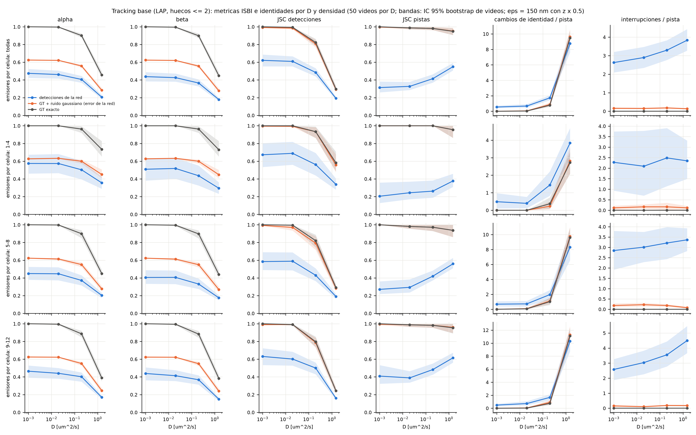
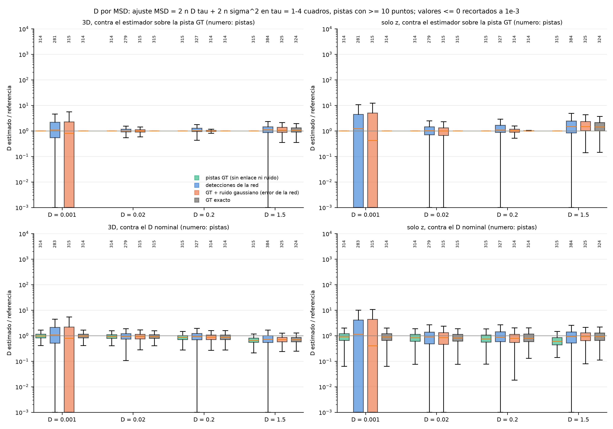
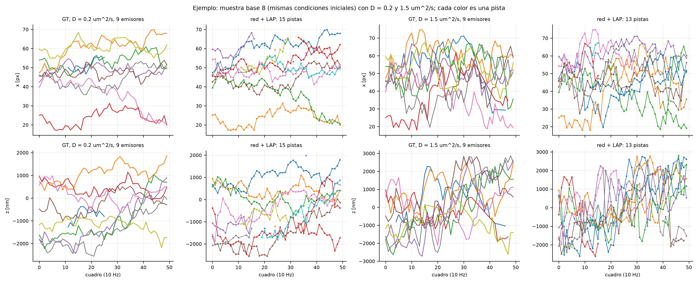

# Tracking base: red v2 + enlace LAP, validado en simulación

Primera versión del tracking 3D en la célula:
- **localización:** la red `hypatia_celula_v2_b45_cerca_s1_20261114-090158/mejor.pt` (`resultados_celula_v2.md`), cuadro a cuadro;
- **enlace:** LAP clásico entre cuadros, con cierre de huecos.

Se valida en 200 videos simulados con la config de entrenamiento de esa red (`configs/celula_v2.yaml`, cerca). Sin reentrenar, sin Hypatia.

```bash
PY=~/miniforge3/envs/tesis/bin/python
$PY tracking/tests/test_tracking.py                     # 9 tests del enlace y las métricas (~1 s)
$PY figuras/tracking_base.py datos --procesos 12        # 200 videos -> localizacion/datos/tracking_celula_v2_cerca/ (~5 min)
LD_PRELOAD=$HOME/miniforge3/envs/tesis/lib/libstdc++.so.6 $PY figuras/tracking_base.py localizar   # la red s1 (~30 min en la RTX 3060)
$PY figuras/tracking_base.py analisis                   # enlace, métricas y figuras (~30 s)
```

- **Código:** `tracking/enlace.py` (enlace), `tracking/metricas.py` (métricas) y `figuras/tracking_base.py` (el experimento).
- **Salidas en `figuras/tracking_base/`:**
  - `tracking_base_metricas.csv`: ISBI e identidades por entrada, D y densidad, con IC;
  - `tracking_base_videos.csv`: sumas por video;
  - `tracking_base_msd.csv` y `tracking_base_msd_pistas.csv`: D por MSD, agregado y por pista;
  - `tracking_base_red.csv`: error de la red;
  - `tracking_base_densidad.csv` y `tracking_base_sensibilidad_z.csv`;
  - las figuras `fig_tracking_base_{metricas,msd,ejemplo}.png` (300 dpi).

Los IC son al 95 %, por bootstrap de videos (1000 remuestreos).

## Resumen

| | resultado |
|---|---|
| datos | 200 videos de 50 cuadros a 10 Hz (96 × 96 px), 1260 trayectorias. Son 50 muestras base (célula, PSF, geometría, fotones, fondo y posiciones iniciales) × 4 valores de D, así que la comparación entre D es pareada. Hay de 1 a 12 emisores por célula. **El GT ya guardaba la identidad** (`particle_id`), así que el simulador no se tocó |
| D | **0.001, 0.02, 0.2 y 1.5 µm²/s.** El paso rms por eje y por cuadro es 14, 63, 198 y 518 nm: de muy por debajo del error de la red (27 nm lateral, 98 nm en z) a comparable con la distancia al vecino más cercano (0.66–0.71 µm lateral y 1.2 µm en 3D con 5–12 emisores) |
| la red en estos videos | Recall 0.748, precisión 0.905, 0.49 FP por cuadro. RMSE de 26.9 / 27.6 / 97.7 nm en x / y / z. No depende de D, porque no hay desenfoque de movimiento |
| D bajo (≤ 0.02) | **El enlace es perfecto con el GT** (α = 1.00 y JSC = 1.00). Con GT + ruido, el JSC es 0.99 y el α baja a 0.62 solo porque el error de posición se acerca a ε. **Con la red, lo que falla es la detección:** el JSC es 0.62, hay 3.2 pistas por partícula (996 para 314), 2.6 interrupciones por pista y un JSC de pistas de 0.31 |
| D = 0.2 | El enlace empieza a fallar incluso con el GT: 0.78 cambios de identidad por pista (0.37 con 1–4 emisores; 0.74–1.0 con 5–12) y un JSC de 0.82. La red: α 0.41, JSC 0.49, 1.7 cambios de identidad y 3.3 interrupciones por pista |
| D = 1.5 | **Domina el enlace:** con el GT exacto, α 0.46, JSC 0.30 y 9.5 cambios de identidad por pista (2.7 con 1–4 emisores; 11.1 con 9–12). La red no empeora mucho más: α 0.21 y JSC 0.19. Sin reescalar z, los cambios de identidad bajan de 9.5 a 5.7 (GT) y de 8.8 a 6.4 (red) |
| D por MSD | Ajuste de MSD(τ) = 2nDτ + 2nσ² en τ = 1–4, comparado con el mismo estimador sobre la pista GT de la partícula. Error relativo mediano de la red en 3D / solo z: **77 % / 222 %** a D = 0.001 (dominado por el ruido; el 17 % / 28 % de los D sale negativo), **13 % / 35 %** a 0.02, **13 % / 34 %** a 0.2 y **31 % / 66 %** a 1.5. Con GT + ruido: 11 / 33 % a 0.02 y 5 / 14 % a 0.2. **Confinamiento:** sobre las pistas GT, el estimador da 0.96 / 0.89 veces el D nominal a D = 0.001 y 0.65 / 0.60 a D = 1.5 |
| un cambio sobre la marcha | El radio de búsqueda al cuantil 99 % del paso cortaba el 39 % de las pistas solo por el ruido (GT + ruido a D = 0.001: 439 pistas para 314 partículas). Se pasó al 99.99 % (sección 3) |

## 1. Datos

`figuras/tracking_base.py datos` usa la config de la corrida s1 (`config.yaml` de la corrida, que es `celula_v2.yaml` con `anillos_hacia_objetivo: true`) y `data.simulacion.generar_muestra`, la misma función que genera las muestras de entrenamiento y de test. A cada video solo le cambia tres campos del simulador:
- `n_frames = 50`;
- `D_rango_um2_s = (D, D)`;
- `n_emisores_rango = (n, n)`, con n = 1 + idx % 12.

La semilla es 5, distinta de las de entrenamiento (1), validación (2) y test (3). El intervalo entre cuadros es dt = 0.1 s, y la exposición es instantánea (`n_subpasos = 1`), como en el entrenamiento.

- **Identidad:** el GT de `simulador_nuevo` ya tiene `particle_id`, además del `D_um2_s` de cada partícula. No hubo que agregar nada, así que la config por defecto sigue igual bit a bit, porque no se tocó código del simulador ni de `localizacion`.
- **Diseño pareado:** las muestras base idx = 0…49 se simulan con los 4 D, con `video_id` = k·50 + idx. Se verificó que el cuadro 0, la célula, la PSF, el fondo y los fotones coinciden entre los 4 D de cada muestra; solo cambia el movimiento.
- **Densidad:** 1–4 emisores por célula (72 videos), 5–8 (64) y 9–12 (64). El diámetro de la célula se sortea por muestra (4–6 µm), así que la distancia al vecino no baja de forma monótona con n:

| emisores por célula | videos | vecino más cercano, 3D (mediana) | lateral | diámetro medio de la célula |
|---|---|---|---|---|
| 1–4 | 72 | 1.87 µm | 1.31 µm | 4.7 µm |
| 5–8 | 64 | 1.20 µm | 0.71 µm | 4.8 µm |
| 9–12 | 64 | 1.26 µm | 0.66 µm | 5.4 µm |

**Por qué estos D.** El paso por eje en un cuadro es √(2·D·dt):

| D [µm²/s] | paso rms por eje (teórico / medido) | paso rms 3D | frente a qué |
|---|---|---|---|
| 0.001 | 14 / 14 nm | 24 nm | **casi inmóvil:** muy por debajo del error de la red (27 nm lateral, 98 nm en z). El MSD lo domina el ruido |
| 0.02 | 63 / 63 nm | 110 nm | **del orden del error de localización** |
| 0.2 | 200 / 198 nm | 350 nm | muy por encima del error y por debajo de la distancia al vecino |
| 1.5 | 548 / 518 nm | 950 nm | **comparable a la distancia al vecino** (0.66–0.71 µm lateral y 1.2 µm en 3D con 5–12 emisores). Las paredes de la célula ya acortan el paso (518 frente a 548 nm) |

El rango por defecto del simulador (0.01–0.3 µm²/s) queda dentro. A D = 1.5, en 5 s la partícula recorre √(6·D·t) ≈ 6.7 µm, más que la célula, así que el MSD se satura (sección 4).

## 2. Localización

La red s1 corre cuadro a cuadro sobre los 10 000 cuadros. Cada video lleva su geometría para el canal de distancia, y el postproc es el del checkpoint (umbral 0.4). Salen 51 635 detecciones, en 29 min en la RTX 3060. Los errores se miden emparejando cada cuadro con el GT evaluable (húngaro con la tolerancia 150 / 300 nm de `evaluate.py`):

| D | recall | precisión | FP por cuadro | RMSE x / y / z |
|---|---|---|---|---|
| 0.001 | 0.750 | 0.899 | 0.53 | 28.0 / 28.5 / 98.3 nm |
| 0.02 | 0.743 | 0.902 | 0.50 | 28.5 / 28.6 / 98.5 |
| 0.2 | 0.743 | 0.908 | 0.47 | 26.3 / 27.2 / 97.1 |
| 1.5 | 0.755 | 0.913 | 0.45 | 24.6 / 26.2 / 97.1 |
| todos | **0.748** | **0.905** | 0.49 | **26.9 / 27.6 / 97.7** |

Es algo mejor que en el test v2 de `resultados_celula_v2.md` (recall 0.672, RMSE z 99 nm), con el mismo error en z; la distribución de emisores es otra (n fijo por video, de 1 a 12). Son las detecciones las que se enlazan, incluidos los FP.

## 3. Enlace

`tracking/enlace.py`. No están instalados ni laptrack ni trackpy, así que el enlace se implementó con `scipy.optimize.linear_sum_assignment`:

- **Coordenadas:** x e y en nm, y z en nm × σ_lat / σ_z = 0.279 («z reescalada por su error mayor»). σ_lat = 27.3 nm y σ_z = 97.7 nm son los RMSE de la red en estos videos.
- **Cuadro a cuadro:** asignación húngara entre t − 1 y t, con costo d² y la matriz aumentada de Jaqaman et al. (2008), en la que cada detección puede morir o nacer con costo b = radio². Dos detecciones se enlazan solo si d < radio, y la asignación es óptima en conjunto, no voraz (test `test_lap_optimo_global`).
- **Radio:** R_CHI · √(2·D·dt + 2σ_lat²), con R_CHI = √χ²₃(0.9999) = 4.59 y el D de la condición. El radio se elige por el D esperado, como se hace en la práctica, así que no se mide la robustez a un D desconocido. Vale de 190 nm (D = 0.001) a 2.5 µm (D = 1.5).
- **Cierre de huecos:** otra asignación aumentada entre finales y comienzos de segmento separados por 1 o 2 cuadros vacíos, con costo d² / g y umbral d < radio·√g.
- **Sin Kalman.** Con un modelo browniano la predicción es la última posición, que es lo que ya usa el costo. Un Kalman solo suavizaría el ruido, lo que sirve a D bajo, donde el enlace ya es perfecto con el GT.
- **El cambio de R_CHI.** La primera corrida usó el cuantil 99 % (3.37). Con GT + ruido y D = 0.001, que debería ser trivial, salieron 439 pistas para 314 partículas y 0.42 cambios de identidad por pista. Un 1 % de enlaces perdidos por paso son 1 − 0.99⁴⁹ = 39 % de pistas con al menos un corte, y un corte entre cuadros consecutivos no lo repara el cierre de huecos. Con el 99.99 % quedan 315 pistas y 0.003 cambios por pista. Es un error de diseño del radio, no un ajuste a la red: el cambio se decidió con el GT + ruido, y la red se evalúa con los mismos parámetros que los controles.

Se enlazan tres entradas con los mismos parámetros, para separar el error de localización del de enlace:
- **red:** las detecciones de la red, con sus FN y FP;
- **GT + ruido:** las posiciones GT evaluables con ruido gaussiano de σ = 26.9 / 27.6 / 97.7 nm por eje (el RMSE de la red), sin FN ni FP;
- **GT exacto:** las posiciones GT evaluables sin ruido. Mide solo el enlace.

## 4. Métricas



`tracking/metricas.py`:
- **ISBI (Chenouard et al., Nat. Methods 2014).**
  - La distancia entre pistas es Σ_t min(‖θ(t) − ω(t)‖, ε) sobre la unión de sus cuadros, con ε si solo una de las dos está definida.
  - El emparejamiento húngaro es con pistas vacías.
  - α = 1 − d(X, Y*) / d(X, ∅); β descuenta además las pistas espurias.
  - JSC de detecciones y JSC de pistas.
  - La distancia es en (x, y, z · 150/300) con **ε = 150 nm**, es decir, el elipsoide de 150 nm lateral y 300 nm axial de la evaluación de la red. El desafío usaba ε = 5 px (490 nm aquí). Con un ε más estricto, α refleja también el error de localización: con GT + ruido, α no pasa de 0.62 aunque el enlace sea perfecto.
- **Identidades (como CLEAR MOT).** En cada cuadro, puntos reales y estimados se emparejan (húngaro, d < ε). Por pista real:
  - **cambios de identidad:** veces que cambia el id estimado emparejado;
  - **interrupciones:** tramos emparejados − 1;
  - **ids distintos** que la cubren.

Todas las densidades juntas (50 videos y 314–315 pistas reales por D):

| entrada | D | α [IC] | β | JSC detecciones | JSC pistas | cambios de id. / pista | interrupciones / pista | pistas estimadas |
|---|---|---|---|---|---|---|---|---|
| red | 0.001 | **0.475** [0.424, 0.520] | 0.438 | 0.621 | 0.314 | 0.55 | 2.63 | 996 |
| | 0.02 | **0.461** [0.418, 0.503] | 0.426 | 0.609 | 0.327 | 0.68 | 2.90 | 946 |
| | 0.2 | **0.406** [0.367, 0.444] | 0.365 | 0.485 | 0.414 | 1.73 | 3.30 | 757 |
| | 1.5 | **0.206** [0.185, 0.233] | 0.178 | 0.192 | 0.550 | 8.76 | 3.83 | 573 |
| GT + ruido | 0.001 | 0.625 | 0.624 | 0.992 | 0.997 | 0.003 | 0.16 | 315 |
| | 0.02 | 0.621 | 0.620 | 0.985 | 0.987 | 0.05 | 0.15 | 319 |
| | 0.2 | 0.558 | 0.556 | 0.808 | 0.981 | 0.87 | 0.18 | 321 |
| | 1.5 | 0.284 | 0.278 | 0.292 | 0.952 | 9.63 | 0.14 | 331 |
| GT exacto | 0.001 | 1.000 | 1.000 | 1.000 | 1.000 | 0 | 0 | 314 |
| | 0.02 | 0.997 | 0.996 | 0.994 | 0.987 | 0.03 | 0 | 319 |
| | 0.2 | 0.901 | 0.898 | 0.822 | 0.981 | 0.78 | 0 | 321 |
| | 1.5 | 0.456 | 0.448 | 0.298 | 0.949 | 9.47 | 0 | 332 |

Por densidad (emisores por célula 1–4 / 5–8 / 9–12):

| entrada | D | α | JSC detecciones | JSC pistas | cambios de id. / pista | interrupciones / pista |
|---|---|---|---|---|---|---|
| red | 0.001 | 0.57 / 0.45 / 0.46 | 0.67 / 0.58 / 0.63 | 0.20 / 0.27 / 0.41 | 0.49 / 0.68 / 0.49 | 2.3 / 2.9 / 2.6 |
| | 0.2 | 0.50 / 0.37 / 0.40 | 0.56 / 0.43 / 0.50 | 0.26 / 0.42 / 0.48 | 1.4 / 2.0 / 1.7 | 2.5 / 3.2 / 3.6 |
| | 1.5 | 0.36 / 0.20 / 0.17 | 0.34 / 0.19 / 0.16 | 0.38 / 0.56 / 0.62 | 3.8 / 8.3 / 10.3 | 2.4 / 3.4 / 4.5 |
| GT + ruido | 0.2 | 0.60 / 0.55 / 0.55 | 0.93 / 0.79 / 0.79 | 1.00 / 0.97 / 0.98 | 0.23 / 1.1 / 0.89 | 0.16 / 0.18 / 0.18 |
| | 1.5 | 0.45 / 0.28 / 0.25 | 0.56 / 0.28 / 0.24 | 0.96 / 0.94 / 0.96 | 2.8 / 9.8 / 11.3 | 0.12 / 0.08 / 0.18 |
| GT exacto | 0.2 | 0.96 / 0.90 / 0.89 | 0.93 / 0.82 / 0.80 | 1.00 / 0.97 / 0.98 | 0.37 / 1.0 / 0.74 | 0 |
| | 1.5 | 0.73 / 0.45 / 0.39 | 0.58 / 0.29 / 0.24 | 0.96 / 0.94 / 0.95 | 2.7 / 9.6 / 11.1 | 0 |

**Separación de los errores:**

- **GT exacto frente a ideal: el enlace.**
  - Perfecto hasta D = 0.02.
  - A D = 0.2 aparecen cambios de identidad (0.78 por pista), más con 5–12 emisores que con 1–4.
  - A D = 1.5 el enlace fracasa: el paso (0.95 µm en 3D) es del orden de la distancia al vecino, y el radio (2.5 µm) abarca a casi toda la célula. Una pista estimada sigue a su partícula solo el 30 % del tiempo (JSC 0.30), aunque el emparejamiento ISBI le asigne una pista a casi cada partícula (JSC de pistas 0.95).
- **GT + ruido frente a GT exacto: el error de localización.** A D ≤ 0.02 no rompe ningún enlace (JSC 0.99) y solo baja α, de 1 a 0.62: la posición está a ~60 nm de la verdad, frente a ε = 150. Las 0.15 interrupciones por pista son cuadros en que el ruido gaussiano en z pasa de ε, no cortes del enlace. A D alto agrega poco a lo que ya pierde el enlace.
- **Red frente a GT + ruido: las detecciones.** A D bajo es casi toda la diferencia.
  - El 25 % de detecciones perdidas, que tienden a repetirse en el mismo emisor débil o en la misma z difícil, produce huecos de más de 2 cuadros. Cada partícula queda partida en ~3 pistas (2.6–2.9 interrupciones por pista).
  - El JSC de pistas cae a 0.31 por esas pistas cortas sobrantes, que el ISBI cuenta como espurias.
  - Los 0.5 FP por cuadro agregan pistas espurias de uno o pocos puntos, y β queda 0.04 por debajo de α.
- **El JSC de pistas de la red *sube* con D (0.31 → 0.55), al revés que todo lo demás.** El radio crece con D, y a D alto el cierre de huecos une fragmentos (573 pistas frente a 996), aunque sea a costa de cambios de identidad (8.8 por pista).
- **La densidad pesa sobre todo a D alto:** a D = 1.5, el α de la red va de 0.36 (1–4 emisores) a 0.17 (9–12). A D bajo la diferencia entre densidades queda dentro de los IC.

**Sensibilidad a la escala de z** (`tracking_base_sensibilidad_z.csv`): enlazando con z sin reescalar (escala 1 y radio con el error medio por eje), a D alto todo mejora.

| entrada, D | z × 0.279 (lo pedido): α / JSC / cambios de id. por pista | z × 1 |
|---|---|---|
| GT exacto, 0.2 | 0.90 / 0.82 / 0.78 | 0.94 / 0.89 / 0.46 |
| GT exacto, 1.5 | 0.46 / 0.30 / 9.5 | 0.53 / 0.36 / 5.7 |
| red, 0.2 | 0.41 / 0.49 / 1.7 | 0.43 / 0.52 / 1.4 |
| red, 1.5 | 0.21 / 0.19 / 8.8 | 0.23 / 0.22 / 6.4 |

Reescalar z por su error es correcto cuando el ruido domina el paso (D bajo). Cuando domina el movimiento, que es isótropo, comprime z 3.6 veces y le quita al enlace la separación axial entre partículas, que en la célula es tan informativa como la lateral (la célula se extiende igual en z que en x e y). El costo correcto es la distancia de Mahalanobis con la covarianza del paso, 2·D·dt·I + 2·Σ_loc, que interpola entre los dos casos.

## 5. D por MSD



Para cada pista estimada con ≥ 10 puntos se calcula el MSD(τ) con los pares disponibles (admite huecos) en τ = 1–4 cuadros. Se ajusta **MSD(τ) = 2·n·D·τ + 2·n·σ²**, con la ordenada libre para que el error de localización no sesgue la pendiente (n = 3 en 3D y n = 1 en z; test `test_d_msd`).

- **Referencia principal:** el mismo estimador aplicado a la pista GT completa de la partícula que la pista estimada sigue en la mayoría de sus cuadros. Así la comparación incluye el confinamiento y los mismos lags. Las pistas sin partícula se cuentan aparte y fueron casi ninguna: 2 de 283 en la red a D = 0.001.
- **Referencia nominal:** el D de la simulación, solo como contexto.

Mediana de D estimado / referencia, con [p25, p75], y error relativo mediano |D/ref − 1|:

| entrada | D | 3D: D / ref GT | error 3D | z: D / ref GT | error z | D ≤ 0 (3D / z) |
|---|---|---|---|---|---|---|
| red | 0.001 | 1.07 [0.54, 2.18] | **77 %** | 1.21 [−0.43, 4.39] | **222 %** | 17 % / 28 % |
| | 0.02 | 1.00 [0.90, 1.15] | **13 %** | 1.01 [0.70, 1.44] | **35 %** | 1 % / 9 % |
| | 0.2 | 1.03 [0.94, 1.28] | **13 %** | 1.10 [0.86, 1.66] | **34 %** | 0 % / 4 % |
| | 1.5 | 1.12 [0.85, 1.44] | **31 %** | 1.47 [0.82, 2.44] | **66 %** | 0 % / 2 % |
| GT + ruido | 0.001 | 0.80 [−0.39, 2.25] | 133 % | 0.42 [−3.4, 5.0] | 429 % | 33 % / 48 % |
| | 0.02 | 0.99 [0.89, 1.10] | 11 % | 0.99 [0.66, 1.32] | 33 % | 0 % / 4 % |
| | 0.2 | 1.00 [0.95, 1.05] | 5 % | 1.01 [0.89, 1.16] | 14 % | 0 % / 0 % |
| | 1.5 | 1.05 [0.87, 1.37] | 23 % | 1.46 [1.01, 2.32] | 54 % | 0 % / 0 % |
| GT exacto | 0.001–0.2 | 1.00 | 0 % | 1.00 | 0 % | 0 |
| | 1.5 | 1.05 [0.90, 1.31] | 21 % | 1.43 [1.00, 2.10] | 51 % | 0 |

Las pistas GT sin enlace frente al D nominal (el efecto del confinamiento y del estimador):

| D nominal | 0.001 | 0.02 | 0.2 | 1.5 |
|---|---|---|---|---|
| D estimado / nominal, 3D (mediana) | 0.96 | 0.92 | 0.86 | **0.65** |
| ídem, solo z | 0.89 | 0.83 | 0.75 | **0.60** |

- **D = 0.001:** con 14 nm de paso por eje y 27–98 nm de error, la pendiente en 4 lags no se distingue del ruido. El 17 % (3D) y el 28 % (z) de las estimaciones de la red salen ≤ 0. No se puede medir D por pista con 50 cuadros; haría falta promediar pistas o usar un estimador que conozca σ (CVE o máxima verosimilitud).
  - Que la red quede *mejor* que el GT + ruido (77 % frente a 133 %) indica que su error no es gaussiano: el núcleo es más estrecho que el RMSE (los ~100 nm de z incluyen colas), así que el ruido gaussiano con ese σ es un control pesimista a D bajo.
- **D = 0.02 y 0.2:** la red queda en ~13 % en 3D y ~35 % en z, cerca del GT + ruido a 0.02 y peor a 0.2 (13 % frente a 5 %). A 0.2 la diferencia son los cambios de identidad, que meten saltos en la pista. Por densidad, a D = 0.2 la red da 8 % (1–4), 22 % (5–8) y 13 % (9–12) en 3D.
- **D = 1.5:** el error lo pone el enlace, porque el GT exacto enlazado ya da 21 % / 51 %. Los cambios de identidad meten saltos largos y **sobrestiman** D (mediana 1.12 en 3D y 1.47 en z).
- **Confinamiento:** a D = 1.5 el mismo estimador sobre la pista GT da 0.65× el nominal en 3D y 0.60× en z. **Comparar con el nominal engaña:** la red da 0.72× el nominal en 3D a D = 1.5, que parece un error de −28 %. En realidad es la suma de dos errores de signo opuesto: el confinamiento resta y los cambios de identidad suman. Por eso la referencia es el estimador sobre la pista GT.
- **z es peor que 3D** en todas las condiciones, por dos razones: el error en z es 3.6 veces el lateral, y el MSD de un solo eje tiene un tercio de los pares.

## 6. Ejemplo



Muestra base 8 (9 emisores) con D = 0.2 y 1.5: las mismas condiciones iniciales. A D = 0.2 la red con LAP da 15 pistas para 9 partículas, casi todas largas y con las interrupciones donde el emisor se pierde unos cuadros. A D = 1.5 da 13 pistas que saltan entre partículas en z.

## Lo que sigue

1. **Fragmentación por detección**, el mayor error a D ≤ 0.2. Dos opciones:
   - huecos más largos (`max_hueco` 4–5) y un umbral de la red más bajo para el tracking, dejando al enlace filtrar los FP aislados;
   - usar `conf` en el costo.

   El control GT + ruido muestra que el enlace no es el límite ahí.
2. **Costo de Mahalanobis** con la covarianza del paso (2·D·dt·I + 2·Σ_loc), en lugar de una escala fija de z. La sensibilidad de la sección 4 indica que solo quitar la reescala de z ya reduce los cambios de identidad un 27–40 % a D = 1.5.
3. **D desconocido:** hoy el radio usa el D de la condición. Faltan un radio adaptativo (estimar D de los primeros enlaces o por pista) o hipótesis múltiples, y medir cuánto se pierde.
4. **D por pista a D bajo:** un estimador que use σ conocido (CVE, Vestergaard et al. 2014) o MLE en lugar de la pendiente en 4 lags.
5. **Movimiento rápido real:** con D = 1.5 y 100 ms de exposición hay desenfoque de movimiento (`n_subpasos > 1`), que el simulador permite pero la red no vio en el entrenamiento. Este test lo omite.

## Supuestos y limitaciones

- **Sin fotofísica:** no hay parpadeo, fotoblanqueo ni partículas que entran o salen; todas las pistas duran 50 cuadros. Las interrupciones son solo de la red.
- **Mismo D para todas las partículas de un video,** y el radio lo conoce. Es un caso favorable al enlace.
- **ε = 150 nm** (elipsoide 150 / 300) es más estricto que el del desafío ISBI (5 px). Los valores absolutos de α no son comparables con los del desafío; las comparaciones entre entradas y condiciones sí.
- **El control GT + ruido** usa un ruido gaussiano con el RMSE de la red, sin sus colas ni su sesgo, y sin FN ni FP. Separa «detecciones» de «localización» solo en ese sentido.
- **Reproducibilidad:** con la misma semilla, los datos y el análisis son reproducibles. La inferencia en fp16 en la GPU puede variar en el último dígito de algunas detecciones.
